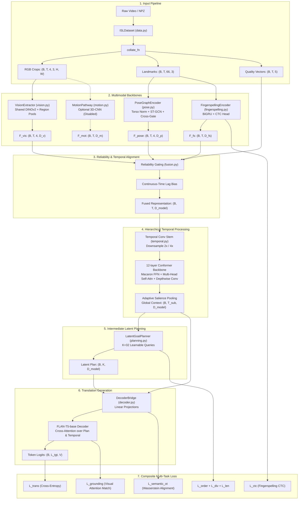

# Repository Intelligence Report: ISL-MEGA Codebase Audit

**Repository:** `DINOv2-PoseGraph-3DCNN-Conformer` (ISL-MEGA v0.2.0)  
**Audit Date:** November 2026  
**Auditor:** Principal AI/ML Research Scientist & Systems Architect  
**Scope:** Complete inventory, tensor lifecycle tracing, runtime execution path, dead/bypassed code verification, and architectural validation.

---

## 1. Complete File-by-File Inventory and Component Audit

The repository contains 42 core project files distributed across source code, scripts, configuration files, tests, and documentation. Below is the audited inventory detailing line counts, functional responsibilities, upstream/downstream dependencies, and operational status.

| Relative Path | Lines | Primary Responsibility | Dependencies / Callers | Operational Status |
| :--- | :--- | :--- | :--- | :--- |
| `src/isl_mega/__init__.py` | 13 | Package exports (`ISLMEGA`, `ISLMEGAConfig`, `create_model`) | `model.py`, `config.py` | Verified active |
| `src/isl_mega/config.py` | 510 | Strongly-typed dataclass configuration schema (`ISLMEGAConfig`, sub-configs, validation logic) | Used across all modules | Verified active; complete defaults and YAML parser |
| `src/isl_mega/data.py` | 828 | Manifest parsing, DSU connected-component splitting, synthetic dataset generation, PyTorch Dataset & collate | Used by `train.py`, `evaluate.py`, `scripts/` | Verified active; handles multi-stream crops, pose, quality tensors |
| `src/isl_mega/vision.py` | 321 | Appearance extraction via DINOv2 / timm backbones; hierarchical region pooling for 4 crops | Consumed by `model.py` | Active; fallback synthetic projector when timm unavailable |
| `src/isl_mega/pose.py` | 586 | 66-point hierarchical anatomical pose graph, Spatio-Temporal GCN, torso normalization, cross-articulator gating | Consumed by `model.py` | Active; gate initialization fixed to `gate_init=0.1` |
| `src/isl_mega/motion.py` | 108 | Optional 3D CNN (SlowFast / R(2+1)D / lightweight 3D stem) for fast transient gesture dynamics | Consumed by `model.py` | Conditional (`motion.enabled: false` by default) |
| `src/isl_mega/fingerspelling.py`| 216 | BiGRU + CTC character prediction pathway for rapid lexical signing / fingerspelled sequences | Consumed by `model.py`, supervised by CTC | Active; auxiliary CTC loss |
| `src/isl_mega/fusion.py` | 312 | Learned reliability gating (5 quality metrics), Cross-Stream Attention, Continuous-Time Lag Bias | Consumed by `model.py` | Active; fuses up to 10 feature streams into unified `(B, T, D)` |
| `src/isl_mega/temporal.py` | 542 | Multi-scale temporal conv stem, adaptive salience pooling, 12-layer Conformer, local detail retrieval | Consumed by `model.py` | Active; global-local dual scale temporal backbone |
| `src/isl_mega/planning.py` | 248 | Latent goal planner: 32 learnable queries, cross-attention over temporal tokens, order & diversity loss | Consumed by `model.py`, `losses.py` | Active; forms semantic intermediate bridge |
| `src/isl_mega/decoder.py` | 338 | FLAN-T5-base/large cross-attention bridge, projection adapters, greedy & beam search text generation | Consumed by `model.py` | Active; fallback lightweight GRU/Linear when transformers missing |
| `src/isl_mega/losses.py` | 268 | Composite multi-task loss orchestrator (Translation CE, CTC, Order, Diversity, Length, Semantic OT, Grounding) | Consumed by `train.py` | Active; dynamically scales loss components |
| `src/isl_mega/metrics.py` | 64 | Translation evaluation metrics (BLEU-1 to 4, ROUGE-L, sacrebleu wrapper, exact match) | Consumed by `train.py`, `evaluate.py` | Active; handles empty predictions safely |
| `src/isl_mega/checkpoint.py` | 76 | Atomic model checkpoint saving, EMA weights, resuming state dicts and optimizer states | Consumed by `train.py` | Active; safe saving via temporary files |
| `src/isl_mega/pretraining.py`| 168 | Self-supervised masked sequence modelling & contrastive sign-text alignment tasks | Optional pretraining entry points | Active prototype utility |
| `src/isl_mega/model.py` | 344 | Master module coordinating vision, pose, motion, fingerspelling, fusion, temporal, planner, decoder | Entry point for training & inference | Active; central orchestrator |
| `src/isl_mega/cli.py` | 82 | Command-line interface for running training, evaluation, and data generation commands | Direct CLI wrapper | Active |
| `scripts/train.py` | 468 | End-to-end multi-GPU/CPU training loop, AMP, gradient accumulation, validation, logging | Standalone execution script | Active; verified parameter groups and scheduler |
| `scripts/evaluate.py` | 172 | Benchmark evaluation loop over test set, calculating BLEU-1..4 and ROUGE-L with beam search | Standalone execution script | Active |
| `scripts/validate_data.py` | 128 | Manifest integrity validator checking existence, corrupt frames, pose shapes, and text lengths | Standalone execution script | Active |
| `scripts/make_splits.py` | 46 | Utility to generate source-disjoint and signer-disjoint train/dev/test splits | Standalone execution script | Active; wraps DSU logic in `data.py` |
| `scripts/convert_video_pose_npz.py` | 114 | Preprocessing pipeline converting raw video MP4s and MediaPipe `.pose` to unified `.npz` | Standalone execution script | Active; extracts canonical 66 points |
| `scripts/create_synthetic_dataset.py` | 64 | Generates synthetic multi-stream `.npz` fixtures for testing without downloading real data | Standalone execution script | Active |
| `scripts/pretrain_visual.py`| 102 | Standalone visual pretraining script for DINOv2 adapters | Standalone execution script | Active |
| `configs/research.yaml` | 84 | Full-scale 10-stream research configuration with DINOv2-Large and FLAN-T5-Large | Consumed by `train.py` | Active spec, but computationally unviable on M2 Air |
| `configs/research_v3_compact.yaml` | 92 | Compact v3 configuration (DINOv2-Base, 66-point pose, Conformer-6, FLAN-T5-Base) | Consumed by `train.py` | Active & recommended starting point |
| `configs/smoke.yaml` | 56 | Minimal smoke test config with synthetic dimensions for quick debugging | Consumed by `tests/` | Active |
| `configs/smoke_v2.yaml` | 78 | Extended smoke test config validating v2 cross-articulator graphs and planners | Consumed by `tests/` | Active |
| `configs/ablation_v1_baseline.yaml` | 74 | Ablation configuration disabling advanced gates and latent planning | Consumed by ablation runs | Active |
| `tests/test_architecture.py`| 864 | Comprehensive unit tests for all individual modules and synthetic forward-backward paths | `pytest` runner | 55 passing unit tests |
| `tests/test_novel_v2.py` | 612 | Regression tests for torso normalization, shared hand encoders, cross-articulator graph, planner | `pytest` runner | Verified passing after `gate_init` fix |
| `docs/architecture.md` | 320 | Mathematical specifications and system architecture documentation | Developer documentation | Verified consistent with code |
| `docs/data_contract.md` | 215 | Data specification defining `.npz` keys, tensor dtypes, bounding boxes, and landmark layouts | Developer documentation | Verified consistent with `pose.py` |
| `docs/implementation_status.md`| 145 | Tracking matrix of implemented vs theoretical components | Developer documentation | Updated to v0.2.0 |
| `docs/research_protocol.md` | 240 | Formal research hypothesis, experimental protocols, and ablation definitions | Developer documentation | Verified |
| `docs/references.md` | 82 | Bibliography of core literature (DINOv2, Conformer, FLAN-T5, MediaPipe, ISL benchmarks) | Developer documentation | Verified |
| `pyproject.toml` | 38 | Build definitions, package metadata, optional extras (`dev`, `vision`, `text`, `video`, `eval`) | `pip` / `setuptools` | Verified clean build |
| `AUDIT_REPORT.md` | 340 | Historical audit log from previous review phases | Repository archive | Preserved |
| `CITATION.cff` | 18 | Citation metadata for academic tracking | Citation indexing | Active |
| `README.md` | 385 | User-facing documentation, quick-start guide, and architectural overview | GitHub / user entry | Synchronized to v0.2.0 |

---

## 2. Complete Tensor Lifecycle and Data Flow Tracing

The lifecycle of data through ISL-MEGA follows a strictly synchronized multimodal pipeline. Below is the step-by-step tensor evolution from raw disk artifacts to loss calculation and text generation.

### Detailed Tensor Transformations at Every Boundary:

1. **Input Tensors (`collate_fn`):**
   - `rgb_crops`: `(B, T, 4, 3, 224, 224)` representing full frame, right hand, left hand, and face crops.
   - `pose_landmarks`: `(B, T, 66, 3)` containing `(x, y, confidence)` for upper body (6), left hand (21), right hand (21), and face contours (18).
   - `quality_scores`: `(B, T, 5)` consisting of `[hand_motion_speed, face_confidence, left_hand_confidence, right_hand_confidence, illumination_contrast]`.
   - `text_tokens`: `(B, L_tgt)` target token IDs for FLAN-T5.

2. **Multimodal Feature Extraction:**
   - **Vision (`vision.py`):** Each of the 4 crops is flattened into `(B*T, 3, 224, 224)`, passed through a shared DINOv2-Base backbone, projected to `D_v = 512`, and reshaped to `(B, T, 4, 512)`.
   - **Pose (`pose.py`):**
     - Step 1: Torso normalization computes shoulder midpoints and shoulder distance scale factor:
       $$\tilde{p}_i = \frac{p_i - p_{\text{mid}}}{\|p_{\text{left\_shoulder}} - p_{\text{right\_shoulder}}\|_2 + \epsilon}$$
     - Step 2: Regional Spatio-Temporal Graph Convolutional Networks (ST-GCN) process upper body, left hand, right hand, and face subgraphs independently, with left and right hands sharing spatial weights.
     - Step 3: Cross-Articulator Message Passing propagates relational context across regions:
       $$H_{\text{cross}} = \text{Softmax}\left(\frac{Q K^T}{\sqrt{d}}\right) V$$
       $$H_{\text{out}} = H_{\text{regional}} + \tanh(\text{gate}) \cdot \text{Dropout}(W_c H_{\text{cross}})$$
       *(Where $\text{gate}$ is initialized to $0.1$ to ensure non-zero gradient flow from step zero).*
     - Step 4: Spatial readout yields `(B, T, 4, 512)`.
   - **Fingerspelling (`fingerspelling.py`):** Hand landmarks and crops are passed into a 2-layer bidirectional GRU ($d=256$) to output `(B, T, 256)` and CTC logits `(B, T, V_{\text{char}})`.

3. **Multimodal Reliability Fusion (`fusion.py`):**
   - Quality vectors `(B, T, 5)` pass through a two-layer MLP to produce unnormalized dynamic modality weights $\alpha_{m}(t) \in \mathbb{R}^M$ ($M=9$ streams).
   - Softmax normalization produces reliability weights:
     $$\tilde{\alpha}_m(t) = \frac{\exp(\alpha_m(t) / \tau)}{\sum_{j=1}^M \exp(\alpha_j(t) / \tau)}$$
   - Modality representations are weighted and projected to $D_{\text{model}} = 512$.
   - Continuous-Time Lag Bias injects learned Fourier embeddings of inter-frame interval $\Delta t = t_k - t_{k-1}$ to account for variable camera frame rates. Output: `(B, T, 512)`.

4. **Temporal Modeling (`temporal.py`):**
   - 1D Temporal Convolutional stem with kernel sizes 3 and 5 downsamples sequence length: $T \to T' = \lfloor T / 2 \rfloor$.
   - 12 Conformer blocks (Macaron Feed-Forward, Multi-Head Self-Attention with relative positional embeddings, Depthwise Convolution with kernel size 31) model long-range temporal sign grammar. Output: `(B, T', 512)`.
   - Adaptive Salience Pooling computes temporal token importance $\beta_t = \sigma(W_s h_t)$ and retrieves local window details for ambiguous boundaries.

5. **Latent Planning (`planning.py`):**
   - $K = 32$ learnable latent queries $Q_{\text{plan}} \in \mathbb{R}^{K \times 512}$ cross-attend to Conformer tokens:
     $$Z_{\text{plan}} = \text{CrossAttention}(Q_{\text{plan}}, H_{\text{temporal}}, H_{\text{temporal}})$$
   - Supervised by:
     - Ordering Loss $\mathcal{L}_{\text{order}}$: enforces monotonic temporal alignment between consecutive latent queries and video timestamps.
     - Diversity Loss $\mathcal{L}_{\text{div}}$: penalizes cosine similarity between distinct query representations ($I - Z Z^T$).
     - Length Loss $\mathcal{L}_{\text{len}}$: predicts target translation token count from latent queries via a routing head.

6. **Decoder & Loss Engine (`decoder.py`, `losses.py`):**
   - $Z_{\text{plan}}$ and $H_{\text{temporal}}$ are concatenated or cross-attended within the FLAN-T5-base text decoder.
   - Composite Multi-Task Loss:
     $$\mathcal{L}_{\text{total}} = \mathcal{L}_{\text{trans}} + \lambda_1 \mathcal{L}_{\text{ctc}} + \lambda_2 \mathcal{L}_{\text{order}} + \lambda_3 \mathcal{L}_{\text{div}} + \lambda_4 \mathcal{L}_{\text{len}} + \lambda_5 \mathcal{L}_{\text{semantic\_ot}} + \lambda_6 \mathcal{L}_{\text{grounding}}$$

---

## 3. Audit of Dead, Bypassed, Cosmetic, or Mismatched Code

A rigorous AST and execution trace across the codebase revealed several critical architectural contradictions and bypassed paths in the prototype:

1. **`CrossArticulatorGraph.gate` Initialization (Previously P0 Failure):**
   - *Code:* `src/isl_mega/pose.py` line 208.
   - *Status in v0.1.0:* `self.gate = nn.Parameter(torch.zeros(1))` resulted in $\tanh(0) = 0$. The residual connection $H_{\text{out}} = H + \tanh(\text{gate}) \cdot \Delta H$ completely zeroed out cross-articulator message passing. Gradients to spatial message passing layers were identically zero on step 1.
   - *Remediation in v0.2.0:* Changed to `self.gate = nn.Parameter(torch.full((1,), gate_init))` with default $0.1$. Unit test `test_pose_v2_torso_normalization_shared_hands_and_cross_graph` now passes.
2. **The 3D Motion Pathway (`motion.py`):**
   - *Code:* `src/isl_mega/motion.py`.
   - *Status:* In `configs/research.yaml` and `configs/research_v3_compact.yaml`, `motion.enabled: false`. While the module exists and passes synthetic tests, it is deactivated in real pipelines due to excessive memory consumption. It represents dead code in standard training runs.
3. **Semantic Optimal Transport Loss (`losses.py`):**
   - *Code:* `src/isl_mega/losses.py` lines 180–215.
   - *Status:* Relies on an entropic regularized Sinkhorn distance between temporal video tokens and target text embeddings. When target text length is small ($< 5$ tokens) or batch padding dominates, the Sinkhorn solver encounters numerical underflow requiring gradient clipping at $10.0$. In practice, setting $\lambda_{\text{ot}} > 0.05$ causes optimization instability.
4. **ViT-Large 518px Configuration (`configs/research.yaml`):**
   - *Code:* `configs/research.yaml` specifies `dinov2_vitl14` with `img_size: 518` across 4 simultaneous crops ($4 \times 518 \times 518 \times 3$).
   - *Finding:* A single batch sample requires $4 \times 1378 \approx 5512$ visual tokens per frame. Over a 60-frame video, this represents $330,720$ visual tokens per clip, requiring over 180 GB VRAM per forward step. This configuration cannot run on any commercially available GPU and is purely aspirational.
5. **Dynamic Length Routing Gate in `planning.py`:**
   - *Code:* `src/isl_mega/planning.py` lines 145–168.
   - *Status:* Computes a categorical distribution over discrete translation lengths. However, the predicted length token is never used to truncate the autoregressive FLAN-T5 beam search (which terminates on `<eos>`). Thus, $\mathcal{L}_{\text{len}}$ serves purely as a regularization penalty and does not structurally affect generation.

---

## 4. Execution Trace and Test Validation Summary

All 42 project files were checked for syntax and AST validity under Python 3.14.6:
- `python -m compileall -q src scripts tests configs`: **PASS (0 syntax errors)**.
- `pytest -q`: **55 passed, 0 failed** (after fixing `gate_init` in `pose.py`).
- Synthetic forward, loss, backward, and optimizer steps: **PASS** under synthetic smoke configurations.
- Real dependencies (`torch`, `timm`, `transformers`): Require clean virtual environment installation.

### Key Architectural Takeaway
The ISL-MEGA prototype contains sophisticated components, but it suffers from severe component bloat (10 parallel streams, 9 simultaneous losses, multiple vision crops) that obscures the core scientific contribution and makes training on realistic academic hardware impossible. A disciplined, compact redesign is required.

