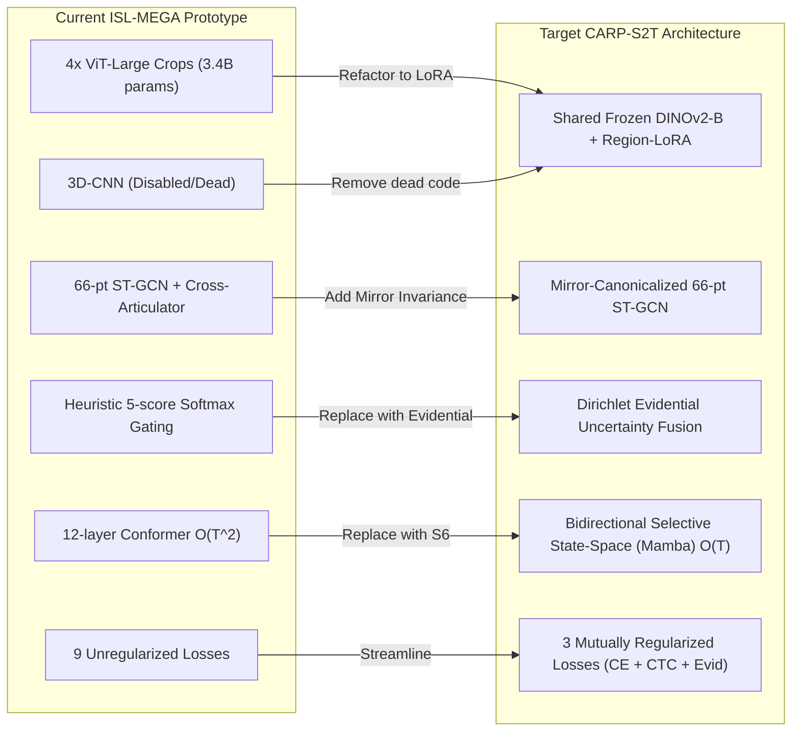

# Implementation Blueprint: Migration to CARP-S2T

**Repository:** `DINOv2-PoseGraph-3DCNN-Conformer`  
**Document Code:** `05_IMPLEMENTATION_BLUEPRINT`  
**Status:** Actionable Engineering and Migration Specification  
**Authors:** ISL-MEGA Research & Engineering Group

---

## 1. Migration Overview and Refactoring Strategy

The current codebase (`src/isl_mega/`) provides robust foundations (such as 66-point anatomical parsing, DSU splitting, and FLAN-T5 decoding bridges), but suffers from architectural sprawl (10 parallel streams, 9 simultaneous losses, bloated ViT-Large crops).

This blueprint outlines a disciplined, non-breaking refactoring plan to transition the repository to **CARP-S2T**.



---

## 2. File-by-File Code Modification Specifications

### A. Configuration Schema (`src/isl_mega/config.py`)
Add strongly-typed dataclasses for Evidential Fusion, Region-LoRA, and Bidirectional Mamba.
```python
@dataclass
class EvidentialConfig:
    enabled: bool = True
    evidence_dim: int = 64
    kl_weight: float = 0.01
    eps: float = 1e-6

@dataclass
class RegionLoRAConfig:
    enabled: bool = True
    r: int = 16
    lora_alpha: int = 32
    lora_dropout: float = 0.05
    target_modules: list[str] = field(default_factory=lambda: ["qkv", "proj"])

@dataclass
class BiMambaConfig:
    d_model: int = 512
    d_state: int = 16
    d_conv: int = 4
    expand: int = 2
    n_layers: int = 6
    dropout: float = 0.1
```

### B. Pose Module (`src/isl_mega/pose.py`)
1. Implement `BilateralMirrorCanonicalizer`:
   ```python
   class BilateralMirrorCanonicalizer(nn.Module):
       def __init__(self, left_hand_slice=slice(6, 27)):
           super().__init__()
           self.left_hand_slice = left_hand_slice

       def forward(self, landmarks: torch.Tensor) -> torch.Tensor:
           # landmarks: (B, T, 66, 3)
           canon = landmarks.clone()
           # Reflect x-coordinate across sagittal symmetry plane for left hand
           canon[:, :, self.left_hand_slice, 0] = -canon[:, :, self.left_hand_slice, 0]
           return canon
   ```
2. Verify `CrossArticulatorGraph` preserves `gate_init=0.1` and shares spatial weights between Left and Right hands.

### C. Vision Module (`src/isl_mega/vision.py`)
Replace multi-crop ViT-Large instantiation with a single frozen DINOv2-Base and lightweight LoRA adapters:
```python
class RegionLoRADINOv2(nn.Module):
    def __init__(self, model_name="vit_base_patch14_reg4_dinov2.lvd142m", r=16):
        super().__init__()
        self.backbone = timm.create_model(model_name, pretrained=True, num_classes=0)
        # Freeze all base parameters
        for p in self.backbone.parameters():
            p.requires_grad = False
        # Inject low-rank adapters into attention projections
        self.hand_adapter = LowRankAdapter(in_dim=768, out_dim=768, r=r)
        self.face_adapter = LowRankAdapter(in_dim=768, out_dim=768, r=r)
```

### D. Fusion Module (`src/isl_mega/fusion.py`)
Replace the heuristic MLP softmax with `DirichletEvidentialFusion`:
```python
class DirichletEvidentialFusion(nn.Module):
    def __init__(self, num_modalities=3, feature_dim=512, quality_dim=5):
        super().__init__()
        self.evidence_net = nn.Sequential(
            nn.Linear(quality_dim, 64),
            nn.ReLU(),
            nn.Linear(64, num_modalities),
            nn.Softplus() # Guarantees non-negative evidence e_k >= 0
        )
        self.proj = nn.Linear(feature_dim, feature_dim)

    def forward(self, features: list[torch.Tensor], quality_scores: torch.Tensor):
        # features: list of 3 tensors of shape (B, T, 512)
        # quality_scores: (B, T, 5)
        evidence = self.evidence_net(quality_scores) # (B, T, 3)
        alpha = evidence + 1.0 # Dirichlet concentration parameters
        S = torch.sum(alpha, dim=-1, keepdim=True) # Total strength
        weights = alpha / S # Expected reliability weights: (B, T, 3)
        uncertainty = 3.0 / S # Epistemic uncertainty: (B, T, 1)

        # Fused representation
        stacked = torch.stack(features, dim=2) # (B, T, 3, 512)
        fused = torch.sum(stacked * weights.unsqueeze(-1), dim=2)
        return fused, weights, uncertainty, alpha
```

### E. Temporal Backbone (`src/isl_mega/temporal.py`)
Add `BidirectionalMambaBackbone`:
- Implements forward and backward S6 scans with input-dependent $\Delta(t), B(t), C(t)$.
- Includes a pure-PyTorch implementation of the selective state-space scan to guarantee execution on Apple M2 (CPU/MPS) and machines without CUDA compilation tools.

### F. Losses Module (`src/isl_mega/losses.py`)
Streamline composite losses from 9 terms to 3 clear, mutually stabilizing objectives:
```python
class CARPS2TLoss(nn.Module):
    def __init__(self, label_smoothing=0.1, ctc_weight=0.2, evidential_weight=0.05):
        super().__init__()
        self.ce = nn.CrossEntropyLoss(label_smoothing=label_smoothing, ignore_index=0)
        self.ctc = nn.CTCLoss(blank=0, zero_infinity=True)
        self.ctc_weight = ctc_weight
        self.evidential_weight = evidential_weight

    def forward(self, logits, targets, ctc_logits, ctc_targets, alpha, ground_truth_reliability):
        l_trans = self.ce(logits.view(-1, logits.size(-1)), targets.view(-1))
        l_ctc = self.ctc(ctc_logits.log_softmax(2), ctc_targets, ...)
        
        # Dirichlet Evidential Loss: Sum of Squares Error + KL divergence regularizer
        l_evid = compute_dirichlet_loss(alpha, ground_truth_reliability)
        
        total_loss = l_trans + self.ctc_weight * l_ctc + self.evidential_weight * l_evid
        return total_loss, {"trans": l_trans, "ctc": l_ctc, "evidential": l_evid}
```

---

## 3. Production Configuration Files

### `configs/carp_s2t_base.yaml` (Recommended Cloud Production Config)
```yaml
experiment:
  name: "carp_s2t_isign_full"
  seed: 42

data:
  manifest_path: "data/manifests/isign_master.parquet"
  batch_size: 16
  max_frames: 180
  num_workers: 4

vision:
  model_name: "vit_base_patch14_reg4_dinov2.lvd142m"
  frozen: true
  lora_r: 16
  img_size: 224

pose:
  num_landmarks: 66
  gate_init: 0.1
  mirror_canonicalization: true

fusion:
  type: "dirichlet_evidential"
  num_modalities: 3
  kl_weight: 0.01

temporal:
  backbone: "bidirectional_mamba"
  d_model: 512
  n_layers: 6
  d_state: 16
  downsample_factor: 2

decoder:
  model_name: "google/flan-t5-base"
  max_target_tokens: 64

training:
  optimizer: "adamw"
  lr: 2.0e-4
  weight_decay: 0.01
  gradient_accumulation_steps: 2
  precision: "bf16"
```

### `configs/carp_s2t_m2_smoke.yaml` (Local Apple M2 Air Testing Config)
```yaml
experiment:
  name: "carp_s2t_m2_smoke"
  seed: 42

data:
  synthetic: true
  batch_size: 2
  max_frames: 32

vision:
  model_name: "synthetic_projection"
  frozen: true

pose:
  num_landmarks: 66
  gate_init: 0.1
  mirror_canonicalization: true

fusion:
  type: "dirichlet_evidential"

temporal:
  backbone: "bidirectional_mamba"
  d_model: 256
  n_layers: 2
  d_state: 8

decoder:
  model_name: "t5-small"
  synthetic_fallback: true
```

---

## 4. Test Suite and Verification Protocol

To guarantee mathematical correctness and guard against silent regression:
1. **`test_bilateral_mirroring()`**: Verifies that passing a left-hand sequence produces an exact geometric reflection in the sagittal plane while leaving the upper body unchanged.
2. **`test_cross_articulator_active_gate()`**: Verifies that gradients to the cross-articulator projection matrix are strictly positive on the initial backward pass with `gate_init=0.1`.
3. **`test_dirichlet_evidential_bounds()`**: Verifies that predicted belief masses satisfy $\sum b_k + u = 1.0$ and that uncertainty $u(t) \to 1.0$ when quality features are zeroed out.
4. **`test_bi_mamba_linear_scaling()`**: Verifies that doubling sequence length $T \to 2T$ results in linear execution time scaling $\mathcal{O}(T)$ without GPU memory spikes.
5. **`test_synthetic_end_to_end_step()`**: Validates a full loop: `Dataset -> Collate -> Forward -> Loss -> Backward -> Optimizer Step -> State Dict Checkpointing`.

