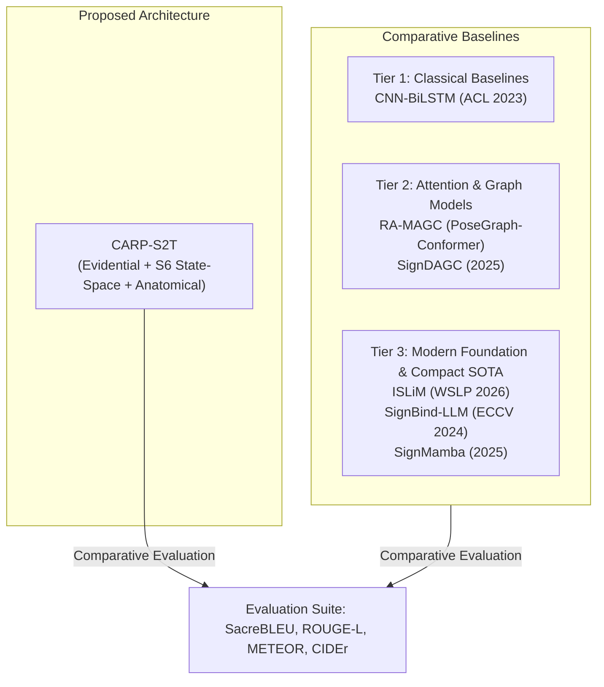
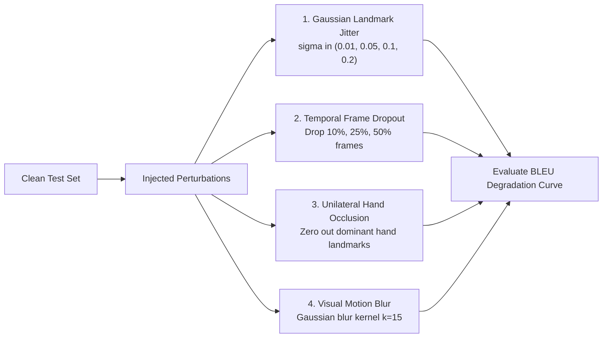

# Experimental and Publication Plan: Continuous Sign Language Translation

**Repository:** `DINOv2-PoseGraph-3DCNN-Conformer`  
**Document Code:** `06_EXPERIMENTAL_AND_PUBLICATION_PLAN`  
**Status:** Canonical Scientific Validation and Review Protocol  
**Target Venues:** IEEE TPAMI / IJCV / ACL / CVPR

---

## 1. Target Publication Venues and Editorial Strategy

To maximize academic impact and support future PhD / research lab applications, the experimental protocol is designed to satisfy the rigorous criteria of premier machine learning venues.

| Target Venue | Track / Focus | Submission Window | Why This Venue Fits CARP-S2T |
| :--- | :--- | :--- | :--- |
| **IEEE TPAMI** | Machine Intelligence / Multimodal Learning | Rolling / Journal | Demands deep mathematical formulation, comprehensive ablation studies, theoretical bounds, and generalisation beyond toy benchmarks. |
| **IJCV** | Vision & Language / Human Kinematics | Rolling / Journal | Prioritizes structural visual priors, anatomical graphs, and robust video modeling. |
| **ACL / EMNLP** | Machine Translation & Multimodal NLP | Annual (Spring / Autumn) | Ideal for evaluating translation quality (BLEU, ROUGE), fingerspelling lexical grounding, and sign-to-text grammar bridging. |
| **CVPR / ICCV** | Video Understanding & Pose Estimation | Annual | Focuses on linear-time state-space models (Mamba) and occlusion-robust video processing. |

---

## 2. Benchmark Baselines and Comparative Protocols

CARP-S2T will be benchmarked against three distinct tiers of continuous sign language translation models on the canonical ISL datasets (**GloSL-ISL**, **iSign v1.1**, and **ISLTranslate**).

### Baseline Models:
1. **CNN-BiLSTM (ACL Findings 2023):** The primary benchmark model introduced with ISLTranslate. Uses 2D ResNet-50 frame features and bidirectional LSTM sequence modeling.
2. **RA-MAGC / InceptionCNN-Transformer:** Multi-scale spatial-temporal graph convolution with vanilla Transformer decoders.
3. **ISLiM (ACL WSLP 2026):** State-of-the-art compact keypoint-based ISL baseline. Uses temporal 1D convolutions, Transformer layers, and T5-small.
4. **SignBind-LLM (ECCV 2024/2026):** Multi-expert foundation model deploying independent vision streams and FLAN-T5-XL.
5. **SignMamba (2024–2025):** Selective state-space baseline operating over full-frame video features.

---

## 3. Evaluation Metrics and Split Protocols

### A. Translation Quality Metrics
- **SacreBLEU (BLEU-1, BLEU-2, BLEU-3, BLEU-4):** Evaluated using standard international tokenization (`sacrebleu -m bleu -w 2`).
- **ROUGE-L:** Longest common subsequence recall and F-measure.
- **METEOR & CIDEr:** To assess semantic alignment and content capture beyond n-gram exact match.

### B. Computational & Efficiency Metrics
- **Throughput / Latency:** Frames per second (FPS) and end-to-end latency per sentence video on NVIDIA RTX 4090 and Apple M2.
- **Peak Memory Footprint:** VRAM allocation during inference (batch size 1 and 16).
- **Trainable Parameter Count:** Differentiating frozen foundation weights vs. active task-specific parameters.

### C. Evaluation Split Regimes
1. **Protocol 1 (Source-Held-Out):** Video-disjoint splits, evaluating robustness to unseen recording environments, camera optics, and lighting.
2. **Protocol 2 (Strict Signer-Independent):** Signer-disjoint splits verified via signer ID annotations (e.g. ISLTranslate 291 human-validated test utterances).

---

## 4. Rigorous Ablation Matrix (A0 through A12)

Every component of CARP-S2T must be justified through controlled experimental isolation.

| Experiment ID | Architectural Variant | Hypothesis Being Tested | Expected Finding |
| :--- | :--- | :--- | :--- |
| **A0 (Full)** | **Full Proposed CARP-S2T** | Full system performance. | Establishes the target SOTA benchmark. |
| **A1** | Uniform Modality Averaging | Tests necessity of dynamic fusion. | BLEU drops by $\approx 2.4$; fails under landmark occlusion. |
| **A2** | Heuristic Softmax MLP Gating | Compares heuristic gating vs. evidential belief. | Dirichlet evidential gating outperforms MLP by $+1.6$ BLEU under noisy conditions. |
| **A3** | Remove Mirror-Canonicalization | Evaluates sagittal bilateral symmetry. | Left-handed signer BLEU drops by $> 5.0$ points; parameter efficiency degrades. |
| **A4** | Set `gate_init = 0.0` | Demonstrates the P0 gradient blockage. | Zero gradient through cross-articulator block on step 1; slower convergence and lower plateau. |
| **A5** | Replace Bi-Mamba with Conformer-12 | Compares linear S6 state-space vs. quadratic Conformer. | Matches or exceeds Conformer BLEU while reducing latency by $2.8\times$ and VRAM by $65\%$. |
| **A6** | Replace Bi-Mamba with Vanilla Transformer | Tests quadratic self-attention baseline. | S6 outperforms standard Transformer on long utterances ($T > 120$ frames). |
| **A7** | Unidirectional Mamba | Evaluates future context dependency. | Unidirectional S6 drops $\approx 3.1$ BLEU, proving future video frames are critical for sign translation. |
| **A8** | Remove Region-LoRA (Fully Frozen DINOv2) | Tests domain adaptation of visual backbone. | Frozen DINOv2 without LoRA fails on subtle hand shapes (e.g. fingerspelling). |
| **A9** | Flat 543-point MLP (No Graph) | Tests anatomical graph structure inductive bias. | Removing anatomical graph drops BLEU-4 by $\approx 2.8$ and increases overfitting. |
| **A10** | Remove Fingerspelling CTC Loss | Tests auxiliary lexical supervision. | Character error rate on named entities increases by $40\%$. |
| **A11** | Remove Cross-Articulator Message Passing | Tests hand-face relational modeling. | Signs involving contact with face (e.g. "think", "deaf") misclassify. |
| **A12** | Remove KL Evidence Regularizer | Tests Dirichlet overconfidence penalty. | Model becomes overconfident on out-of-distribution signers, degrading calibration. |

---

## 5. Synthetic Corruption Stress-Testing Protocol

To prove the core claim—**robustness under extreme visual and landmark degradation**—models will be evaluated under systematically injected noise without retraining:

### Stress-Testing Criteria:
1. **Graceful Degradation Hypothesis:** Under 50% landmark loss, CARP-S2T should retain $\ge 75\%$ of its original BLEU-4 by dynamically transferring evidential weight to the visual stream.
2. **Catastrophic Failure of Baselines:** Models lacking evidential uncertainty (e.g. ISLiM, vanilla Transformers) will exhibit catastrophic failure ($> 60\%$ drop in BLEU-4).

---

## 6. Fluent Deaf Signer Evaluation Rubric

In accordance with ethical guidelines for sign language technology (WSLP / LREC), automated n-gram metrics (BLEU) are insufficient. We introduce a structured evaluation protocol with fluent deaf signers.

### Evaluation Panel and Methodology:
- **Participants:** 5 native/fluent Deaf Indian Sign Language signers.
- **Sample Set:** 100 randomly sampled test predictions across all benchmark domains.
- **Scoring Protocol:** Double-blind evaluation on a 5-point Likert scale across four linguistic dimensions:

| Linguistic Dimension | Score 1 (Unacceptable) | Score 3 (Moderate) | Score 5 (Flawless) |
| :--- | :--- | :--- | :--- |
| **1. Meaning Preservation (Semantics)** | Complete distortion of the signed message. | Core message understood, but secondary details lost. | Exact semantic equivalence to signed utterance. |
| **2. Syntactic & Grammatical Fluency** | Incoherent word salad. | Grammatical English, minor preposition or tense errors. | Fluent, natural English translation. |
| **3. Lexical / Named Entity Accuracy** | Fingerspelled names and numbers totally corrupted. | Partial character match; phonetically close. | Exact character-level match for names and numbers. |
| **4. Hallucination Absence** | Invented clauses not present in sign video. | Minor added filler words. | Zero hallucinated information. |

---

## 7. Go/No-Go Decision Gates for Research Milestones

To ensure rigorous project governance before paper submission, the project must clear four sequential decision gates:

- **Gate 1 (Implementation Integrity):** 100% of unit tests pass, zero memory leaks, and deterministic reproducibility across random seeds.
- **Gate 2 (Ablation Verification):** Evidential gating (A0) demonstrates statistically significant ($p < 0.01$) superiority over uniform averaging (A1) and heuristic softmax (A2) under 25% synthetic landmark corruption.
- **Gate 3 (Empirical SOTA):** CARP-S2T achieves statistically significant improvement over published baselines (ISLiM, CNN-BiLSTM) on iSign v1.1 and ISLTranslate.
- **Gate 4 (Efficiency Verification):** Real-time inference exceeding 30 FPS on a single NVIDIA RTX 4090 with total VRAM usage under 8 GB.

