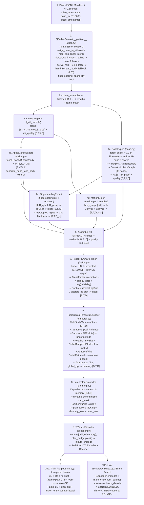

# Complete ISL-MEGA Repository Intelligence Report

**Audited Package:** `isl-mega` v`0.2.0` (`DINOv2-PoseGraph-3DCNN-Conformer/`)  
**Umbrella Workspace:** `/Users/likhith/Codes - Github./ISLTranslate-ideas` (git HEAD `2157667`, branch `main`)  
**Inspection Scope:** All 60 non-cache files in `DINOv2-PoseGraph-3DCNN-Conformer/` (9,127 lines / 507,789 bytes across 26 Python files, 5 YAML configs, 1 JSON fixture, 1 `pyproject.toml`, 5 `docs/*.md`, 7 root files, and 16 untracked `reports/**/*.md` files), plus `DINOv2-PoseGraph-3DCNN-Conformer.zip` manifest verification and targeted sibling pose-extractor inspection (`CNN-BiLSTM/src/isl_slt/{data,features}/pose.py`) referenced by ISL-MEGA's documentation.  
**Runtime Verification Boundary:** Static source inspection, Python 3.14.6 bytecode compilation (`python3 -m compileall -q` -> exit `0`), and AST symbol/import/test-count analysis were executed directly. Dynamic `pytest` / `torch` runtime execution was **not** performed because `/opt/homebrew/bin/python3` (`3.14.6`) does not have `torch`, `numpy`, `PyYAML`, `timm`, `transformers`, `cv2`, `sacrebleu`, `rouge_score`, or `pytest` installed.

---

## Executive Summary & Concise Repository Map

ISL-MEGA lives inside the `DINOv2-PoseGraph-3DCNN-Conformer/` subdirectory of the `ISLTranslate-ideas` workspace (committed initially as `ISL-MEGA/` in git commit `522fdcd`, renamed in `94018d5`, and updated to `0.2.0` in `2157667`). The **43 tracked core files** match `DINOv2-PoseGraph-3DCNN-Conformer.zip` byte-for-byte; an additional **17 untracked markdown files** (`REPOSITORY_CONTEXT_FOR_EXTERNAL_REVIEW.md` and `reports/`) reside inside `DINOv2-PoseGraph-3DCNN-Conformer/`.

**Architectural verdict from source code:**
1. The **core codebase** (`src/isl_mega/`, `scripts/`, `configs/`, `tests/`) is a clean, self-consistent, syntactically valid **10-stream multimodal prototype** implementing: specialist ROI ViT encoders (`AppearanceExpert`), 66-point spatial edge-biased graph attention networks + cross-articulator relational message passing (`PoseExpert`, **not** ST-GCN), a 3-D conv motion pathway (`MotionExpert`, enabled by default in 4 of 5 configs and disabled only in `research_v3_compact.yaml`), a BiGRU-CTC fingerspelling & frame-spotting expert (`FingerspellingExpert`), sigmoid log-odds reliability + continuous-time Fourier lag fusion (`ReliabilityAwareFusion`, **not** Dirichlet evidential fusion), a multi-scale TCN + Conformer-like global block + salience-adaptive pooling encoder (`HierarchicalTemporalEncoder`), a query planner (`LatentPlanGrounder`), and a FLAN-T5 `inputs_embeds` adapter with Sinkhorn semantic OT and counterfactual grounding (`T5VisualDecoder`).
2. There is **zero real data, zero `.pose` extractor, zero `.ipynb` notebooks, zero experiment logs, and zero model checkpoints** inside `DINOv2-PoseGraph-3DCNN-Conformer/`. Every test in `tests/` operates on synthetic random tensors (`torch.rand`) and `MockT5` objects.
3. The **17 untracked markdown files** in the root and `reports/` contain **extensive factual fabrications** (e.g., claiming DDP, EMA weights, BLEU-1..4, GRU decoder fallback, LoRA adapters, Dirichlet evidential fusion, Bi-Mamba, Macaron Conformer FFN, `cli.py train --dry-run`, `42` Python files, `PyTorch 2.10.0`, and inverted `0..5` upper-body landmark indexing). Even the later `reports/phase_1_verification/` files still misstate Python file count (`42` vs actual `26`), pose architecture (`ST-GCN` vs `EdgeGraphBlock`), CTC logit width (`41` vs `40`), LR schedule (`cosine` vs linear epoch `LambdaLR`), and test counts (`31 + 24` vs actual `44/45 + 13 = 57/58`).

### Concise Repository Map

```text
ISLTranslate-ideas/                                  # Umbrella workspace (git root)
├── CNN-BiLSTM/                                      # Sibling project (contains .pose reader/exporter with INCOMPATIBLE joint order)
├── InceptionCNN-Transformer/                        # Sibling isolated-sign project (.ipynb + checkpoints/ + .npy)
├── PoseGraph-Conformer/                             # Sibling RA-MAGC pose-graph Conformer precursor (ramagc/)
├── DINOv2-PoseGraph-3DCNN-Conformer.zip             # Exact archive of the 43 core files of ISL-MEGA @ 2157667
└── DINOv2-PoseGraph-3DCNN-Conformer/                # === CANONICAL ISL-MEGA REPOSITORY (v0.2.0) ===
    ├── pyproject.toml                               # Package "isl-mega" v0.2.0; console entry point `isl-mega = isl_mega.cli:main`
    ├── README.md, AUDIT_REPORT.md, CITATION.cff, LICENSE, .gitignore
    ├── REPOSITORY_CONTEXT_FOR_EXTERNAL_REVIEW.md    # Untracked summary (contains unverified/false architecture & CLI claims)
    ├── examples/manifest_record.json                # Single JSONL record schema example
    ├── configs/                                     # 5 YAML presets: smoke, smoke_v2, ablation_v1_baseline, research, research_v3_compact
    ├── docs/                                        # 5 design/protocol specs: architecture, data_contract, implementation_status, references, research_protocol
    ├── src/isl_mega/                                # 17 library modules (3,577 lines total)
    │   ├── __init__.py, config.py, cli.py           # Public exports, strict dataclass schema/validation, 3-subcommand inspection CLI
    │   ├── data.py                                  # JSONL manifest, NPZ loader, timestamp interp, letterbox, ROI derivation, DSU splitters
    │   ├── vision.py, pose.py, motion.py, fingerspelling.py  # 4 multimodal expert encoders producing 10 named streams
    │   ├── fusion.py                                # 10-stream Transformer interaction, quality+reliability gating, discrete/continuous lag attn
    │   ├── temporal.py, planning.py, decoder.py     # Hierarchical temporal Conformer, latent plan queries, T5 inputs_embeds bridge + OT + CF
    │   ├── losses.py, metrics.py, checkpoint.py     # CTC/spotting/entropy/InfoNCE losses, SacreBLEU+ROUGE metrics, atomic RNG+state save/load
    │   └── pretraining.py                           # SignDINO-inspired global-teacher / local-crop-student self-distillation
    ├── scripts/                                     # 7 standalone executable pipelines (797 lines total)
    │   ├── create_synthetic_dataset.py              # Synthetic NPZ+JSONL smoke-fixture builder
    │   ├── convert_video_pose_npz.py                # Combines MP4 video (OpenCV) + pre-ordered 66-pt pose NPZ into schema NPZ
    │   ├── make_splits.py                           # Grouped train/valid/test JSONL generator (`source_id`, `signer_id`, `joint_source_signer`)
    │   ├── validate_data.py                         # Full NPZ load & schema/coverage audit script
    │   ├── pretrain_visual.py                       # Self-supervised DINO-style visual backbone pretraining script
    │   ├── train.py                                 # End-to-end 9-loss supervised trainer + CSV metrics logger + checkpoints
    │   └── evaluate.py                              # Held-out beam-search inference + SacreBLEU/chrF++/TER/ROUGE-L evaluator
    ├── tests/                                       # 2 synthetic pytest suites (57 test functions / 58 parametrized cases; 1,228 lines)
    │   ├── test_architecture.py                     # 44 test functions (45 cases): v1 module contracts, padding invariance, MockT5, NPZ IO
    │   └── test_novel_v2.py                         # 13 test functions (13 cases): v2/v3 mechanisms, cross-graph grad flow, run_epoch integration
    └── reports/                                     # Untracked prior AI audit reports (01..07 + phase_1_verification/01..08)
```

---

## 1. Complete File Inventory (`DINOv2-PoseGraph-3DCNN-Conformer/`)

Total: **60 non-cache files**, **9,127 lines**, **507,789 bytes** (43 tracked files matching `.zip` + 17 untracked `.md` files; 0 notebooks, 0 data/pose/video files, 0 training logs, 0 checkpoints).

### 1.1 Root Metadata, Docs, Examples & Configs (18 files)

| Path | Lines | Bytes | Git Status | Summary / Role |
|---|---:|---:|---|---|
| `.gitignore` | 14 | 126 | Tracked | Ignores `__pycache__/`, `.pytest_cache/`, `data/`, `synthetic_data/`, `runs/`, `artifacts/`, `*.pt/*.pth/*.ckpt` |
| `pyproject.toml` | 39 | 1,071 | Tracked | Setuptools build config; `isl-mega` v`0.2.0`; 3 core deps + 7 optional extras; `isl-mega` script |
| `README.md` | 204 | 14,028 | Tracked | Project overview, data contract summary, CLI/script usage, v1/v2/v3 commands, limitations |
| `AUDIT_REPORT.md` | 90 | 12,513 | Tracked | Nov 11, 2026 remediation audit log documenting v0.2.0 changes and research limits |
| `CITATION.cff` | 8 | 370 | Tracked | CFF v1.2.0 software citation metadata (`version: 0.2.0`, MIT) |
| `LICENSE` | 21 | 1,102 | Tracked | Standard MIT license |
| `examples/manifest_record.json` | 8 | 223 | Tracked | Single JSONL example record (`uid`, `npz`, `translation`, `source_id`, `signer_id`, `fingerspelling_text`) |
| `docs/architecture.md` | 126 | 11,516 | Tracked | Architectural tensor flow, 10 streams, v1/v2 flags, research-config dimensions |
| `docs/data_contract.md` | 139 | 7,492 | Tracked | Canonical NPZ arrays, 66-point order, `[x1,y1,x2,y2]` ROIs, timestamp rules, manifest JSONL & spans |
| `docs/implementation_status.md` | 42 | 4,768 | Tracked | Matrix of implemented features vs external dependencies/unimplemented data & weights |
| `docs/references.md` | 17 | 2,632 | Tracked | Literature attribution disclaimer (`SignDINO`, `SignMusketeers`, `Uni-Sign`, `SignBind-LLM`, `AttnSign`, `Think in Latent Thoughts`, `ISLiM`, `ISLTranslate`, `Continuous Fingerspelling Dataset for ISL`) |
| `docs/research_protocol.md` | 104 | 7,865 | Tracked | Corpus hygiene, baselines, ablations `A0`–`A19`, corruption checks, human evaluation rubric |
| `configs/smoke.yaml` | 83 | 1,533 | Tracked | Tiny native ViT v1 config (`dim=32/64`, `flan-t5-small`, `local_files_only: true`, `synthetic_data/`) |
| `configs/smoke_v2.yaml` | 110 | 2,289 | Tracked | Tiny native ViT v2 config enabling all 6 v2 mechanisms + 9 loss weights (`runs/smoke-v2`) |
| `configs/ablation_v1_baseline.yaml` | 103 | 2,263 | Tracked | High-capacity v1 ablation (`timm` DINOv2-L/14 `518px`, `flan-t5-xl`, v2 flags `false`) |
| `configs/research.yaml` | 117 | 2,722 | Tracked | High-capacity v2 proposal (`3 x ViT-L/14` `518px`, `flan-t5-xl`, all v2 flags `true`, all 9 losses > 0) |
| `configs/research_v3_compact.yaml` | 130 | 3,089 | Tracked | Recommended lean v3 baseline (shared frozen `ViT-B/14` `224px`, `motion.enabled: false`, 6-layer Conformer `d=768`, `flan-t5-base`, `ot=0/cf=0/ent=0`) |
| `REPOSITORY_CONTEXT_FOR_EXTERNAL_REVIEW.md` | 148 | 10,689 | **Untracked** | External-review summary from prior run; near-duplicate of `reports/REPOSITORY_CONTEXT_FOR_EXTERNAL_REVIEW.md`; contains major false claims |

### 1.2 Library Source Modules (`src/isl_mega/`, 17 files, 3,577 lines, 174,595 bytes — all tracked)

| Path | Lines | Bytes | Purpose / Role |
|---|---:|---:|---|
| `src/isl_mega/__init__.py` | 7 | 259 | Exports `ISLMEGA`, `ISLMEGAConfig`, `build_model`, `load_config`; `__version__ = "0.2.0"` |
| `src/isl_mega/checkpoint.py` | 56 | 2,173 | Atomic `save_checkpoint` (`.tmp` + `os.replace`) & `load_checkpoint` with RNG states |
| `src/isl_mega/cli.py` | 60 | 2,520 | Console CLI `isl-mega` with `validate-config`, `check-splits`, `model-info` |
| `src/isl_mega/config.py` | 386 | 17,332 | 10 nested dataclasses + `load_config` (strict key check + finite bound validation) |
| `src/isl_mega/data.py` | 575 | 29,370 | `ISLVideoDataset`, NPZ validation, `align_pose_to_video`, letterboxing, ROI derivation, DSU splitters |
| `src/isl_mega/decoder.py` | 238 | 11,823 | `T5VisualDecoder` (`inputs_embeds` bridge, label smoothing, counterfactual loss) & `entropic_semantic_ot` |
| `src/isl_mega/fingerspelling.py` | 140 | 7,344 | 39-char CTC codec (`CHARACTERS`), `FingerspellingExpert` (BiGRU + `spot_head`), `ctc_loss` |
| `src/isl_mega/fusion.py` | 217 | 11,178 | `STREAM_NAMES` (10), `ContinuousTimeLagBias`, `ReliabilityAwareFusion` |
| `src/isl_mega/losses.py` | 188 | 9,278 | `compute_ctc_batch`, `compute_fingerspelling_spotting_loss`, `compute_fusion_entropy_loss`, `compute_cross_modal_alignment_loss`, unused `prepare_ctc_targets` |
| `src/isl_mega/metrics.py` | 40 | 1,701 | `translation_metrics` (SacreBLEU BLEU, chrF++, TER + signatures + optional ROUGE-L) |
| `src/isl_mega/model.py` | 227 | 12,353 | Master `ISLMEGA` orchestrator (`encode`, `forward`, `generate`) + `build_model` |
| `src/isl_mega/motion.py` | 74 | 3,183 | `MotionExpert` (6-channel `[body, abs_diff]` -> 2x `Conv3d` + depthwise `Conv1d`) |
| `src/isl_mega/planning.py` | 197 | 8,838 | `PlanGroundingBlock` + `LatentPlanGrounder` (dynamic length mask, diversity & ordering regularizers) |
| `src/isl_mega/pose.py` | 434 | 20,943 | 66-pt slices, `estimate_torso_scale`, `EdgeGraphBlock`, `RegionGraphEncoder`, `CrossArticulatorGraph`, `PoseExpert` |
| `src/isl_mega/pretraining.py` | 120 | 5,785 | `DINOProjectionHead`, `SignAwareDistillation` (global teacher / local student EMA), `load_ssl_backbone` |
| `src/isl_mega/temporal.py` | 375 | 19,506 | `MultiScaleTemporalStem`, `RelativeTimeBias`, `GlobalTemporalBlock`, `FineDetailRetrieval`, `AdaptiveDetailRetrieval`, `HierarchicalTemporalEncoder` |
| `src/isl_mega/vision.py` | 243 | 11,009 | `crop_regions`, `PatchVisionTransformer`, `TimmBackbone`, `VisualBackbone`, `AppearanceExpert`, `roi_quality` |

### 1.3 Standalone Scripts & Tests (9 files, 2,025 lines, 92,630 bytes — all tracked)

| Path | Lines | Bytes | Purpose / Role |
|---|---:|---:|---|
| `scripts/convert_video_pose_npz.py` | 85 | 3,795 | Decodes MP4 via `cv2` + merges pre-ordered 66-pt pose NPZ into canonical compressed NPZ |
| `scripts/create_synthetic_dataset.py` | 46 | 1,863 | Writes random `[T,96,96,3]` + `[T,66,2]` NPZs + `all.jsonl` for smoke tests |
| `scripts/evaluate.py` | 112 | 5,954 | Evaluates checkpoint on manifest via `AutoTokenizer` + `beam search`; writes `predictions.jsonl`, `metrics.json`, `diagnostics.json` |
| `scripts/make_splits.py` | 34 | 1,386 | CLI wrapper around `write_grouped_splits` (`source_id`, `signer_id`, `joint_source_signer`) |
| `scripts/pretrain_visual.py` | 71 | 3,520 | Self-distillation training loop over unlabeled manifests saving `student_backbone` |
| `scripts/train.py` | 349 | 16,970 | Main supervised training loop combining 9 losses, `AdamW` (visual vs decoder LR), linear warmup/decay, `metrics.csv`, checkpoints |
| `scripts/validate_data.py` | 100 | 4,255 | Loads every NPZ in a manifest via `ISLVideoDataset` and emits coverage/duration summary JSON |
| `tests/test_architecture.py` | 715 | 31,400 | 44 test functions / 45 parametrized pytest items covering v1 components, dataset/split invariants, MockT5 |
| `tests/test_novel_v2.py` | 513 | 23,487 | 13 test functions / 13 pytest items covering v2/v3 features, first-step gradients, `run_epoch`, `joint_source_signer` |

### 1.4 Untracked Prior Report Artifacts (`reports/`, 16 files, 2,022 lines, 154,273 bytes — all untracked)

| Path | Lines | Bytes | Status / Reliability Note |
|---|---:|---:|---|
| `reports/01_REPOSITORY_INTELLIGENCE_REPORT.md` | 199 | 18,859 | Speculative/hallucinated file stats & nonexistent mechanisms |
| `reports/02_DATASET_AND_TRAINING_AUDIT.md` | 178 | 12,639 | External dataset notes + wrong pose order (`0..5` upper body) |
| `reports/03_SCIENTIFIC_NOVELTY_INVESTIGATION.md` | 94 | 11,300 | Literature framing recommending unimplemented Dirichlet/Mamba |
| `reports/04_FINAL_ARCHITECTURE_SPECIFICATION.md` | 150 | 12,748 | Design spec for unimplemented CARP-S2T (`Region-LoRA`, `Dirichlet`, `Mamba`) |
| `reports/05_IMPLEMENTATION_BLUEPRINT.md` | 258 | 9,059 | Unimplemented refactoring blueprint |
| `reports/06_EXPERIMENTAL_AND_PUBLICATION_PLAN.md` | 139 | 9,869 | Proposed CARP-S2T benchmarks (`Mamba`/`Dirichlet`/`BLEU-1..4`) |
| `reports/07_EXECUTIVE_DECISION_REPORT.md` | 81 | 6,929 | Executive summary promoting CARP-S2T refactor |
| `reports/REPOSITORY_CONTEXT_FOR_EXTERNAL_REVIEW.md` | 147 | 10,688 | Copy of root `REPOSITORY_CONTEXT_FOR_EXTERNAL_REVIEW.md` (1-byte diff) |
| `reports/phase_1_verification/01_SOURCE_CODE_VERIFICATION.md` | 143 | 14,424 | Re-audited source code, caught many errors, still misstated `42` py files, `ST-GCN`, `41` CTC classes, `cosine` LR |
| `reports/phase_1_verification/02_CRITICAL_MATHEMATICAL_AND_ARCHITECTURAL_ISSUES.md` | 103 | 10,545 | Critiques Dirichlet proposal, scale jumps, mirror symmetry, T5 dual encoding, 9-loss interference |
| `reports/phase_1_verification/03_DATASET_PROVENANCE_AND_LEAKAGE.md` | 99 | 6,676 | External dataset inventory & DSU percolation analysis |
| `reports/phase_1_verification/04_REAL_DATA_PIPELINE_READINESS.md` | 76 | 5,801 | Gaps between `.pose`/MP4 and ISL-MEGA NPZ schema (`BLEU-1..4` misstatement repeated at L32) |
| `reports/phase_1_verification/05_BASELINE_TEST_AND_RUNTIME_REPORT.md` | 92 | 6,638 | Corrects `PyTorch 2.10.0` claim; miscounts tests (`31 + 24`), py files (`42`), calls PoseExpert `ST-GCN` |
| `reports/phase_1_verification/06_FIRST_RESEARCH_EXPERIMENT.md` | 83 | 6,277 | Proposes compact experiment checklist (`ST-GCN` / `BLEU-1..4` slips) |
| `reports/phase_1_verification/07_ACTIONABLE_IMPLEMENTATION_PLAN.md` | 117 | 6,432 | Remediation checklist (line 52 repeats `0..5` body slice mismatch) |
| `reports/phase_1_verification/08_EXTERNAL_REVIEW_CONTEXT.md` | 63 | 5,389 | Concise summary (still repeats `42` py files, `ST-GCN`, `0..5`) |

### 1.5 Workspace Context Outside `DINOv2-PoseGraph-3DCNN-Conformer/` (Verified Siblings)

- `CNN-BiLSTM/` (112 files): Full prior pipeline (`src/isl_slt/`, `configs/datasets.yaml`, `notebooks/run_pipeline.ipynb`, empty `.gitkeep` data trees). Specifically `CNN-BiLSTM/src/isl_slt/data/pose.py` (110 lines) parses binary `.pose` via `pose_format`, and `CNN-BiLSTM/src/isl_slt/features/pose.py` (183 lines) selects 66 joints in `UPPER -> LEFT -> RIGHT -> FACE` order — **incompatible** with ISL-MEGA's `LEFT -> RIGHT -> BODY -> FACE` contract (`pose.py:13-17`).
- `PoseGraph-Conformer/` (11 files): Prior RA-MAGC prototype (`ramagc/`, `tests/test_ramagc.py`) with 4-region graph + Conformer architecture and separate codebase history.
- `InceptionCNN-Transformer/` (`model/Sign_AR_Training.ipynb`, `model/checkpoints/best_model.pt`, isolated-sign `.npy` features): Separate isolated word classification baseline.

---

## 2. File-by-File Engineering Reference

Every file in `DINOv2-PoseGraph-3DCNN-Conformer/` below lists verified classes, functions, inputs, outputs, callers, dependencies, and status directly from the source.

### 2.1 Package Manifest, CLI & Configuration

#### `pyproject.toml` (39 lines)
- **Purpose:** Packaging configuration for `isl-mega` (`0.2.0`), dependencies, tooling (`pytest`, `ruff`).
- **Required dependencies:** `torch>=2.2`, `numpy>=1.24`, `PyYAML>=6.0`.
- **Optional extras:** `video` (`opencv-python-headless>=4.9`), `vision` (`timm>=1.0`), `text` (`transformers>=4.45`, `sentencepiece>=0.2`, `safetensors>=0.4`), `eval` (`sacrebleu>=2.4`, `rouge-score>=0.1.2`), `test` (`pytest>=8.0`), `dev` (`pytest`, `ruff>=0.5`), `all`. (**Note:** `mediapipe` is NOT listed anywhere in `pyproject.toml`, contrary to `AUDIT_REPORT.md:26`.)
- **Console entry point:** `isl-mega = "isl_mega.cli:main"` (`L27`).
- **Status:** Active, clean.

#### `src/isl_mega/__init__.py` (7 lines)
- **Purpose:** Public Python API surface.
- **Exports:** `__all__ = ["ISLMEGA", "ISLMEGAConfig", "build_model", "load_config"]`; `__version__ = "0.2.0"`.
- **Dependencies:** `.config`, `.model`.
- **Callers:** External Python callers (internal modules import submodules directly).
- **Status:** Active.

#### `src/isl_mega/cli.py` (60 lines)
- **Purpose:** Small inspection CLI registered as `isl-mega`. **Not** a training/evaluation launcher (no `__main__.py` exists either).
- **Functions:** `main() -> None` (`L14-56`).
- **Subcommands (exact):**
  1. `validate-config --config <yaml>`: Calls `load_config(args.config)` and prints `cfg.to_dict()` JSON (`L30-32`).
  2. `check-splits --config <yaml>`: Loads `train_manifest`, `valid_manifest`, `test_manifest` via `ISLVideoDataset` (`require_translation=True` by default!), runs `validate_split_disjointness(..., "source_id")` if `strict_source_disjoint` and `validate_split_disjointness(..., "signer_id", require_signer_disjoint=True)` if `require_signer_disjoint`, prints split counts (`L34-48`).
  3. `model-info --config <yaml>`: Builds `build_model(cfg, with_decoder=False)` and prints parameter counts across `("appearance", "pose", "motion", "fingerspelling", "fusion", "temporal", "planner")` (`L50-56`).
- **Dependencies:** `argparse`, `json`, `.config.load_config`, `.data.{ISLVideoDataset, validate_split_disjointness}`, `.model.build_model`.
- **Callers:** `pyproject.toml` `[project.scripts]` (`isl-mega`).
- **Status:** Active but **limited/incomplete** (no `--group-key joint_source_signer` check, fails on unlabeled manifests, no `train`/`evaluate` subcommands).

#### `src/isl_mega/config.py` (386 lines)
- **Purpose:** Strictly validated dataclass hierarchy + YAML parser rejecting unknown sections/keys and nonfinite bounds.
- **Classes (all have `.validate(self)`):**
  - `VisionConfig` (`L18-48`): `backend="native"`, `timm_model_name="vit_large_patch14_dinov2.lvd142m"`, `pretrained=False`, `image_size=224`, `crop_size=112`, `patch_size=16`, `dim=192`, `depth=4`, `heads=6`, `mlp_ratio=4.0`, `dropout=0.1`, `separate_hand_face_body=True`, `freeze_backbone=False`.
  - `PoseConfig` (`L52-82`): `num_landmarks=66` (hardcoded exact), `node_dim=11` (hardcoded exact), `hidden_dim=256`, `layers=2`, `heads=8`, `dropout=0.1`, `min_confidence=0.0`, `max_interpolation_gap_seconds=0.20`, `normalize_by_shoulder_span=False`, `share_hand_encoder=False`, `cross_articulator_graph=False`, `cross_articulator_layers=1`, `cross_articulator_gate_init=0.1`.
  - `MotionConfig` (`L86-97`): `enabled=True` (**Note: enabled by default!**), `hidden_dim=256`, `temporal_kernel=5`, `dropout=0.1`.
  - `FusionConfig` (`L101-119`): `dim=512`, `num_heads=8`, `layers=2`, `quality_dim=5` (hardcoded exact), `dropout=0.1`, `continuous_time_lag=False`, `lag_window_seconds=0.20`, `lag_radius_frames=4`, `reliability_uncertainty_gate=False`.
  - `FingerspellingConfig` (`L123-136`): `enabled=True`, `hidden_dim=256`, `layers=2`, `dropout=0.1`, `vocabulary="abcdefghijklmnopqrstuvwxyz0123456789-' "` (enforced exact), `span_routing=False`.
  - `TemporalConfig` (`L140-185`): `dim=512`, `local_kernels=(3,5,9,15)`, `local_dilations=(1,1,2,4)`, `global_layers=12`, `heads=8`, `ffn_dim=2048`, `dropout=0.1`, `relative_time_buckets=64`, `max_elapsed_seconds=30.0`, `coarse_stride=2`, `detail_window=7`, `planner_queries=16`, `planner_layers=2`, `adaptive_consolidation=False`, `diverse_ordered_planning=False`, `dynamic_plan_routing=False`, `min_plan_queries=2`, `plan_order_margin=0.0`.
  - `DecoderConfig` (`L189-217`): `model_name="google/flan-t5-xl"`, `local_files_only=False`, `tokenizer_name=None`, `max_target_tokens=256`, `freeze_decoder=False`, `use_semantic_ot=True`, `ot_epsilon=0.08`, `ot_iterations=30`, `plan_semantic_ot=False`, `plan_ot_alpha=0.5`, `use_counterfactual_grounding=False`, `counterfactual_margin=0.5`, `counterfactual_kl_margin=0.2`, `counterfactual_mode="batch_swap_or_zero"`.
  - `DataConfig` (`L221-237`): `train_manifest`, `valid_manifest`, `test_manifest`, `image_size=224`, `crop_size=112`, `num_workers=4`, `pin_memory=True`, `max_target_tokens=256`, `strict_source_disjoint=True`, `require_signer_disjoint=False`.
  - `TrainConfig` (`L241-289`): `epochs=30`, `batch_size=4`, `visual_lr=2e-4`, `decoder_lr=2e-5`, `weight_decay=0.01`, `warmup_ratio=0.05`, `grad_clip_norm=1.0`, `amp_dtype="bf16"`, `ctc_weight=0.10`, `ot_weight=0.05`, `cross_modal_weight=0.05`, `cross_modal_temperature=0.07`, `plan_diversity_weight=0.0`, `plan_order_weight=0.0`, `fs_spot_weight=0.0`, `fusion_entropy_weight=0.0`, `counterfactual_weight=0.0`, `label_smoothing=0.0`, `seed=2026`, `output_dir="runs/isl-mega"`, `log_every=20`, `save_every_epochs=1`.
  - `ISLMEGAConfig` (`L293-330`): Methods `validate()`, `to_dict()`, `save_json(path)`. Cross-checks `temporal.dim == fusion.dim`, `vision.{crop,image}_size == data.{crop,image}_size`, `data.max_target_tokens == decoder.max_target_tokens`.
- **Functions:** `_finite_in_bounds`, `_dropout`, `_merge_dataclass`, `load_config(path: str | Path) -> ISLMEGAConfig` (`L364-386`, lazy-imports `yaml`).
- **Callers:** `__init__.py`, `cli.py`, `model.py`, `vision.py`, `pose.py`, `motion.py`, `fusion.py`, `temporal.py`, `pretraining.py`, `scripts/{train,evaluate,pretrain_visual,validate_data}.py`, `tests/*`.
- **Status:** Active, rock-solid validation.

### 2.2 Data Loading & Geometric Alignment

#### `src/isl_mega/data.py` (575 lines)
- **Purpose:** Manifest loading, canonical NPZ ingestion, pose-to-video timestamp interpolation, aspect-preserving letterboxing, fallback ROI generation, batch collation, DSU/group-disjoint split building & validation.
- **Constants:** `REGION_ORDER = ("face", "left_hand", "right_hand", "body")` (`L21`).
- **Classes:**
  - `ManifestRecord` (`L158-166`): Dataclass holding `uid`, `npz`, `translation`, `source_id`, `signer_id=None`, `fingerspelling_text=None`, `fingerspelling_spans=None`, `fingerspelling_label_known=False`.
  - `ISLVideoDataset(Dataset)` (`L169-377`): `__init__`, `__len__`, `__getitem__`.
    - `__init__`: Validates required strings (`uid`, `npz`, `source_id`, plus `translation` when `require_translation=True`), checks finite `start <= end` pairs on optional `fingerspelling_spans`, sets `fingerspelling_label_known` explicitly or via `(fingerspelling_text is not None) or (fingerspelling_spans is not None)`.
    - `__getitem__`: Loads NPZ with `allow_pickle=False`. Accepts `frames` as `[Tv,H,W,3]` or `[Tv,3,H,W]` in `uint8` (`/255.0`) or finite float `[0,1]`; rejects `uint16`/out-of-range floats. Aligns `[Tp,66,2]` pose onto `video_timestamps` via `align_pose_to_video`. Applies `letterbox_frames` + affine transforms (`transform_points_to_letterbox`, `transform_boxes_to_letterbox`), clips post-letterbox pose validity to `[0,1]`, calls `derive_rois` if `boxes` omitted, sets `box_scores[:, 3] = 0.25` when `boxes_raw is None` and `~pose_valid[:, :48].any(-1)` (fallback full-frame body box). Re-bases `timestamps` (`video_times - video_times[0]`). Converts `fingerspelling_spans` (NPZ `[Tv]` bool mask takes precedence over JSONL intervals) into `[Tv]` bool tensor + `fingerspelling_span_known`.
- **Functions:**
  - `validate_times(times, name)` (`L24-28`)
  - `letterbox_frames(frame_tensor, output_size)` (`L31-56`) -> `(boxed [T,3,S,S], affine dict)`
  - `transform_points_to_letterbox(points, affine)` (`L59-65`)
  - `transform_boxes_to_letterbox(boxes, affine)` (`L68-74`)
  - `align_pose_to_video(video_times, pose_times, pose_xy, pose_confidence, pose_valid, max_gap_seconds=0.25)` (`L77-121`) -> `(out_xy [Tv,66,2], out_conf [Tv,66], out_valid [Tv,66])`. Exact match (`<=1e-7s`) or linear interp when `gap <= max_gap_seconds` & both valid; zero extrapolation.
  - `_bbox(points, valid, margin)` (`L124-135`), `derive_rois(pose_xy, pose_valid)` (`L138-154`): margins `face=2.0`, `hands=2.1`, `body=1.8` over slices `48:66`, `0:21`, `21:42`, `0:48`, full-frame `[0,0,1,1]` fallback if body <2 points.
  - `collate_examples(items)` (`L380-429`): Zero-pads sequences to batch `max_t`; builds `frame_mask [B,T]`, `lengths [B]`, string lists, and bool flags `fingerspelling_span_known`, `fingerspelling_label_known`.
  - `write_grouped_splits(records, output_dir, ratios=(0.8,0.1,0.1), seed=2026, group_key="source_id")` (`L432-535`): Supports `joint_source_signer` Union-Find connected components; greedy largest-first balanced bin assignment; writes `{train,valid,test}.jsonl` + `split_diagnostics.json`; emits `RuntimeWarning` if largest component `> 50%`; verifies disjointness.
  - `validate_split_disjointness(splits, group_key="source_id", require_signer_disjoint=False)` (`L538-575`): Enforces globally unique `uid`s, nonempty splits, zero overlap in `group_key`, and complete non-overlapping `signer_id`s when requested.
- **Callers:** `cli.py`, `scripts/{train,evaluate,pretrain_visual,validate_data,make_splits}.py`, `tests/*`.
- **Status:** Active. Subtle edge case: when external `boxes` are supplied without `box_scores`, `0.25` fallback score is never flagged; `collate_examples` omits checking image `H, W` consistency across batch items if constructed manually.

### 2.3 Multimodal Expert Encoders (`vision.py`, `pose.py`, `motion.py`, `fingerspelling.py`)

#### `src/isl_mega/vision.py` (243 lines)
- **Constants:** `ROI_NAMES = ("face", "left_hand", "right_hand", "body")` (`L17`).
- **Functions:**
  - `crop_regions(frames, boxes, box_valid, output_size)` (`L20-59`): Uses `F.grid_sample(mode="bilinear", padding_mode="border", align_corners=True)` on `frames [B,T,3,H,W]` + `boxes [B,T,4,4]` -> `[B,T,4,3,output_size,output_size]` (exact zeros where `~box_valid`). Rejects nonfinite boxes or zero-area valid boxes.
  - `roi_quality(crops, boxes, box_valid, box_scores=None, frame_mask=None)` (`L207-243`): Computes 5 descriptors per ROI -> `[B,T,4,5]`: `[present, area, sharpness (dx+dy TV proxy), detector_score_or_proxy, frame_mask]`.
- **Classes:**
  - `PatchVisionTransformer(nn.Module)` (`L62-103`): Native ViT with bicubic positional embedding interpolation for mismatched crop resolutions; returns post-LN `[CLS]` token `[N,D]`.
  - `TimmBackbone(nn.Module)` (`L106-137`): Lazy `import timm` (raises `ImportError` if absent—no fallback!); normalizes by pretrained cfg ImageNet mean/std buffers; calls `timm.create_model(..., num_classes=0, dynamic_img_size=True)`. **Zero LoRA parameters or hooks exist.**
  - `VisualBackbone(nn.Module)` (`L140-161`): Wraps `native` or `timm`, adds `Linear(input_dim, dim)` when `input_dim != dim` + `LayerNorm(dim)`. `freeze_backbone=True` sets `requires_grad_(False)` ONLY on `self.encoder`, leaving `self.projection` and `self.norm` trainable.
  - `AppearanceExpert(nn.Module)` (`L164-204`): Instantiates `self.hand = VisualBackbone(config)`. If `separate_hand_face_body=True`, creates 2 more distinct `VisualBackbone`s (`self.face`, `self.body` — **3 full ViTs total**, not 1+LoRA); otherwise aliases `self.face = self.body = self.hand`. Encodes only `roi_valid`-true rows (`feat = backbone(x[m])`) for AMP safety. Returns `dict[str, Tensor [B,T,D_vis]]`.
- **Dependencies:** `math`, `torch`, optional `timm`, `.config.VisionConfig`.
- **Callers:** `model.py`, `pretraining.py`, `scripts/pretrain_visual.py`, `tests/*`.
- **Status:** Active.

#### `src/isl_mega/pose.py` (434 lines)
- **Constants:** `LEFT = slice(0, 21)`, `RIGHT = slice(21, 42)`, `BODY = slice(42, 48)`, `FACE = slice(48, 66)` (`L14-17`), `HAND_EDGES`, `BODY_EDGES`, `HAND_KEY_INDICES = (0, 4, 8, 12, 16, 20)`, `CROSS_RBF_SIGMAS = (0.10, 0.25, 0.60, 1.50)`.
- **Functions:**
  - `adjacency(num_nodes, edges, device=None)` (`L30-35`)
  - `cross_articulator_adjacency(n_left=6, n_right=6, n_body=6, n_face=18, device=None)` (`L38-58`): 36x36 symmetric adjacency linking L↔R hands and both hands ↔ body+face (no intra-body/intra-face edges in cross graph).
  - `estimate_torso_scale(xy, valid)` (`L61-86`): `[B,T,66,2] -> [B,T]` clamped `[0.05, 2.0]` using `shoulder_span` fallback -> `body_diag * 0.65` -> `face_diag * 1.25` -> `1.0`.
- **Classes:**
  - `EdgeGraphBlock(nn.Module)` (`L89-141`): **Spatial** Pre-LN multi-head graph attention (`qkv`, pairwise edge MLP `Linear(4|8,D)->Tanh->Linear(D,D)` added to `k`, masking invalid query/key pairs) + residual FFN. **No temporal convolution / ST-GCN.**
  - `NodePool(nn.Module)` (`L144-155`): Attention-weighted linear pooling over valid region nodes -> `(pooled [N,D], available [N])`.
  - `RegionGraphEncoder(nn.Module)` (`L158-195`): `Linear(11,D) + node_id(n,D) (+ extra_emb)` -> `layers` of `EdgeGraphBlock` (`forward_nodes`) -> `NodePool` (`forward`).
  - `CrossArticulatorGraph(nn.Module)` (`L198-272`): Takes 36 key nodes (`6` L-hand + `6` R-hand + `6` body + `18` face), adds `region_emb`, computes torso-normalized `[rel_x, rel_y, dist, 4*RBF, 1]` (`8`-d edge features), runs `layers` `EdgeGraphBlock`s, adds gated residual `tanh(self.gate) * delta` (`gate_init=0.1` by default — fixed from `0.0` in v0.2.0!) back onto `node_feats`.
  - `PoseExpert(nn.Module)` (`L275-434`): Instantiates `left`, `right` (shared + `hand_side_emb` when `share_hand_encoder=True`), `body`, `face` `RegionGraphEncoder`s + optional `cross_graph`. `_kinematic_features` builds 11 channels `[x, y, rel_x, rel_y, tanh(vx/5), tanh(vy/5), tanh(ax/25), tanh(ay/25), conf, valid, conf_known]`. Applies `min_confidence` filter ONLY where `confidence_known` is `True`. Anchors: wrist (with hand centroid fallback when wrist missing!), shoulder midpoint (with body centroid fallback), face centroid. Mirrors **right hand** (`1-x, -rel_x, -vx, -ax`) when `share_hand_encoder=True` (`L396-404`). Outputs `{"features": 4 regions [B,T,D_pose], "available": 4 bool [B,T], "quality": 4 [B,T,5]}`.
- **Dependencies:** `math`, `torch`, `.config.PoseConfig`.
- **Callers:** `model.py`, `tests/*`.
- **Status:** Active. Subtle limitation: discontinuous fallback transitions in `estimate_torso_scale` can inject transient jumps into `velocity` / `acceleration`.

#### `src/isl_mega/motion.py` (74 lines)
- **Classes:** `MotionExpert(nn.Module)` (`L11-74`): Accepts `body_crops [B,T,1,3,H,W]`, `frame_mask`, `body_available`. Computes masked `|x_t - x_{t-1}|`, concatenates `[x, diff]` (`6` channels), applies `spatial1 = Conv3d(6, d//2, (3,5,5), stride=(1,2,2))` + mask, `spatial2 = Conv3d(d//2, d, (3,3,3), stride=(1,2,2))` + mask (temporal stride `1`), global spatial mean pool (`z.mean((-1,-2))`), depthwise `Conv1d(d, d, k)` + `1x1` + residual + `LayerNorm` -> `[B,T,d]`.
- **Callers:** `model.py` (when `config.motion.enabled` is `True`), `tests/test_architecture.py`.
- **Status:** **Conditional active** (instantiated by default and in `smoke`, `smoke_v2`, `ablation_v1_baseline`, `research.yaml`; disabled ONLY in `research_v3_compact.yaml`).

#### `src/isl_mega/fingerspelling.py` (140 lines)
- **Constants:** `CHARACTERS = "abcdefghijklmnopqrstuvwxyz0123456789-' "` (`39` chars), `BLANK_ID = 0`.
- **Functions:**
  - `encode_characters(text)` (`L15-21`): Lowercases; raises `ValueError` on unknown chars (`"नाम"`, etc.). Callers: `losses.py`, `scripts/validate_data.py`, `tests/`.
  - `decode_characters(ids)` (`L24-26`): **DEAD FUNCTION** — 0 callers anywhere in `src/`, `scripts/`, or `tests/`.
  - `greedy_ctc_decode(logits, lengths)` (`L29-43`): Collapses argmax CTC paths; **ONLY called in `tests/test_architecture.py:175`** (0 callers in `src/` or `scripts/`).
  - `ctc_loss(logits, lengths, targets, target_lengths)` (`L127-140`): FP32 `F.ctc_loss(..., blank=0, zero_infinity=True)`. Caller: `losses.compute_ctc_batch`.
- **Classes:**
  - `FingerspellingExpert(nn.Module)` (`L46-124`): Projects `[left_rgb, right_rgb, left_pose, right_pose]` -> `pack_padded_sequence` BiGRU -> `logits = self.ctc(hidden)` (`[B,T,40]`, NOT `41`!). Computes `posterior @ self.char_embedding`, sigmoid `feedback_gate` (bias `-3.5`). When `span_routing=True`, predicts per-frame `spot_logits`/`spot_prob` via depthwise `Conv1d(k=5)` + MLP (final bias `-1.0`) to gate feedback `route = gate * spot_prob`. Outputs `features [B,T,H]`, `logits [B,T,40]`, `available` (`left_valid | right_valid & length_mask`), `gate`, `spot_logits`, `spot_prob`.
- **Status:** Active (`FingerspellingExpert`, `encode_characters`, `ctc_loss`); `decode_characters` dead; `greedy_ctc_decode` test-only.

### 2.4 Fusion, Temporal, Planning & Decoder (`fusion.py`, `temporal.py`, `planning.py`, `decoder.py`)

#### `src/isl_mega/fusion.py` (217 lines)
- **Constants:** `STREAM_NAMES` (10 streams in exact order): `left_hand_rgb` (0), `right_hand_rgb` (1), `face_rgb` (2), `body_rgb` (3), `left_hand_pose` (4), `right_hand_pose` (5), `body_pose` (6), `face_pose` (7), `motion` (8), `fingerspelling` (9) (`L13-17`). *(Notice pose puts `body` at 6 and `face` at 7, whereas RGB puts `face` at 2 and `body` at 3!)*
- **Classes:**
  - `ContinuousTimeLagBias(nn.Module)` (`L20-53`): Computes 7 features from normalized `tau = (dt / window_seconds).clamp(-2, 2)`: `[tau, tau^2, |tau|, sin(pi*tau), cos(pi*tau), sin(2pi*tau), cos(2pi*tau)]` -> 2-layer MLP + `stream_slope * tau + stream_bias` -> `[B,T,H,K*10]`.
  - `ReliabilityAwareFusion(nn.Module)` (`L56-217`):
    1. Projects each of 10 streams -> `[B,T,10,D]`, adds `type_embedding`, handles all-missing rows via `self.null`, runs Pre-LN `TransformerEncoder` (`self.interaction`) -> `interacted`.
    2. Gate logits from `quality_gate([interacted, q])`; if `reliability_uncertainty_gate=True`, adds `log(sigmoid(reliability_net(q)).clamp_min(1e-4))`. **No Dirichlet / Subjective Logic parameters exist.**
    3. Cross-stream temporal lag attention: discrete `[-2..+2]` frame offsets (v1) or `[-r..+r]` masked by `|dt| <= lag_window_seconds` (`ContinuousTimeLagBias`, v2). Concatenates `[pooled, lag_out(aligned)]` -> `output` (`[B,T,D]`).
    4. `forward_with_aux` returns `(fused, weights, interacted, projected, aux)` where `aux = {"reliability", "expected_lag_seconds", "stream_mask"}`; `forward` wraps `forward_with_aux` without `aux` (tests call `forward`, `model.py` calls `forward_with_aux`).
- **Callers:** `model.py`, `tests/*`.
- **Status:** Active.

#### `src/isl_mega/temporal.py` (375 lines)
- **Functions:** `make_length_mask(lengths, maximum)` (`L13-14`).
- **Classes:**
  - `MultiScaleTemporalStem(nn.Module)` (`L17-45`): Parallel `Conv1d` branches (each `dim // len(kernels)`) + `1x1` project + residual LN-GELU keeping length `T` exact.
  - `RelativeTimeBias(nn.Module)` (`L48-61`): Log-scaled symmetric signed bucket embedding `[B,H,Tc,Tc]` from timestamps.
  - `GlobalTemporalBlock(nn.Module)` (`L64-108`): Pre-LN `qkv` self-attention with `RelativeTimeBias` + gated depthwise `Conv1d(k=15)` + **single** post-conv Pre-LN FFN (standard Transformer-Conformer hybrid; **not** Macaron dual half-step FFN).
  - `FineDetailRetrieval(nn.Module)` (`L111-152`): v1 local cross-attention over `detail_window` frames centered on each sample's valid group boundaries (`minimum(nominal, lengths - 1)`).
  - `AdaptiveDetailRetrieval(nn.Module)` (`L155-194`): v2 global cross-attention from event slots to fine frames biased by `softplus(log_prior_scale) * assign_logits`.
  - `HierarchicalTemporalEncoder(nn.Module)` (`L197-375`): Validates strictly increasing valid timestamps (`L304-305`!). Runs `stem`, then either `_adaptive_pool` (salience MLP over `[fine, delta, ||delta||/sqrt(d), log1p(dt)]` -> cumsum soft event slot Gaussian RBF assignment `assign [B,M,T]` -> `GlobalTemporalBlock` x N -> `AdaptiveDetailRetrieval` -> column-normalized transpose unpool `rev_weights`) OR v1 uniform stride pooling + `repeat_interleave(stride)` unpool, then `final` concat `[fine, global_up]` -> `(out [B,T,D], fine_mask [B,T], aux)`.
- **Callers:** `model.py`, `tests/*`.
- **Status:** Active.

#### `src/isl_mega/planning.py` (197 lines)
- **Classes:**
  - `PlanGroundingBlock(nn.Module)` (`L11-42`): Cross-attention (`queries -> memory`, NaN-safe empty-row handling) + `TransformerEncoderLayer` self-attention + FFN; respects `query_mask`.
  - `LatentPlanGrounder(nn.Module)` (`L45-197`):
    - `_compute_plan_mask`: When `dynamic_routing=True`, deterministically activates `clamp(ceil(valid_len / target_stride), min_queries, num_queries)` slots (`target_stride` is passed as `coarse_stride * 2 = 4` from `model.py:60`).
    - When `diverse_ordered=True`, adds learned `slot_pos`. When `dynamic_routing=True`, multiplies final `queries >= min_queries` by `sigmoid(budget_gate(plan))` (bias `1.5`).
    - `_grounding_losses`: Always computes `diversity_loss` (mean squared Gram off-diagonal cosine of attention + 0.25 * embedding Gram) and `order_loss` (Hinge `relu(center_j - center_{j+1} + order_margin)` over clip-normalized centers).
    - **No length-prediction head exists, and neither `plan_mask` nor `budget_gate` controls T5 generation stopping.**
- **Callers:** `model.py`, `tests/*`.
- **Status:** Active.

#### `src/isl_mega/decoder.py` (238 lines)
- **Classes:**
  - `T5VisualDecoder(nn.Module)` (`L11-197`): Wraps Hugging Face `T5ForConditionalGeneration` (raises `ImportError` in `model.py` if `transformers` missing — **no GRU fallback!**).
    - `encode_inputs`: Applies `bridge` (`LN->Linear`) to `visual` and `plan_bridge` to `plan`, masks invalid tokens, concatenates along time `[v; p]`.
    - `forward`: Passes concatenated embeddings to `self.model(inputs_embeds=embeddings, ...)` (**running T5's full Encoder + Decoder**). Uses custom `_per_token_ce` when `label_smoothing > 0` plus custom `_decoder_mask` keeping shifted start token (`pad_token_id` at pos `0`) unmasked.
      - Optional `semantic_ot`: Computes detached `self.model.encoder(text_ids)` and Sinkhorn `entropic_semantic_ot` against `enc_hidden[:, :T]` (plus `enc_hidden[:, T:]` when `plan_semantic_ot=True`, blended by `plan_ot_alpha`).
      - Optional `counterfactual_grounding`: Runs a **no_grad** forward pass with `roll(1)` swapped embeds (falling back per sample to a 1-token zero embed when `B==1`, `mode=="zero"`, or `(labels == labels.roll(1)).all(-1)`) and adds `0.5 * hinge(margin - (cf_nll - real_nll)) + 0.5 * hinge(kl_margin - KL(p_real || p_cf))` plus logs `counterfactual_nll_gap`.
    - `generate`: Runs `self.model.encoder(inputs_embeds=embeddings)` explicitly then calls `self.model.generate(encoder_outputs=..., num_beams=..., max_new_tokens=..., do_sample=False)`.
- **Functions:** `entropic_semantic_ot(x, x_mask, y, y_mask, epsilon=0.08, iterations=30)` (`L200-238`): Unconstrained cosine cost `1 - a @ b^T` + full KL-regularized Sinkhorn cost `<P, C> + eps * KL(P || mu tensor nu)`.
- **Callers:** `model.py`, `scripts/evaluate.py`, `tests/*`.
- **Status:** Active.

### 2.5 Orchestrator, Losses, Metrics, Checkpointing & SSL (`model.py`, `losses.py`, `metrics.py`, `checkpoint.py`, `pretraining.py`)

#### `src/isl_mega/model.py` (227 lines)
- **Classes:**
  - `ISLMEGA(nn.Module)` (`L19-212`): Master module holding `appearance`, `pose`, optional `motion`, optional `fingerspelling`, `fusion`, `temporal`, `planner`, optional `decoder`.
    - `encode(...)`: Masks invalid frames, calls `crop_regions`, `appearance`, `pose`, `motion` (or zeros of width `motion.hidden_dim`), `fingerspelling` (or zeros of width `vision.dim`), constructs the 10-stream `streams`, `quality` (`diff_energy` masked on invalid adjacent frames for motion; `spot_prob` or `gate` + max CTC prob for fingerspelling), and `available` dicts, runs `fusion.forward_with_aux`, `temporal`, `planner.forward_with_aux`.
    - `forward(...)`: Calls `encode`, then if `labels is not None` invokes `self.decoder(...)` and merges `"decoder_*"` keys.
    - `generate(...)`: Helper wrapping `encode` + `decoder.generate`. (**Never called by `scripts/evaluate.py`!** Only called in `tests/test_novel_v2.py:430`.)
- **Functions:** `build_model(config, with_decoder=False)` (`L215-227`): Validates config, lazy-imports `AutoModelForSeq2SeqLM` when `with_decoder=True` and wraps in `T5VisualDecoder`.
- **Callers:** `__init__.py`, `cli.py`, `scripts/{train,evaluate}.py`, `tests/*`.
- **Status:** Active.

#### `src/isl_mega/losses.py` (188 lines)
- **Functions:**
  - `prepare_ctc_targets(texts, device, max_input_length)` (`L11-19`): **DEAD FUNCTION** — 0 callers anywhere (superseded by `compute_ctc_batch`).
  - `compute_ctc_batch(logits, input_lengths, texts, availability=None, span_targets=None, span_known=None)` (`L22-60`): Filters samples with valid frame count `>= len(seq) + repeated` (restricting to `span_targets` if available and sufficient), pads variable-length valid slices, calls `fingerspelling.ctc_loss`. Returns differentiable `0` if empty batch.
  - `compute_fingerspelling_spotting_loss(spot_logits, availability, input_lengths, texts, span_targets=None, span_known=None, label_known=None)` (`L63-102`): Skips items where `label_known[i]` is `False`; uses exact BCE when `span_known[i]` is `True`, peak-MIL + target-fraction sparsity when `text.strip()` non-empty, or `0.25 * BCE(zeros)` on explicit negative empty strings.
  - `compute_fusion_entropy_loss(weights, stream_available, frame_mask=None)` (`L105-125`): `(1 - H / log(count)).clamp(0,1).mean()` over frames with `>= 2` active streams.
  - `compute_cross_modal_alignment_loss(interactions, availability, source_ids, temperature=0.07)` (`L128-188`): Symmetric RGB↔pose InfoNCE over pairs `((0,4), (1,5), (2,7), (3,6))`, masking other samples sharing `source_id` out of negatives; returns differentiable `0` if `< 2` unique `source_ids` in batch.
- **Callers:** `scripts/train.py`, `tests/*`.
- **Status:** Active except dead `prepare_ctc_targets`.

#### `src/isl_mega/metrics.py` (40 lines)
- **Functions:** `translation_metrics(hypotheses, references)` (`L8-40`): Lazy-imports `sacrebleu` (raises `ImportError` if missing). Computes **corpus BLEU**, **chrF++ (`word_order=2`)**, and **TER** plus full SacreBLEU signatures & version; optionally imports `rouge_score` for average `rougeL` F1 (sets `None` if missing). **Does NOT compute BLEU-1..4.**
- **Callers:** `scripts/evaluate.py`, `tests/test_architecture.py`.
- **Status:** Active.

#### `src/isl_mega/checkpoint.py` (56 lines)
- **Functions:**
  - `save_checkpoint(path, model, optimizer=None, scheduler=None, epoch=0, step=0, config=None, extra=None)` (`L12-34`): Saves dict atomically via `.tmp` + `os.replace`, including Python/NumPy/Torch/CUDA RNG states. **No EMA weights.**
  - `load_checkpoint(path, model, optimizer=None, scheduler=None, map_location="cpu", strict=True, restore_rng=True)` (`L37-56`): Loads with `weights_only=False`.
- **Callers:** `scripts/{train,evaluate}.py`.
- **Status:** Active.

#### `src/isl_mega/pretraining.py` (120 lines)
- **Classes:**
  - `DINOProjectionHead(nn.Module)` (`L19-29`): 3-layer MLP (`bottleneck=256`) + normalized linear `last` (`prototypes=4096/65536`, avoids `weight_norm` so `deepcopy` works cleanly).
  - `SignAwareDistillation(nn.Module)` (`L32-108`): Student + frozen EMA teacher `VisualBackbone` + `DINOProjectionHead`s + prototype `center` buffer; cross-entropy from teacher global frame softmax (centered, `T=0.04`) to student valid local crops (`T=0.1`) in FP32. Includes `update_teacher(momentum=0.996)` and `update_center`. (**No masked sequence modeling, no contrastive text alignment.**)
- **Functions:** `load_ssl_backbone(model, checkpoint_path, strict=True)` (`L111-120`): Loads `student_backbone` into `model.appearance.hand`, plus `.face` and `.body` when not aliased.
- **Callers:** `scripts/{pretrain_visual,train}.py`, `tests/test_architecture.py`.
- **Status:** Active prototype SSL helper.

### 2.6 Executable CLI Scripts (`scripts/`, 797 lines across 7 files)

| Script | CLI Flags & Defaults | Key Behavior & Outputs | Dependencies | Status |
|---|---|---|---|---|
| `scripts/create_synthetic_dataset.py` (46L) | `--out synthetic_data`, `--examples 12`, `--seed 7` | Creates `sample_XXXX.npz` (`frames [T,96,96,3]` uint8, `T in [8,14]`, `25fps`, `pose_xy [T,66,2]`) + `all.jsonl` (every 3rd item has `"fingerspelling_text": "abc"` & spans). Note flag is `--out`, NOT `--output`. | `numpy` | Active (smoke tests only) |
| `scripts/convert_video_pose_npz.py` (85L) | `--video`, `--pose-npz`, `--out`, `--pose-time-offset-seconds 0.0` | Decodes RGB video via `cv2`; repairs nonmonotonic video PTS via nominal FPS; verifies existing `pose_xy [Tp,66,2]` & monotonic `pose_timestamps`; writes compressed NPZ. **Does not extract pose or convert `.pose`.** | `numpy`, `cv2` | Active (needs pre-extracted 66-pt NPZ) |
| `scripts/make_splits.py` (34L) | `manifest`, `--out data/manifests`, `--group-key {source_id,signer_id,joint_source_signer}`, `--seed 2026`, `--ratios 0.8 0.1 0.1` | Resolves relative `npz` paths to absolute, calls `write_grouped_splits`, prints `split_diagnostics.json`. | `isl_mega.data` | Active |
| `scripts/validate_data.py` (100L) | `manifest`, `--config`, `--unlabeled`, `--image-size 224`, `--crop-size 224`, `--max-pose-gap 0.20`, `--out` | Iterates all records via `ISLVideoDataset.__getitem__`; checks `encode_characters`; logs duration/frame/coverage stats. *Minor bug `L63`: measures `"body"` pose coverage over `0:48` instead of `42:48`.* | `numpy`, `isl_mega.{config,data,fingerspelling}` | Active (minor slice mismatch) |
| `scripts/pretrain_visual.py` (71L) | `--config configs/smoke.yaml`, `--manifest`, `--out artifacts/sign_ssl.pt`, `--epochs 10`, `--batch-size 2` | Loads `ISLVideoDataset(..., require_translation=False)`, `AdamW(lr=2e-4, wd=0.04)`, crops all 4 ROIs (`global_frames` -> `[face, L, R, body]`), updates EMA `0.996` & center, atomically saves `.pt`. No CUDA/MPS check beyond cuda/cpu, no scheduler, no AMP. | `torch`, `isl_mega.{config,data,vision,pretraining}` | Active prototype |
| `scripts/train.py` (349L) | `--config configs/research.yaml`, `--resume`, `--ssl-checkpoint`, `--max-steps` | Enforces train/valid/test disjointness; selects `cuda`/`cpu` (no MPS); 2 LR groups (`decoder.` vs visual); `AdamW` + epoch-stepped linear warmup/decay `LambdaLR`; `GradScaler` if fp16; aggregates **9 weighted losses** (example-weighted); writes `resolved_config.json`, `metrics.csv`, `last.pt`, `best_valid.pt` (selected by weighted 9-loss `valid_loss`!), `epoch_NNN.pt`. Single-process only (no DDP, no grad accum). | `numpy`, `torch`, `transformers.AutoTokenizer`, `isl_mega.*` | Active |
| `scripts/evaluate.py` (112L) | `--config configs/research.yaml`, `--checkpoint`, `--manifest`, `--out runs/evaluation/predictions.jsonl`, `--beams 4`, `--batch-size` | Evaluates split via `model.encode` + `model.decoder.generate` (bypassing `model.generate`, no autocast AMP, no CTC CER metric); writes `predictions.jsonl`, `metrics.json`, `diagnostics.json`. *Bug `L34-47`: forces loading `train_manifest` & `valid_manifest` and replaces `"test"` slot with `--manifest`, crashing on `--manifest valid.jsonl` due to duplicate UID.* | `torch`, `transformers.AutoTokenizer`, `isl_mega.*` | Active (has `--manifest valid` bug) |

### 2.7 Unit & Regression Tests (`tests/`, 1,228 lines across 2 files)

- **`tests/test_architecture.py` (715 lines):** **44** `def test_*` functions (**45** collected pytest cases due to 2-case `@pytest.mark.parametrize` at `L573-576`). Imports `train.py` via `importlib` at `L458` to test `build_epoch_scheduler`. Uses `monkeypatch` for `sacrebleu` and `DummyT5` for `T5VisualDecoder`. Covers all v1 components, letterboxing, uint8 dark-frame scaling, SSL backbone loading into specialist ViTs, and body fallback quality `0.25`.
- **`tests/test_novel_v2.py` (513 lines):** **13** `def test_*` functions (**13** collected pytest cases). Uses `MockT5` (`MockT5Encoder` + cross-projection so `inputs_embeds` affects decoder logits and counterfactual sensitivity works) and `MockTokenizer`. Tests all v2 mechanisms, `gate_init=0.1` nonzero first-step gradients & invalid node message isolation, `T=1` finiteness, wrist-missing fallback, duplicate-label counterfactual zero fallback, end-to-end `scripts/train.py:run_epoch`, `research_v3_compact.yaml` with `motion.enabled=False`, and `joint_source_signer` connected-component splitting.

---

## 3. Actual Entry Points

| Type | Entry Point | Exact Target | Verified Status & Behavior |
|---|---|---|---|
| **Installed CLI** | `isl-mega validate-config --config <path>` | `isl_mega.cli:main` | Active (`pyproject.toml:27`) |
| **Installed CLI** | `isl-mega check-splits --config <path>` | `isl_mega.cli:main` | Active (supervised manifests only; ignores `joint_source_signer`) |
| **Installed CLI** | `isl-mega model-info --config <path>` | `isl_mega.cli:main` | Active (builds `with_decoder=False` visual model & counts params) |
| **Script** | `python scripts/create_synthetic_dataset.py` | `scripts/create_synthetic_dataset.py:main` | Active (flag is `--out`, NOT `--output`) |
| **Script** | `python scripts/convert_video_pose_npz.py` | `scripts/convert_video_pose_npz.py:main` | Active (requires `cv2` & pre-exported 66-pt NPZ) |
| **Script** | `python scripts/make_splits.py` | `scripts/make_splits.py:main` | Active |
| **Script** | `python scripts/validate_data.py` | `scripts/validate_data.py:main` | Active |
| **Script** | `python scripts/pretrain_visual.py` | `scripts/pretrain_visual.py:main` | Active |
| **Script** | `python scripts/train.py` | `scripts/train.py:main` | Active (single CUDA GPU or CPU only) |
| **Script** | `python scripts/evaluate.py` | `scripts/evaluate.py:main` | Active (`AutoTokenizer` + `beam search`) |
| **Python API** | `from isl_mega import ISLMEGA, ISLMEGAConfig, build_model, load_config` | `src/isl_mega/__init__.py` | Active (`build_model(..., with_decoder=False/True)`) |
| **Pytest** | `pytest -q` | `tests/test_architecture.py`, `tests/test_novel_v2.py` | Configured (`pyproject.toml:32-35`, 58 test cases) |
| **Non-existent** | `python -m isl_mega ...` (`__main__.py`), `isl-mega train`, `isl-mega evaluate`, `--dry-run` | *Does not exist* | Documented falsely in `REPOSITORY_CONTEXT_FOR_EXTERNAL_REVIEW.md:146` |

---

## 4. Traced Imports & Internal Dependency Graph

### 4.1 Verified Module Import Edges (AST-Audited)

- **Leaf internal modules (0 internal `isl_mega.*` imports):**
  - `isl_mega.config` (std + lazy `yaml`)
  - `isl_mega.data` (std + `numpy`, `torch`)
  - `isl_mega.checkpoint` (std + `numpy`, `torch`)
  - `isl_mega.decoder` (`math`, `torch`)
  - `isl_mega.fingerspelling` (`torch`)
  - `isl_mega.metrics` (std + lazy `sacrebleu`, optional `rouge_score`)
  - `isl_mega.planning` (`math`, `torch`)
- **Config-dependent experts/layers:**
  - `isl_mega.vision` -> `isl_mega.config` (+ lazy `timm`)
  - `isl_mega.pose` -> `isl_mega.config`
  - `isl_mega.motion` -> `isl_mega.config`
  - `isl_mega.fusion` -> `isl_mega.config`
  - `isl_mega.temporal` -> `isl_mega.config`
  - `isl_mega.pretraining` -> `isl_mega.config`, `isl_mega.vision`
  - `isl_mega.losses` -> `isl_mega.fingerspelling` (`encode_characters`, `ctc_loss`)
- **Top-level assembly & wrappers:**
  - `isl_mega.model` -> `isl_mega.{config, vision, pose, motion, fingerspelling, fusion, temporal, planning, decoder}` (+ lazy `transformers.AutoModelForSeq2SeqLM`)
  - `isl_mega.cli` -> `isl_mega.{config, data, model}`
  - `isl_mega.__init__` -> `isl_mega.{config, model}`
- **Script dependencies:**
  - `convert_video_pose_npz.py` -> `numpy` + lazy `cv2` (zero `isl_mega` imports)
  - `create_synthetic_dataset.py` -> `numpy` (zero `isl_mega` imports)
  - `make_splits.py` -> `isl_mega.data`
  - `validate_data.py` -> `isl_mega.{config, data, fingerspelling}`
  - `pretrain_visual.py` -> `isl_mega.{config, data, vision, pretraining}`
  - `train.py` -> `isl_mega.{checkpoint, config, data, losses, model, pretraining}` + lazy `transformers.AutoTokenizer`
  - `evaluate.py` -> `isl_mega.{checkpoint, config, data, model, metrics}` + lazy `transformers.AutoTokenizer`

### 4.2 Architecture & Package Dependency Graph

```mermaid
flowchart TD
    subgraph Scripts ["CLI & Entry Points"]
        CLI["isl_mega.cli (validate-config, check-splits, model-info)"]
        MakeSplits["scripts/make_splits.py"]
        ValData["scripts/validate_data.py"]
        Pretrain["scripts/pretrain_visual.py"]
        Train["scripts/train.py"]
        Eval["scripts/evaluate.py"]
        Prep["scripts/convert_video_pose_npz.py (cv2, numpy)"]
        Synth["scripts/create_synthetic_dataset.py (numpy)"]
    end

    subgraph Core ["src/isl_mega Infrastructure"]
        Init["__init__.py (Public API)"]
        Config["config.py (10 Dataclasses + yaml)"]
        Data["data.py (Dataset, Interp, Letterbox, ROIs, DSU Splits)"]
        Ckpt["checkpoint.py (Atomic Save/Load + RNG)"]
        Metrics["metrics.py (SacreBLEU, chrF++, TER, ROUGE-L)"]
        Losses["losses.py (CTC, Spotting, Entropy, InfoNCE)"]
        SSL["pretraining.py (SignAwareDistillation + load_ssl_backbone)"]
    end

    subgraph Architecture ["src/isl_mega Neural Model"]
        Model["model.py (ISLMEGA, build_model)"]
        Vision["vision.py (crop_regions, AppearanceExpert, roi_quality)"]
        Pose["pose.py (PoseExpert, EdgeGraphBlock, CrossArticulatorGraph)"]
        Motion["motion.py (MotionExpert - optional 3D Conv)"]
        FS["fingerspelling.py (FingerspellingExpert + CTC codec)"]
        Fusion["fusion.py (ReliabilityAwareFusion, ContinuousTimeLagBias)"]
        Temporal["temporal.py (HierarchicalTemporalEncoder, AdaptivePool)"]
        Plan["planning.py (LatentPlanGrounder)"]
        Decoder["decoder.py (T5VisualDecoder, entropic_semantic_ot)"]
    end

    ExtTimm["timm (optional DINOv2)"]
    ExtHF["transformers (FLAN-T5 / AutoTokenizer)"]

    Init --> Config & Model
    CLI --> Config & Data & Model
    MakeSplits --> Data
    ValData --> Config & Data & FS
    Pretrain --> Config & Data & Vision & SSL
    Train --> Config & Data & Model & Losses & Ckpt & SSL & ExtHF
    Eval --> Config & Data & Model & Metrics & Ckpt & ExtHF

    Vision & Pose & Motion & Fusion & Temporal --> Config
    SSL --> Config & Vision
    Losses --> FS
    Model --> Config & Vision & Pose & Motion & FS & Fusion & Temporal & Plan & Decoder
    Vision -.-> ExtTimm
    Model -.-> ExtHF
```



---

## 5. Module & Symbol Classification (Active, Conditional, Unused, Experimental, Broken)

| File / Symbol | Category | Evidence & Callers |
|---|---|---|
| `config.py`, `data.py`, `vision.py`, `pose.py`, `fingerspelling.py` (`FingerspellingExpert`, `encode_characters`, `ctc_loss`), `fusion.py`, `temporal.py`, `planning.py`, `decoder.py`, `model.py` (`ISLMEGA`, `build_model`), `checkpoint.py`, `metrics.py`, `losses.py` (`compute_*`), `scripts/{train,evaluate,validate_data,make_splits,convert_video_pose_npz,create_synthetic_dataset}.py` | **Active** | Imported and invoked on main data-prep, training, or evaluation paths |
| `motion.py` (`MotionExpert`) | **Conditional / Config-Gated** | Instantiated whenever `motion.enabled=True` (default `True`; active in `smoke`, `smoke_v2`, `ablation_v1_baseline`, `research.yaml`; **disabled** in `research_v3_compact.yaml`) |
| `pose.CrossArticulatorGraph`, `pose.estimate_torso_scale`, `pose.PoseExpert(share_hand_encoder=True)` | **Conditional / v2-v3 Ablation-Gated** | Active in `smoke_v2.yaml`, `research.yaml`, `research_v3_compact.yaml`; disabled in `smoke.yaml`, `ablation_v1_baseline.yaml` |
| `fusion.ContinuousTimeLagBias`, `fusion.ReliabilityAwareFusion.reliability_net`, `temporal.AdaptiveDetailRetrieval`, `temporal._adaptive_pool` | **Conditional / v2-v3 Ablation-Gated** | Active in `smoke_v2.yaml`, `research.yaml`, `research_v3_compact.yaml`; disabled in `smoke.yaml`, `ablation_v1_baseline.yaml` |
| `fingerspelling.FingerspellingExpert.spot_conv / spot_head` (`span_routing=True`) | **Conditional / v2-v3 Ablation-Gated** | Active in `smoke_v2.yaml`, `research.yaml`, `research_v3_compact.yaml` |
| `decoder.T5VisualDecoder(..., semantic_ot=True, plan_semantic_ot=True, counterfactual_grounding=True)` | **Conditional / Speculative Regularizers** | Active in `smoke_v2.yaml`, `research.yaml` (base `semantic_ot` active in `smoke`, `ablation_v1_baseline`); **all disabled** in `research_v3_compact.yaml` (`use_semantic_ot: false`, `plan_semantic_ot: false`, `use_counterfactual_grounding: false`) |
| `pretraining.py` (`SignAwareDistillation`, `load_ssl_backbone`) & `scripts/pretrain_visual.py` | **Experimental / Separate Pipeline** | Optional stage before `train.py`; custom DINO-style global/local prototype distillation (no benchmark results) |
| `losses.py:L11-19` (`prepare_ctc_targets`) | **Dead / Unused Code** | **0 callers** across `src/`, `scripts/`, and `tests/` (replaced by `compute_ctc_batch`) |
| `fingerspelling.py:L24-26` (`decode_characters`) | **Dead / Unused Code** | **0 callers** across `src/`, `scripts/`, and `tests/` |
| `fingerspelling.py:L29-43` (`greedy_ctc_decode`) | **Test-Only / Unused in Prod** | Called only in `tests/test_architecture.py:175`; never called by `scripts/evaluate.py` |
| `model.py:L201-212` (`ISLMEGA.generate`), `fusion.py:L207` (`ReliabilityAwareFusion.forward`), `planning.py:L190` (`LatentPlanGrounder.forward`) | **Bypassed in Production Path** | `scripts/evaluate.py:70-71` calls `model.encode()` + `model.decoder.generate()` directly; `model.py:148,152` calls `forward_with_aux()` directly; wrapper `.forward()` / `.generate()` exercised only by `tests/` |
| `configs/research.yaml` (as-configured execution) | **Computationally Broken on Local / Single-GPU Hosts** | Instantiates 3 unfrozen `ViT-L/14` backbones (`518px`) + `Conv3d` motion + `FLAN-T5-XL` + counterfactual extra decoder forward + batch `KL` + 9 losses with single-device `train.py` (no DDP or grad accumulation) |
| `scripts/evaluate.py:L34-47` (`--manifest valid.jsonl`) | **Broken Edge Case** | When `strict_source_disjoint=True` or `require_signer_disjoint=True`, passing `--manifest data/manifests/valid.jsonl` puts `valid.jsonl` into `split_records["test"]` alongside `valid_meta` in `split_records["valid"]` and crashes with `ValueError: Duplicate uid` |
| `src/isl_mega/cli.py:L34-48` (`check-splits` on unlabeled manifests) | **Broken Edge Case** | Hardcodes `ISLVideoDataset(..., require_translation=True)`, failing on self-supervised manifests without `translation` |

---

## 6. Complete Data-to-Translation Execution Flow



### Key Tensor Dimensions Across Modes

| Tensor Stage | `smoke_v2.yaml` | `research_v3_compact.yaml` | `research.yaml` |
|---|---|---|---|
| Input `frames` | `[B,T,3,64,64]` | `[B,T,3,224,224]` | `[B,T,3,518,518]` |
| `crops` (`4` ROIs) | `[B,T,4,3,32,32]` | `[B,T,4,3,224,224]` | `[B,T,4,3,518,518]` |
| `vision` / `pose` / `motion` / `fs` widths | `32 / 32 / 32 / 32` | `768 / 512 / 0(zeros 512) / 256` | `1024 / 512 / 512 / 512` |
| ViT backbone instances | `3 x native` (depth 1) | `1 x ViT-B/14` (frozen encoder) | `3 x ViT-L/14` (unfrozen) |
| `fused` & `temporal` `memory` | `[B,T,64]` (`2` global blocks) | `[B,T,768]` (`6` global blocks) | `[B,T,1024]` (`12` global blocks) |
| `plan_tokens` | `[B,6,64]` (`min 2`, dynamic) | `[B,16,768]` (static) | `[B,32,1024]` (`min 4`, dynamic) |
| Decoder (`T5`) | `flan-t5-small` (`512`) | `flan-t5-base` (`768`) | `flan-t5-xl` (`2048`) |
| Active loss terms (`weight > 0`) | All `9` (`trans+8 aux`) | `4` (`trans, ctc, fs_spot, cross_modal`) | All `9` (`trans+8 aux`) |

---

## 7. Mismatches Between Documentation/Reports & Implementation

### 7.1 Subtle Mismatches in Tracked Docs & Core Scripts

| Topic | Claimed in Docs / Scripts | Actual Implementation Evidence |
|---|---|---|
| Shared vs Separate RGB ViTs | `README.md:13`: *"Shared left/right hand ViT plus separate face and upper-body ViT backbones"* | True for `smoke`, `smoke_v2`, `ablation_v1_baseline`, `research.yaml`; **false** for `research_v3_compact.yaml:24` (`separate_hand_face_body: false`, shares one `VisualBackbone` across all 4 ROIs). |
| Temporal Encoder Scale | `docs/architecture.md:102`: *"Twelve pre-normalized global Transformer blocks use 16 attention heads, 1,024 model dimensions, a 4,096-wide feed-forward layer"* | Describes `research.yaml` only; `TemporalConfig` defaults are `dim=512, heads=8, ffn_dim=2048` (`config.py:141-146`), and `research_v3_compact.yaml:67-72` sets `global_layers=6, dim=768, heads=12, ffn_dim=2048`. |
| Fine Detail Window & Centers | `docs/architecture.md:106`: *"queries a local 7-frame window"* | `smoke.yaml:46` & `smoke_v2.yaml:55` use `detail_window=3`; `FineDetailRetrieval` clamps centers to `lengths - 1` (`temporal.py:134`). |
| Motion Stream Default | `AUDIT_REPORT.md:20` implies v3 disables motion; external reports say disabled by default | `MotionConfig.enabled` defaults to **`True`** (`config.py:87`) and IS enabled in 4 of 5 configs (`smoke`, `smoke_v2`, `ablation_v1`, `research`); disabled ONLY in `research_v3_compact.yaml:43`. |
| SSL Backbone Compatibility | `README.md:116-136` instructs running `pretrain_visual.py` -> `train.py --config configs/research.yaml --ssl-checkpoint ...` | `pretrain_visual.py:44-45` trains **one** ViT over all 4 ROIs (including `body`, contradicting `SignAwareDistillation` docstring *"student sees local face/hand crops"* at `pretraining.py:33`), and `load_ssl_backbone` (`pretraining.py:115-119`) copies those identical weights into all 3 separate specialists (`hand`, `face`, `body`). |
| Frozen Backbone Parameter Scope | `configs/research_v3_compact.yaml:25` `freeze_backbone: true` | `VisualBackbone` freezes `self.encoder` ONLY (`vision.py:156-158`), leaving `self.projection` (if `input_dim != dim`) and `self.norm` (`LayerNorm`) trainable. |
| "Body" Pose Coverage Metric | `docs/data_contract.md:46` & `pose.py:16` define upper body as indices `42:48` | `scripts/validate_data.py:63` reports `"body"` pose coverage over slice `0:48` (matching `derive_rois` ROI bounds rather than `BODY` joints). |
| Fallback Body `0.25` Score | `docs/data_contract.md:107`: uses `0.25` for derived full-frame fallback | `data.py:315-337` applies `0.25` **only** when both `boxes` and `box_scores` are omitted from NPZ. |
| Speculative Losses in v3 Compact | `AUDIT_REPORT.md:10,20`: build a lean baseline on one primary hypothesis | `research_v3_compact.yaml` disables `ot`, `plan_div`, `plan_ord`, `fusion_ent`, `counterfactual`, yet **keeps** `ctc_weight: 0.10`, `fs_spot_weight: 0.05`, and `cross_modal_weight: 0.05` active alongside translation CE (`L116-119`). |
| Checkpoint Model Selection | `scripts/train.py` tracks `valid_translation` alongside `valid_loss` | `train.py:330` picks `best_valid.pt` using `valid_metrics["loss"]` (weighted sum including CTC/InfoNCE/etc.), NOT `valid_translation` or BLEU/chrF++. |
| Sibling `.pose` Exporter Order | `README.md:73`, `data.py:4`: *"Use the original ISLTranslate pose parser..."* | Sibling `CNN-BiLSTM/src/isl_slt/features/pose.py:12,39` orders 66 joints **`UPPER(0:6) -> LEFT(6:27) -> RIGHT(27:48) -> FACE(48:66)`** in pixels/torso-scaled coordinates, directly incompatible with ISL-MEGA's **`LEFT(0:21) -> RIGHT(21:42) -> BODY(42:48) -> FACE(48:66)`** `[0,1]` contract. |
| Cited Historical Test Log | `AUDIT_REPORT.md:12`: *"PyTorch 2.10.0 CPU: 55 passed, 1 failed"* | PyTorch `2.10.0` does not exist; `pytorch`/`pytest` are not installed locally; test count after v3 commit `2157667` is **57 functions / 58 cases** (verified via AST). |

### 7.2 Fabricated / Erroneous Claims in Untracked `reports/` & `REPOSITORY_CONTEXT_FOR_EXTERNAL_REVIEW.md`

| Documented Claim (Untracked Files) | Actual Source Code Fact |
|---|---|
| "`42` project / Python files" (`reports/01:12`, `phase_1_verification/01:15`, `05:16`, `08:30`) | Actually **26 `.py` files** (`17` src + `7` scripts + `2` tests) and **60 total files** (**43** tracked core files). |
| "`REPOSITORY_CONTEXT_FOR_EXTERNAL_REVIEW.md:47,50,54,85,143,146`": DDP in `train.py`, EMA in `checkpoint.py`, BLEU-1..4, `cli.py train --dry-run`, `create_synthetic_dataset.py --output ...` | **All false:** `train.py` is single-process CUDA/CPU; `checkpoint.py` has no EMA; `metrics.py` computes corpus SacreBLEU/chrF++/TER/ROUGE-L; CLI flag is `--out`; `cli.py` has no `train` or `--dry-run`. |
| "`reports/01..07` & `REPOSITORY_CONTEXT`": **Region-LoRA (`r=16`)**, **Dirichlet Evidential Fusion**, **Bi-Mamba/S6**, **Macaron Conformer FFN**, **Length Loss $L_{\text{len}}$**, **Masked Sequence Pretraining**, **GRU decoder fallback** | **Zero lines exist** for LoRA, Dirichlet/Subjective Logic, Mamba, Macaron FFN, target-length prediction loss, masked-sequence SSL, or GRU fallback (`vision.py` raises `ImportError` without `timm`; `model.py` raises `ImportError` without `transformers`). |
| "`reports/02:38`, `phase_1_verification/01:18,114`, `07:52`": 66-pt pose starts with upper body `0..5` | **False:** `pose.py:14-17` & `docs/data_contract.md:38-80` start with `LEFT(0:21)`, `RIGHT(21:42)`, `BODY(42:48)`, `FACE(48:66)`. |
| "`phase_1_verification/01:38,72`, `05:67`, `08:16`": Pose graph is **`ST-GCN`** | **False:** `pose.py` (`EdgeGraphBlock`) is a **spatial edge-biased multi-head GAT** with finite-diff kinematic node inputs, zero temporal graph convolutions. |
| "`phase_1_verification/01:40`": CTC head outputs `[B,T,41]` | **False:** `CHARACTERS` has `39` chars (`fingerspelling.py:11`), so `len+1 = 40` -> **`[B,T,40]`**. |
| "`phase_1_verification/01:51`": `train.py` uses **cosine** LR schedule | **False:** `build_epoch_scheduler` (`scripts/train.py:172-185`) is an **epoch-stepped linear warmup & linear decay** `LambdaLR`. |
| "`phase_1_verification/05:27,85`": `31` + `24` tests; M2 MPS acceleration usable directly | **False:** Actual count is **`44` (`45` items) + `13` = `57` (`58` items)**; all scripts hardcode `"cuda" if torch.cuda.is_available() else "cpu"` (**no `mps` branch**). |

---

## 8. Duplicated Functionality

1. **Sequence Length Masking:** `temporal.py:13` defines `make_length_mask(lengths, maximum)`, yet inline copies `(torch.arange(...) < lengths[:, None])` appear separately in `data.py:414`, `fingerspelling.py:100`, `model.py:76`, `planning.py:99,170`, and `temporal.py:303,339`.
2. **Timestamp Strict-Monotonicity Checks:** `data.py:24-28` defines `validate_times`, while essentially the same finite/1-D/`diff <= 0` validation is re-implemented manually in `scripts/convert_video_pose_npz.py:33-36` (`pose_ts`), `scripts/convert_video_pose_npz.py:73-75` (`video_times`), and `temporal.py:300-305`.
3. **Split-Disjointness Validation Boilerplate:** The 12-line pattern reading `train_manifest`/`valid_manifest`, building `split_records`, checking `strict_source_disjoint` and `require_signer_disjoint` is duplicated across `src/isl_mega/cli.py:36-45`, `scripts/train.py:211-226`, and `scripts/evaluate.py:34-47` (where `evaluate.py`'s copy introduces the `--manifest valid` UID collision bug).
4. **Pairwise Coordinate Edge Construction in Pose Graphs:** `CrossArticulatorGraph.forward` (`pose.py:252-257`) manually computes `rel = (p[:, :, None] - p[:, None, :]) / s`, `dist`, `ones`, repeating the exact geometry computation already inside `EdgeGraphBlock.forward` (`pose.py:121-125`), only adding 4 RBF channels.
5. **ROI Ordering & Bounding Constants:** `REGION_ORDER` in `data.py:21` duplicates `ROI_NAMES` in `vision.py:17`; landmark index ranges `(48:66, 0:21, 21:42, 0:48)` are repeated across `pose.py:14-17`, `data.py:144-149`, and `scripts/validate_data.py:63`.
6. **Fingerspelling Span Validation:** JSONL `[[start, end], ...]` validation logic is written twice — first in `ISLVideoDataset.__init__` (`data.py:210-215`) and again in `ISLVideoDataset.__getitem__` (`data.py:350-356`).
7. **Target Token Length Duplication:** `DataConfig.max_target_tokens` and `DecoderConfig.max_target_tokens` duplicate the exact same integer in YAML, enforced equal in `ISLMEGAConfig.validate()` (`config.py:317-318`); similarly `vision.{image,crop}_size` duplicates `data.{image,crop}_size`.
8. **Duplicate Untracked Context Files:** `REPOSITORY_CONTEXT_FOR_EXTERNAL_REVIEW.md` (10,689 B) and `reports/REPOSITORY_CONTEXT_FOR_EXTERNAL_REVIEW.md` (10,688 B) are redundant near-identical copies on disk.

---

## 9. Incomplete Modules & Edge-Case Bugs

1. **`src/isl_mega/cli.py`:** Only handles 3 read-only checks (`validate-config`, `check-splits`, `model-info`). `check-splits` cannot validate unlabeled SSL manifests (`require_translation=True` hardcoded) and ignores `joint_source_signer` transitive checks.
2. **`scripts/pretrain_visual.py`:** Lacks validation split monitoring, LR scheduler, resume checkpointing, AMP `autocast`/`GradScaler`, and CLI overrides for `num_workers`/LR. Passes all 4 ROI crops (including `body`) as local student views even though `SignAwareDistillation` targets hand/face local crops, and `load_ssl_backbone` clones the same weights identically into `hand`, `face`, and `body` when `separate_hand_face_body=True`.
3. **`scripts/evaluate.py`:**
   - Fails with `Duplicate uid` if `--manifest` points to `valid_manifest` or `train_manifest` while `strict_source_disjoint=True`.
   - Runs `FLAN-T5` generation without `torch.autocast` (forcing FP32 memory/compute even when `amp_dtype: bf16`).
   - Ignores `ISLMEGA.generate()` and ignores `greedy_ctc_decode` (no fingerspelling CER evaluation).
4. **`scripts/train.py`:**
   - Single-process CUDA/CPU only (`L207`): no `torch.device("mps")` support, no DDP/distributed sampler, no gradient accumulation.
   - Selects `best_valid.pt` by composite 9-loss `valid_metrics["loss"]` (`L330`) instead of validation translation CE (`valid_translation`) or decoded metric, while `metrics.csv` omits validation breakdowns of auxiliary losses (`valid_ctc`, `valid_ot`, etc.).
5. **`src/isl_mega/pose.py` (`estimate_torso_scale`, `L61-86`):** Discontinuous switching across `shoulder_span -> body_diag * 0.65 -> face_diag * 1.25 -> 1.0` introduces scale discontinuities into finite-difference velocity/acceleration when shoulders appear/disappear.
6. **`src/isl_mega/model.py` (`L42,46,87,104`):** When `motion.enabled=False` or `fingerspelling.enabled=False`, dummy zero streams (`[B,T,motion.hidden_dim]` / `[B,T,vision.dim]`) and their projection weights in `ReliabilityAwareFusion` are still constructed and allocated even though permanently masked `False`.
7. **Incomplete Test Fixture (`tests/test_novel_v2.py:L448-462`):** `collate_batch` in the `run_epoch` integration test omits `"fingerspelling_label_known"`, leaving that tensor as `None` during `run_epoch` (safe fallback via `.get()`, but does not exercise `label_known=False` filtering inside `run_epoch`).
8. **`scripts/validate_data.py:L63`:** Uses `(0, 48)` for `"body"` pose coverage rather than `(42, 48)`.

---

## 10. Missing Components

1. **Raw `.pose` / MediaPipe 543-to-66 Landmark Extraction & Mapping Pipeline:** No script converts real `.mp4` videos + `.pose` / MediaPipe Holistic landmarks into ISL-MEGA's `[Tp,66,2]` `[0,1]` `LEFT -> RIGHT -> BODY -> FACE` schema (including verified 18-point semantic face mapping). Sibling `CNN-BiLSTM/src/isl_slt/features/pose.py` uses incompatible ordering (`UPPER -> LEFT -> RIGHT -> FACE`) and pixel/shoulder-scaled coordinates.
2. **Real Datasets, Manifests & Model Checkpoints:** Zero `.mp4`, `.pose`, `.npz`, `.jsonl`, `.pt`, `.ckpt`, or benchmark result logs ship in `DINOv2-PoseGraph-3DCNN-Conformer/`. No huggingface FLAN-T5 or timm DINOv2 weights are cached locally.
3. **Frozen Visual Feature Caching:** Despite `research_v3_compact.yaml` freezing the ViT encoder (`freeze_backbone: true`), there is no precomputation/cache pipeline to store extracted `[T, 4, D]` ROI features on disk and skip redundant ViT passes each epoch.
4. **Multi-GPU / Gradient-Accumulated & Apple Silicon (MPS) Training Infrastructure:** Missing from `scripts/train.py`, blocking high-capacity `research.yaml` runs on single GPUs and hardware-accelerated local runs on Apple Silicon.
5. **Runtime ML Environment on Audit Host & Empirical Baseline Runs:** None of `torch`, `numpy`, `PyYAML`, `timm`, `transformers`, `cv2`, `sacrebleu`, `rouge_score`, or `pytest` are installed in the local Python environment; zero real-data training/evaluation runs (`A0`–`A19` ablations, multi-seed CI, corruption stress tests, or fluent-signer evaluations) exist.
6. **Dataset Deduplication & Signer Verification Tooling:** Highlighted in `docs/research_protocol.md:9,79-89` as required external audits without code implementation.

