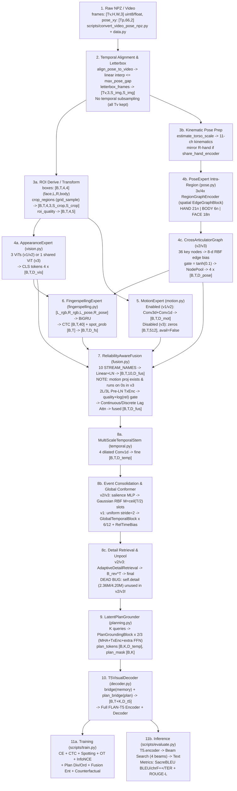

# Complete ISL-MEGA Neural Architecture & Tensor-Flow Audit

**Audited Codebase:** `isl-mega` v`0.2.0` ([`DINOv2-PoseGraph-3DCNN-Conformer/`](file:///Users/likhith/Codes%20-%20Github./ISLTranslate-ideas/DINOv2-PoseGraph-3DCNN-Conformer), git HEAD `2157667`)  
**Primary Architectural Scope:** End-to-end source trace from raw inputs (`scripts/convert_video_pose_npz.py`, `src/isl_mega/data.py`) through multimodal experts, fusion, temporal backbone, latent planner, FLAN-T5 bridge, auxiliary heads, and all 9 training objectives (`scripts/train.py`, `scripts/evaluate.py`).  
**Parameter Count Methodology:** Internal ISL-MEGA module parameter counts (trainable, frozen, total) are computed analytically to exact integers directly from PyTorch layer constructors (`nn.Linear`, `nn.Conv*`, `nn.LayerNorm`, `nn.Embedding`, `nn.GRU`, `nn.MultiheadAttention`, `nn.TransformerEncoderLayer`, `nn.Parameter`) in `src/isl_mega/*.py` and YAML parameters in [`research_v3_compact.yaml`](file:///Users/likhith/Codes%20-%20Github./ISLTranslate-ideas/DINOv2-PoseGraph-3DCNN-Conformer/configs/research_v3_compact.yaml), [`research.yaml`](file:///Users/likhith/Codes%20-%20Github./ISLTranslate-ideas/DINOv2-PoseGraph-3DCNN-Conformer/configs/research.yaml), [`ablation_v1_baseline.yaml`](file:///Users/likhith/Codes%20-%20Github./ISLTranslate-ideas/DINOv2-PoseGraph-3DCNN-Conformer/configs/ablation_v1_baseline.yaml), and [`smoke_v2.yaml`](file:///Users/likhith/Codes%20-%20Github./ISLTranslate-ideas/DINOv2-PoseGraph-3DCNN-Conformer/configs/smoke_v2.yaml). Third-party external checkpoints (`timm` DINOv2 ViT-B/14 & ViT-L/14; Hugging Face `FLAN-T5-small/base/xl`) cannot be instantiated on this host (`torch`/`timm`/`transformers` not installed locally) and are clearly marked as external reference sizes separately from exact internal parameter sums.

---

## Executive Summary & Verified Global Parameter Budget

| Model Profile | Exact ISL-MEGA Internals (Trainable) | External ViT Backbone(s) (Est.) | External FLAN-T5 (Est.) | Combined Total (Est.) | Combined Trainable (Est.) | Combined Frozen (Est.) |
|---|---:|---:|---:|---:|---:|---:|
| [`smoke.yaml`](file:///Users/likhith/Codes%20-%20Github./ISLTranslate-ideas/DINOv2-PoseGraph-3DCNN-Conformer/configs/smoke.yaml) (`v1`, native ViT) | **556,290** *(incl. 3 native ViTs)* | `0` | ~76,961,152 (`flan-t5-small`) | ~77.52M | ~77.52M | `0` |
| [`smoke_v2.yaml`](file:///Users/likhith/Codes%20-%20Github./ISLTranslate-ideas/DINOv2-PoseGraph-3DCNN-Conformer/configs/smoke_v2.yaml) (`v2`, native ViT) | **578,705** *(16,768 dead in `temporal.detail`)* | `0` | ~76,961,152 (`flan-t5-small`) | ~77.54M | ~77.54M | `0` |
| [`research_v3_compact.yaml`](file:///Users/likhith/Codes%20-%20Github./ISLTranslate-ideas/DINOv2-PoseGraph-3DCNN-Conformer/configs/research_v3_compact.yaml) (**`v3` compact**) | **144,485,984** *(2,363,904 dead in `detail`; 395,520 in `motion_proj`)* | ~86,580,480 (`1x ViT-B/14`, **frozen**) | ~247,577,856 (`flan-t5-base`) | **~478.64M** | **~392.06M** | **~86.58M** |
| [`ablation_v1_baseline.yaml`](file:///Users/likhith/Codes%20-%20Github./ISLTranslate-ideas/DINOv2-PoseGraph-3DCNN-Conformer/configs/ablation_v1_baseline.yaml) (`v1` full) | **388,993,150** | ~913,105,920 (`3x ViT-L/14`, trainable) | ~2,849,757,184 (`flan-t5-xl`) | **~4,151.86M** | **~4,151.86M** | `0` |
| [`research.yaml`](file:///Users/likhith/Codes%20-%20Github./ISLTranslate-ideas/DINOv2-PoseGraph-3DCNN-Conformer/configs/research.yaml) (`v2` full) | **387,699,417** *(4,200,448 dead in `temporal.detail`)* | ~913,105,920 (`3x ViT-L/14`, trainable) | ~2,849,757,184 (`flan-t5-xl`) | **~4,150.56M** | **~4,150.56M** | `0` |

> [!IMPORTANT]
> Previous audit docs ([`05_BASELINE_TEST_AND_RUNTIME_REPORT.md`](file:///Users/likhith/Codes%20-%20Github./ISLTranslate-ideas/DINOv2-PoseGraph-3DCNN-Conformer/reports/phase_1_verification/05_BASELINE_TEST_AND_RUNTIME_REPORT.md#L64-L75)) substantially undercounted ISL-MEGA internals by **~2x–3x** across `PoseExpert` (`34.22M` actual vs `10.74M` claimed), `ReliabilityAwareFusion` (`22.57M` vs `14.82M`), `HierarchicalTemporalEncoder` (`56.80M` vs `34.58M`), and `LatentPlanGrounder` (`28.37M` vs `14.18M` — because `PlanGroundingBlock` inadvertently runs **two** 4x FFNs per layer).

---

## End-to-End Real Execution Flow (Mermaid Diagram)

---

## Exact Per-Component Audit (Components 1–14)

### 1. RGB Video Input & Ingestion
- **Source File, Class & Method:**
  - Pre-packaging: [`scripts/convert_video_pose_npz.py:main`](file:///Users/likhith/Codes%20-%20Github./ISLTranslate-ideas/DINOv2-PoseGraph-3DCNN-Conformer/scripts/convert_video_pose_npz.py#L14-L82)
  - Dataset & Collation: [`ISLVideoDataset.__init__`](file:///Users/likhith/Codes%20-%20Github./ISLTranslate-ideas/DINOv2-PoseGraph-3DCNN-Conformer/src/isl_mega/data.py#L170-L233), [`__getitem__`](file:///Users/likhith/Codes%20-%20Github./ISLTranslate-ideas/DINOv2-PoseGraph-3DCNN-Conformer/src/isl_mega/data.py#L237-L377), [`letterbox_frames`](file:///Users/likhith/Codes%20-%20Github./ISLTranslate-ideas/DINOv2-PoseGraph-3DCNN-Conformer/src/isl_mega/data.py#L31-L56), [`collate_examples`](file:///Users/likhith/Codes%20-%20Github./ISLTranslate-ideas/DINOv2-PoseGraph-3DCNN-Conformer/src/isl_mega/data.py#L380-L429)
- **Tensor Shapes & Transformations:**
  - NPZ raw `frames`: `[Tv, H, W, 3]` or `[Tv, 3, H, W]` (`uint8` or `float [0,1]`) -> normalized `[Tv, 3, H, W]` `float32` (`uint8 / 255.0`) -> `letterbox_frames` bilinear aspect-preserving resize + zero padding (`0.0`) -> `[Tv, 3, image_size, image_size]` -> batch collation zero-pads time to `T = max(Tv)` -> `frames: [B, T, 3, image_size, image_size]`, `lengths: [B]`, `frame_mask: [B, T]`.
  - Raw timestamps: `[Tv]` `float64` -> re-based (`video_times - video_times[0]`) -> `timestamps: [B, T]` `float32`.
- **Parameters / Complexity / Connectivity:**
  - `0` parameters; non-differentiable dataloader preprocessing; CPU complexity $O(B \cdot T \cdot \text{image\_size}^2)$.
- **Masking & Missing Observations:**
  - Rejects `NaN`/`Inf`, unsupported dtypes (`uint16`), or float pixel ranges outside `[0, 1]`. Re-pads irregular sequence ends cleanly with `0` (`frame_mask[b, lengths[b]:] = False`).

---

### 2. Frame Sampling & Pose-to-Video Synchronization
- **Source File, Class & Method:**
  - [`align_pose_to_video`](file:///Users/likhith/Codes%20-%20Github./ISLTranslate-ideas/DINOv2-PoseGraph-3DCNN-Conformer/src/isl_mega/data.py#L77-L121), [`derive_rois`](file:///Users/likhith/Codes%20-%20Github./ISLTranslate-ideas/DINOv2-PoseGraph-3DCNN-Conformer/src/isl_mega/data.py#L138-L154)
- **Tensor Shapes & Transformations:**
  - **Temporal Resampling Policy:** Zero RGB frame subsampling or temporal cropping; all `Tv` video frames are retained verbatim (`25`–`30` fps).
  - Pose interpolation: `pose_xy [Tp, 66, 2]`, `pose_times [Tp]`, `pose_conf [Tp, 66]`, `pose_valid [Tp, 66]` -> linearly interpolated onto `video_times [Tv]` -> `[Tv, 66, 2]`, `[Tv, 66]`, `[Tv, 66]` -> affine-transformed into letterbox canvas `[0,1]` (`transform_points_to_letterbox`, out-of-bounds points masked invalid at `data.py:312-313`).
  - ROI generation (when NPZ omits `boxes`): `derive_rois` expands min/max bounding boxes over face (`48:66`, margin `2.0`), left hand (`0:21`, `2.1`), right hand (`21:42`, `2.1`), body (`0:48`, `1.8`) -> `boxes [Tv, 4, 4]`, `box_valid [Tv, 4]`.
- **Masking & Missing Observations:**
  - Exact timestamp matches (`|dt| <= 1e-7s`) copy directly; intervals with `gap > max_pose_gap_seconds` (`0.20s` in `research*`) or missing bracketing endpoint or out-of-clip times (`r == 0` / `r >= Tp`) become invalid (`out_valid = False`, **no extrapolation**).
  - If `< 2` keypoints exist in `[0:48]`, `derive_rois` sets a full-frame body box `[0,0,1,1]` with `box_valid[..., 3] = True` and assigns proxy `box_scores[..., 3] = 0.25`.
  - **Architectural Defect:** If `boxes` are omitted (`derive_rois` fallback), RGB face/hand crops vanish (`box_valid=False`) whenever pose keypoints drop `< 2`, preventing RGB from compensating for pose tracking failures.

---

### 3. Visual Encoder (`AppearanceExpert`, `VisualBackbone`, `crop_regions`, `roi_quality`)
- **Source File, Class & Method:**
  - [`crop_regions`](file:///Users/likhith/Codes%20-%20Github./ISLTranslate-ideas/DINOv2-PoseGraph-3DCNN-Conformer/src/isl_mega/vision.py#L20-L59), [`PatchVisionTransformer`](file:///Users/likhith/Codes%20-%20Github./ISLTranslate-ideas/DINOv2-PoseGraph-3DCNN-Conformer/src/isl_mega/vision.py#L62-L103), [`VisualBackbone`](file:///Users/likhith/Codes%20-%20Github./ISLTranslate-ideas/DINOv2-PoseGraph-3DCNN-Conformer/src/isl_mega/vision.py#L140-L161), [`AppearanceExpert`](file:///Users/likhith/Codes%20-%20Github./ISLTranslate-ideas/DINOv2-PoseGraph-3DCNN-Conformer/src/isl_mega/vision.py#L164-L204), [`roi_quality`](file:///Users/likhith/Codes%20-%20Github./ISLTranslate-ideas/DINOv2-PoseGraph-3DCNN-Conformer/src/isl_mega/vision.py#L207-L243)
- **Tensor Shapes & Transformations:**
  - `crop_regions(frames [B,T,3,S_img,S_img], boxes [B,T,4,4], effective_box_valid [B,T,4])` -> bilinear `F.grid_sample(align_corners=True, padding_mode="border")` * mask -> `crops [B, T, 4, 3, S_crop, S_crop]`.
  - `AppearanceExpert.forward`: For each ROI in `("face", 0)`, `("left_hand", 1)`, `("right_hand", 2)`, `("body", 3)`, selects valid rows `x[m]` (`[N_val, 3, S_crop, S_crop]`) -> runs `VisualBackbone` (`self.norm(self.projection(self.encoder(x[m])))`) -> scatters into `zeros [B*T, D_vis]` -> dict of 4 tensors `[B, T, D_vis]`.
  - `roi_quality`: Computes `[present, box_area, TV_sharpness, detector_score_or_proxy, frame_mask]` -> `[B, T, 4, 5]`.
- **Parameters (Total / Trainable / Frozen):**
  - `smoke_v2.yaml` (`3x` native ViT `crop=32, p=8, D=32, L=1`): `46,272` (`3 * 15,360` encoder + `3 * 64` LN) / `46,272` trainable / `0` frozen.
  - `research_v3_compact.yaml` (`1x` shared `timm` ViT-B/14, `freeze_backbone=True`, `input_dim==dim==768` so `projection=Identity`): Exact wrapper `self.norm` = **`1,536`** trainable (`2 * 768`); external `ViT-B/14` encoder = **`~86,580,480` frozen**.
  - `research.yaml` / `ablation_v1_baseline.yaml` (`3x` `timm` ViT-L/14, `freeze_backbone=False`): Exact wrapper `3 * norm` = **`6,144`** trainable; external `3x ViT-L/14` = **`~913,105,920` trainable** / `0` frozen.
- **Operations, Complexity & Gradients:**
  - Standard multi-head self-attention across $P = (S_{\text{crop}} / p)^2 + 1$ patches: per ROI per frame $O(P^2 D_{\text{vis}} + P D_{\text{vis}}^2)$. For `research_v3_compact` (`S=224, p=14 -> P=257`), each 10s 30fps clip (`T=300`) runs `4 * 300 = 1,200` ViT forward passes! In `research.yaml` (`S=518, p=14 -> P=1370`), complexity explodes by **$\sim 28\times$ per pass** across 3 ViTs.
  - Gradients flow smoothly only through valid ROIs (`x[m]`); note `VisualBackbone.forward` does not wrap `self.encoder` in `torch.no_grad()` when `freeze_backbone=True` (safe when input `frames` require no grad, yet performs redundant ViT forward passes every epoch due to lack of feature caching).
- **Masking & Missing Observations:**
  - Zero-area/nonfinite valid boxes throw `ValueError`; invalid ROIs (`~effective_box_valid`) skip encoder inference (`if m.any()`) and output exact `0.0` vectors (`feature_norm=0`, `present=0`).

---

### 4. DINOv2 Implementation & Self-Supervised Pretraining
- **Source File, Class & Method:**
  - Runtime Backbone: [`TimmBackbone`](file:///Users/likhith/Codes%20-%20Github./ISLTranslate-ideas/DINOv2-PoseGraph-3DCNN-Conformer/src/isl_mega/vision.py#L106-L137)
  - SSL Stage: [`DINOProjectionHead`](file:///Users/likhith/Codes%20-%20Github./ISLTranslate-ideas/DINOv2-PoseGraph-3DCNN-Conformer/src/isl_mega/pretraining.py#L19-L29), [`SignAwareDistillation`](file:///Users/likhith/Codes%20-%20Github./ISLTranslate-ideas/DINOv2-PoseGraph-3DCNN-Conformer/src/isl_mega/pretraining.py#L32-L108), [`load_ssl_backbone`](file:///Users/likhith/Codes%20-%20Github./ISLTranslate-ideas/DINOv2-PoseGraph-3DCNN-Conformer/src/isl_mega/pretraining.py#L111-L120), [`scripts/pretrain_visual.py`](file:///Users/likhith/Codes%20-%20Github./ISLTranslate-ideas/DINOv2-PoseGraph-3DCNN-Conformer/scripts/pretrain_visual.py)
- **Implementation Reality:**
  - `TimmBackbone` calls `timm.create_model(model_name, pretrained=pretrained, num_classes=0, dynamic_img_size=True)`, normalizes RGB by pretrained ImageNet mean/std buffers, and extracts ONLY the 1-D CLS/pooled embedding (`[N, D_vis]`), **discarding all spatial patch tokens**.
  - **No LoRA adapters** exist anywhere (`separate_hand_face_body=True` creates 3 full ViTs; `False` shares 1 ViT).
  - `SignAwareDistillation` (standalone pretraining only) trains a `student` + EMA `teacher` (`m=0.996`) + `DINOProjectionHead` (`D -> 2048 -> 2048 -> 256 -> K_proto`), minimizing cross-entropy from centered global-frame teacher softmax (`T=0.04`) to student local crops (`T=0.1`).
- **SSL Parameter Count (standalone when run):** `DINOProjectionHead` (`D=768, P=65536`): `768*2048+2048 + 2048*2048+2048 + 2048*256+256 + 256*65536 = 23,075,072` per head (`~46.15M` for student+teacher heads) + `2x` `VisualBackbone`. Not instantiated during `train.py` (`load_ssl_backbone` copies `student_backbone` weights into `.hand`, `.face`, `.body`).
- **Mismatch Found:** `scripts/pretrain_visual.py:44-45` feeds all 4 crops (including `body`) as student local views, contradicting [`SignAwareDistillation`](file:///Users/likhith/Codes%20-%20Github./ISLTranslate-ideas/DINOv2-PoseGraph-3DCNN-Conformer/src/isl_mega/pretraining.py#L33)'s docstring (*"student sees local face/hand crops"*), and `load_ssl_backbone` copies identical weights into separate specialists (`research.yaml`).

---

### 5, 6 & 7. Pose Encoder, Anatomical Graph & Cross-Articulator Interaction
- **Source File, Class & Method:**
  - [`PoseExpert`](file:///Users/likhith/Codes%20-%20Github./ISLTranslate-ideas/DINOv2-PoseGraph-3DCNN-Conformer/src/isl_mega/pose.py#L275-L434), [`estimate_torso_scale`](file:///Users/likhith/Codes%20-%20Github./ISLTranslate-ideas/DINOv2-PoseGraph-3DCNN-Conformer/src/isl_mega/pose.py#L61-L86), [`RegionGraphEncoder`](file:///Users/likhith/Codes%20-%20Github./ISLTranslate-ideas/DINOv2-PoseGraph-3DCNN-Conformer/src/isl_mega/pose.py#L158-L195), [`EdgeGraphBlock`](file:///Users/likhith/Codes%20-%20Github./ISLTranslate-ideas/DINOv2-PoseGraph-3DCNN-Conformer/src/isl_mega/pose.py#L89-L141), [`NodePool`](file:///Users/likhith/Codes%20-%20Github./ISLTranslate-ideas/DINOv2-PoseGraph-3DCNN-Conformer/src/isl_mega/pose.py#L144-L155), [`CrossArticulatorGraph`](file:///Users/likhith/Codes%20-%20Github./ISLTranslate-ideas/DINOv2-PoseGraph-3DCNN-Conformer/src/isl_mega/pose.py#L198-L272)
- **Anatomical Partitions & Graph Topologies (`pose.py:13-58`):**
  - `LEFT = 0:21`, `RIGHT = 21:42` (each `21` nodes, `20` undirected kinematic finger chains `HAND_EDGES` + self-loops -> sparse adjacency density $61 / 441 \approx 13.8\%$).
  - `BODY = 42:48` (`6` nodes: L/R shoulders, elbows, wrists; `5` undirected `BODY_EDGES` + self-loops -> $16 / 36 \approx 44.4\%$).
  - `FACE = 48:66` (`18` nodes, **fully connected** -> `18 x 18 = 324` edges).
  - `CrossArticulatorGraph` (`36` nodes): `6` L-hand (`HAND_KEY_INDICES=(0,4,8,12,16,20)`) + `6` R-hand + `6` body + `18` face. Adjacency links `L <-> R`, `L <-> Body+Face`, `R <-> Body+Face` (zero intra-body or intra-face edges in cross graph).
- **Tensor Shapes & Transformations:**
  1. `pose_xy [B,T,66,2]`, `conf [B,T,66]`, `valid [B,T,66]`, `confidence_known [B,T,66]`. If `min_confidence > 0`, threshold applies only where `confidence_known` is True.
  2. `estimate_torso_scale` (`normalize_by_shoulder_span=True` in `v2`/`v3`): `[B, T]` clamped `[0.05, 2.0]` via cascade `shoulder_span -> 0.65 * body_diag -> 1.25 * face_diag -> 1.0`.
  3. `_kinematic_features`: Builds `[B, T, 66, 11]`: `[x, y, rel_x, rel_y, tanh(vx/5), tanh(vy/5), tanh(ax/25), tanh(ay/25), conf, valid, conf_known]`. *(Note: `x, y` stay un-normalized while `v` (`L309`) and `rel_x, rel_y` (`L387`) are divided by `scale`.)* Anchors: hand wrist (or centroid fallback), shoulder midpoint (or body centroid fallback), face centroid. If `share_hand_encoder=True`, right hand mirrors `1 - x`, negates `rel_x, vx, ax`, and adds `hand_side_emb`.
  4. `RegionGraphEncoder`: `Linear(11, D_p) + node_id (+ hand_side_emb)` -> $L_p$ layers of **spatial** `EdgeGraphBlock` (`edge_feat_dim=4`: `[rel_x, rel_y, dist, 1]` -> `Linear(4,D)->Tanh->Linear(D,D)` added to `k` before masked `q * (k + eb) / sqrt(d_h)` softmax + residual FFN) -> `[B, T, N_reg, D_p]`. **(Not ST-GCN — zero temporal graph convolutions!)**
  5. `CrossArticulatorGraph` (if enabled): Gathers 36 node features, adds `region_emb`, computes pairwise `8`-d edge features (`[rel_x, rel_y, dist, 4*RBF(sigmas=(0.10,0.25,0.60,1.50)), 1]`), runs `EdgeGraphBlock`, adds gated residual `tanh(gate) * (h_flat - h0)` (`gate_init=0.1` in v0.2.0).
  6. `NodePool`: Attention-weighted node pooling (`Linear(D_p, 1) -> softmax`) -> 4 region vectors `[B, T, D_p]` + `available [B, T]` + `quality [B, T, 5]`.
- **Exact Parameter Counts:**
  - `research_v3_compact.yaml` & `research.yaml` (`D_p=512, L_p=3, share=True, cross=1`):
    - Shared hand encoder (`21n, 3L`): `10,270,209` + `hand_side_emb` (`1,024`)
    - Body encoder (`6n, 3L`): `10,262,529`
    - Face encoder (`18n, 3L`): `10,268,673`
    - CrossArticulatorGraph (`36n, 1L, 8e`): `3,421,697`
    - **Total:** **`34,224,132`** (`100%` trainable, `0` frozen).
  - `ablation_v1_baseline.yaml` (`D_p=512, L_p=3, share=False, cross=False`):
    - Left (`10,270,209`) + Right (`10,270,209`) + Body (`10,262,529`) + Face (`10,268,673`) = **`41,071,620`** (`100%` trainable).
  - `smoke_v2.yaml` (`D_p=32, L_p=1, share=True, cross=1`): **`58,692`** (`100%` trainable).
- **Complexity, Masking & Instability:**
  - Complexity per frame: $O((21^2 + 21^2 + 6^2 + 18^2 + 36^2) D_p^2) = O(2538 D_p^2)$ (`L=3` + cross layer; spatial pairwise edge MLP dominates quadratic $N^2$).
  - Masking prevents invalid nodes from sending or receiving attention (`EdgeGraphBlock:131,139,141`; invalid frames zeroed out).
  - **Issue Found:** `estimate_torso_scale` hard-switches between heuristics via `torch.where`, causing step jumps in `scale` -> spurious spikes in finite-diff velocity/accel (`pose.py:61-86, 309`). Also `34.22M` parameters (including `10.26M` on `6` body landmarks) is severely overparameterized for 2D keypoints.

---

### 8a. Optional 3-D Motion Pathway (`MotionExpert`)
- **Source File, Class & Method:** [`MotionExpert`](file:///Users/likhith/Codes%20-%20Github./ISLTranslate-ideas/DINOv2-PoseGraph-3DCNN-Conformer/src/isl_mega/motion.py#L11-L74) (instantiated in [`model.py:35`](file:///Users/likhith/Codes%20-%20Github./ISLTranslate-ideas/DINOv2-PoseGraph-3DCNN-Conformer/src/isl_mega/model.py#L35) when `motion.enabled=True`).
- **Behavior by Config:** **Active** in `smoke`, `smoke_v2`, `ablation_v1_baseline`, `research.yaml` (`MotionConfig.enabled` defaults to `True`!); **Disabled (`model.motion = None`)** in `research_v3_compact.yaml`.
- **Tensor Shapes & Transformations (when enabled):**
  - Input: `body_crops [B, T, 1, 3, S_crop, S_crop]` -> compute masked `[body, |frame_t - frame_{t-1}|]` -> `[B, 6, T, S, S]` -> `spatial1 = Conv3d(6->d/2, (3,5,5), s=(1,2,2))` -> mask -> `spatial2 = Conv3d(d/2->d, (3,3,3), s=(1,2,2))` -> mask -> `mean(-1, -2)` -> `[B, T, d]` -> depthwise `Conv1d(k)` + `1x1` + residual `LayerNorm` -> `[B, T, d]`.
- **Exact Parameter Count:** `0` in `research_v3_compact.yaml`; **`3,921,920`** (`3.92M`, all trainable) in `research.yaml` / `ablation_v1_baseline.yaml` (`d=512, k=7`); **`22,272`** in `smoke` / `smoke_v2`.
- **Complexity & Issues:** $O(B \cdot T \cdot S_{\text{crop}}^2 \cdot d^2)$. Global spatial average pooling `.mean((-1,-2))` discards spatial asymmetry, and even when disabled (`research_v3_compact`), `model.py:45,87` still allocates `[B, T, 512]` zero tensors for fusion.

---

### 8b. Fingerspelling Branch (`FingerspellingExpert`)
- **Source File, Class & Method:** [`FingerspellingExpert`](file:///Users/likhith/Codes%20-%20Github./ISLTranslate-ideas/DINOv2-PoseGraph-3DCNN-Conformer/src/isl_mega/fingerspelling.py#L46-L124) (`CHARACTERS` len `39` -> `40` classes incl. blank `0`).
- **Tensor Shapes & Transformations:**
  - Concat `[left_rgb, right_rgb, left_pose, right_pose]` (`[B, T, 2*D_vis + 2*D_pose]`) -> `input` (`Linear->LN->GELU` -> `[B,T,H]`) -> `pack_padded_sequence` bidirectional `GRU` (`layers=2` compact / `3` research, hidden `H//2` per dir -> `[B,T,H]`) -> `ctc = Linear(H, 40)` (`logits [B,T,40]`).
  - Character posterior `softmax(logits) @ char_embedding` (`[B,T,H]`) -> `feedback_gate([hidden, char_context])` (bias `-3.5`).
  - When `span_routing=True` (`v2`/`v3`): `h_clean` masked by `available = (left_valid | right_valid) & length_mask` -> depthwise `Conv1d(k=5)` + `spot_head` (`Linear(2H, H//2)->GELU->Linear(H//2, 1)`, bias `-1.0`) -> `spot_prob [B,T]`, `route = gate * spot_prob`.
  - Output: `features = mask * norm(hidden + route * char_context)` (`[B, T, H]`), `logits [B,T,40]`, `available [B,T]`, `spot_logits`, `spot_prob`, `gate`.
- **Exact Parameter Count (`100%` trainable):**
  - `research_v3_compact.yaml` (`v=768, p=512, h=256, L=2, span=True`): `input 656,128` + `BiGRU 592,896` + `ctc+emb+gate+norm 21,545` + `spot 67,329` = **`1,337,898`** (`1.34M`).
  - `research.yaml` (`v=1024, p=512, h=512, L=3, span=True`): **`5,431,338`** (`5.43M`).
  - `ablation_v1_baseline.yaml` (`span=False`): **`5,165,609`** (`5.17M`).
  - `smoke_v2.yaml` (`v=32, p=32, h=32, L=1, span=True`): **`12,970`**.
- **Complexity & Status:** $O(B \cdot T \cdot H^2)$. Clean padding/missing-hand handling (survives single visible hand). **Unused functions in module:** `decode_characters` (`L24-26`, 0 callers) and `greedy_ctc_decode` (`L29-43`, test-only; never called during `evaluate.py`).

---

### 9. Multimodal Fusion (`ReliabilityAwareFusion`, `ContinuousTimeLagBias`)
- **Source File, Class & Method:** [`ReliabilityAwareFusion`](file:///Users/likhith/Codes%20-%20Github./ISLTranslate-ideas/DINOv2-PoseGraph-3DCNN-Conformer/src/isl_mega/fusion.py#L56-L217), [`ContinuousTimeLagBias`](file:///Users/likhith/Codes%20-%20Github./ISLTranslate-ideas/DINOv2-PoseGraph-3DCNN-Conformer/src/isl_mega/fusion.py#L20-L53)
- **Exact Stream Ordering (`STREAM_NAMES`, `fusion.py:13-17`):**
  `0: left_hand_rgb`, `1: right_hand_rgb`, `2: face_rgb`, `3: body_rgb`, `4: left_hand_pose`, `5: right_hand_pose`, `6: body_pose`, `7: face_pose`, `8: motion`, `9: fingerspelling`. *(Note: pose puts `body` before `face`, opposite to RGB ROI order.)*
- **Tensor Shapes & Transformations:**
  1. Per-stream `Linear(v, D_fus) + LN(D_fus)` -> `projected [B, T, 10, D_fus]` (exported as `modality_embeddings` for InfoNCE before interaction).
  2. Add `type_embedding [1,1,10,D_fus]`; flatten `[B*T, 10, D_fus]` (injecting `self.null` into slot `0` for `all_missing` rows to prevent NaN MHA) -> `layers` Pre-LN `TransformerEncoder` -> `interacted [B, T, 10, D_fus]`.
  3. Reliability + quality gate (`L142-155`): `logits = quality_gate([interacted, q])`; if `reliability_uncertainty_gate=True`, adds `log(sigmoid(reliability_net(q)).clamp_min(1e-4))`; masked softmax -> convex sum `pooled [B, T, D_fus]` (`self.null` where all missing).
  4. Asynchronous cross-stream lag attention (`L157-196`): Queries `pooled`, Keys/Values across window `K` (`[-4..+4]` = `9` frames x `10` streams = `90` keys in v2/v3 masked by `|dt| <= 0.20s`, or `50` keys in v1). `ContinuousTimeLagBias` maps `[tau, tau^2, |tau|, sin/cos(pi*tau), sin/cos(2pi*tau)]` + `stream_slope * tau + stream_bias` into score biases.
  5. `fused = output(cat([pooled, lag_out(aligned)]))` -> **`[B, T, D_fus]`**.
- **Exact Parameter Count (`100%` trainable):**
  - `research_v3_compact.yaml` (`D=768, L=2, H=12, cont=True, rel=True`):
    `projections 4,545,024` (**including `395,520` dead params for `projections["motion"]` receiving zero input!**) + `type_emb+null 8,448` + `2L interaction 14,175,744` + `qgate+rel 297,672` + `lag_attn+bias 2,363,100` + `output 1,181,952` = **`22,571,940`** (`22.57M`).
  - `research.yaml` (`D=1024, L=3, H=16`): **`51,998,360`** (`52.00M`).
  - `ablation_v1_baseline.yaml` (`cont=False, rel=False`): **`51,997,265`** (`52.00M`).
  - `smoke_v2.yaml` (`D=64, L=1, H=4`): **`100,636`**.
- **Complexity & Bottlenecks:** `interaction` is $O(B \cdot T \cdot 10^2 \cdot D_{\text{fus}} + B \cdot T \cdot 10 \cdot D_{\text{fus}}^2)$; lag attention is $O(B \cdot T \cdot 90 \cdot D_{\text{fus}})$.
- **Information Loss:** `pooled` reduces 10 streams to a single convex weighted sum per frame using scalar stream weights (cannot combine different feature channels per articulator except via lag attention residuals). Also `self.projections["motion"]` in `v3` receives exact `0.0` gradients (`395.5k` dead params).

---

### 10. Temporal Backbone (`HierarchicalTemporalEncoder`)
- **Source File, Class & Method:** [`HierarchicalTemporalEncoder`](file:///Users/likhith/Codes%20-%20Github./ISLTranslate-ideas/DINOv2-PoseGraph-3DCNN-Conformer/src/isl_mega/temporal.py#L197-L375), [`MultiScaleTemporalStem`](file:///Users/likhith/Codes%20-%20Github./ISLTranslate-ideas/DINOv2-PoseGraph-3DCNN-Conformer/src/isl_mega/temporal.py#L17-L45), [`GlobalTemporalBlock`](file:///Users/likhith/Codes%20-%20Github./ISLTranslate-ideas/DINOv2-PoseGraph-3DCNN-Conformer/src/isl_mega/temporal.py#L64-L108), [`AdaptiveDetailRetrieval`](file:///Users/likhith/Codes%20-%20Github./ISLTranslate-ideas/DINOv2-PoseGraph-3DCNN-Conformer/src/isl_mega/temporal.py#L155-L194), [`FineDetailRetrieval`](file:///Users/likhith/Codes%20-%20Github./ISLTranslate-ideas/DINOv2-PoseGraph-3DCNN-Conformer/src/isl_mega/temporal.py#L111-L152)
- **Tensor Shapes & Transformations (`adaptive_consolidation=True` in `v2`/`v3`):**
  1. `stem(fused [B,T,D])`: `4` parallel dilated `Conv1d` branches (`k=(3,5,9,15)`, `d=(1,1,2,4)` -> each `D/4` channels) -> `Conv1d(1x1)` + residual LN -> `fine [B, T, D]`.
  2. `_adaptive_pool`: `salience_net([fine, delta, ||delta||/sqrt(D), log1p(dt)])` -> `salience >= 0.1` -> cumulative integral splits clip length `L_i` into `m_i = ceil(L_i / 2)` Gaussian RBF event slots (`M = ceil(T/2)`) via normalized weights `assign [B, M, T]`. Produces `coarse [B, M, D]` via `coarse_projection([assign@fine, assign@delta]) + time_projection([elapsed, log1p(elapsed)]) + slot_spread_proj(slot_std)`.
  3. Global Conformer: `global_layers` (`6` compact / `12` research) Pre-LN `GlobalTemporalBlock`s (RelativeTimeBias `qkv` attention + gated depthwise `Conv1d(k=15)` + **single** Pre-LN FFN `ffn_dim=2048` compact / `4096` research) -> `coarse [B, M, D]`.
  4. `AdaptiveDetailRetrieval`: Cross-attention `coarse [B, M, D]` -> `fine [B, T, D]` with `softplus(log_prior_scale) * assign_logits` -> `retrieved [B, M, D]`.
  5. Unpool & Final: `global_up = rev_weights^T @ retrieved` (`[B, T, D]`) -> `out = final(cat([fine, global_up]))` -> **`memory [B, T, D]`**.
- **Exact Parameter Count (`100%` marked trainable — WITH DEAD BUG):**
  - `research_v3_compact.yaml` (`D=768, L=6, H=12, ffn=2048, b=32, adaptive=True`):
    `stem 5,313,024` + `cproj+tproj+final 2,366,208` + `6 blocks 43,797,504` (`7,299,584`/block) + `time_bias 384` + `adaptive 2,956,814` + **`DEAD self.detail 2,363,904`** = **`56,797,838`** (`54,433,934` active + **`2,363,904` dead/unconnected**).
  - `research.yaml` (`D=1024, L=12, H=16, ffn=4096, b=64, adaptive=True`): **`212,262,930`** (`208,062,482` active + **`4,200,448` dead `self.detail`**).
  - `ablation_v1_baseline.yaml` (`adaptive=False`): **`207,009,792`** (all active; uses `self.detail`).
  - `smoke_v2.yaml` (`D=64, L=2`): **`169,990`** (`153,222` active + **`16,768` dead `self.detail`**).
- **Complexity & Defects:** $O(B \cdot M^2 D + B \cdot M \cdot T \cdot D)$ (`M = ceil(T/2)`). As proven in PROMPT 2, [`temporal.py:218`](file:///Users/likhith/Codes%20-%20Github./ISLTranslate-ideas/DINOv2-PoseGraph-3DCNN-Conformer/src/isl_mega/temporal.py#L218) unconditionally allocates `self.detail`, causing `test_compact_v3_config_and_motion_disabled_forward_backward` to fail (`p.grad is None`). Padding invariance holds on valid frames via explicit `fine_mask` / `coarse_mask` clamping and `torch.where` zeroing.

---

### 11. Latent Planner / Intermediate Representation (`LatentPlanGrounder`)
- **Source File, Class & Method:** [`LatentPlanGrounder`](file:///Users/likhith/Codes%20-%20Github./ISLTranslate-ideas/DINOv2-PoseGraph-3DCNN-Conformer/src/isl_mega/planning.py#L45-L197), [`PlanGroundingBlock`](file:///Users/likhith/Codes%20-%20Github./ISLTranslate-ideas/DINOv2-PoseGraph-3DCNN-Conformer/src/isl_mega/planning.py#L11-L42)
- **Tensor Shapes & Transformations:**
  - `queries [1, K, D]` (`K=16` compact / `32` research), optionally `+ slot_pos` (`diverse_ordered_planning`, **`False` in `research_v3_compact`**).
  - Runs `layers` (`2` compact / `3` research) of `PlanGroundingBlock`: Pre-LN MHA cross-attention (`queries -> memory [B,T,D]`) + `TransformerEncoderLayer` self-attention (which includes **FFN #1**, `D->4D->D`) + residual **FFN #2** (`self.ffn`, `D->4D->D`) -> `self.norm`.
  - If `dynamic_routing=True` (`research.yaml` / `smoke_v2.yaml`, **`False` in `research_v3_compact`**): computes deterministic `plan_mask` with `active = clamp(ceil(valid_len / 4), min_queries, K)` and multiplies slots `>= min_queries` by `sigmoid(budget_gate(plan))` (bias `1.5`).
  - Outputs: `plan_tokens [B, K, D]`, `grounding_attention [B, K, T]`, `plan_mask [B, K]`, `diversity_loss`, `order_loss`.
- **Exact Parameter Count (`100%` trainable):**
  - `research_v3_compact.yaml` (`D=768, K=16, L=2, div_ord=False, dyn=False`): `queries+norm 13,824` + `2 blocks x 14,177,280` = **`28,368,384`** (`28.37M`).
  - `research.yaml` (`D=1024, K=32, L=3, div_ord=True, dyn=True`): **`75,652,097`** (`75.65M`).
  - `ablation_v1_baseline.yaml` (`D=1024, K=32, L=3, False, False`): **`75,618,304`** (`75.62M`).
  - `smoke_v2.yaml` (`D=64, K=6, L=1`): **`101,057`**.
- **Critical Architecture Findings:**
  1. **Accidental Double-FFN Bloat:** `PlanGroundingBlock` nests PyTorch's `TransformerEncoderLayer` (self-attn + 4x FFN) and then adds another `self.ffn` (4x FFN) directly afterward — spending **`24 * D^2`** (`14.18M` per layer at `D=768`) instead of `16 * D^2` (`9.45M`).
  2. **Disabled Regularization in `research_v3_compact.yaml`:** In `v3`, `diverse_ordered_planning=false`, `dynamic_plan_routing=false`, `plan_diversity_weight=0.0`, `plan_order_weight=0.0`, `plan_semantic_ot=false`. Thus `LatentPlanGrounder` burns **28.37M** parameters as an **un-ordered, un-regularized** 16-query pooling layer concatenated right alongside all `T` memory tokens that FLAN-T5's encoder already self-attends over!

---

### 12. Text Decoder (`T5VisualDecoder` + Evaluation Beam Search)
- **Source File, Class & Method:** [`T5VisualDecoder`](file:///Users/likhith/Codes%20-%20Github./ISLTranslate-ideas/DINOv2-PoseGraph-3DCNN-Conformer/src/isl_mega/decoder.py#L11-L197), [`entropic_semantic_ot`](file:///Users/likhith/Codes%20-%20Github./ISLTranslate-ideas/DINOv2-PoseGraph-3DCNN-Conformer/src/isl_mega/decoder.py#L200-L238), [`scripts/evaluate.py:main`](file:///Users/likhith/Codes%20-%20Github./ISLTranslate-ideas/DINOv2-PoseGraph-3DCNN-Conformer/scripts/evaluate.py#L17-L109)
- **Tensor Shapes & Transformations:**
  1. `encode_inputs`: `v = bridge(memory)` (`LN(D_temp)->Linear(D_temp, D_t5)`), `p = plan_bridge(plan)` (`LN->Linear`) -> masked & concatenated along sequence axis -> `embeddings [B, T + K, D_t5]`, `mask [B, T + K]`.
  2. Training (`forward`): Passes `inputs_embeds=embeddings, attention_mask=mask` into **full** `T5ForConditionalGeneration` (`self.model`, running BOTH T5 Encoder and T5 Decoder over length `T + K`), producing `loss` (CE / label-smoothed CE with custom `_decoder_mask` preserving shifted start token at position `0` even when equal to `pad_token_id`) and `encoder_last_hidden_state [B, T+K, D_t5]`.
  3. Inference (`scripts/evaluate.py:70-86`): Calls `model.encode()` -> `model.decoder.generate()` (`self.model.encoder(inputs_embeds=...)` -> `self.model.generate(encoder_outputs=..., num_beams=4, max_new_tokens=cfg.decoder.max_target_tokens, do_sample=False)` -> `tokenizer.batch_decode`). Note [`ISLMEGA.generate`](file:///Users/likhith/Codes%20-%20Github./ISLTranslate-ideas/DINOv2-PoseGraph-3DCNN-Conformer/src/isl_mega/model.py#L201-L212) is bypassed by `evaluate.py`, and `evaluate.py` runs in FP32 without `torch.autocast`.
- **Parameter Counts:**
  - Internal bridges (`bridge` + `plan_bridge`, always trainable):
    - `research_v3_compact.yaml` (`768 -> 768`): **`1,184,256`** (`2 * (1,536 + 590,592)`).
    - `research.yaml` / `ablation` (`1024 -> 2048`): **`4,202,496`**.
    - `smoke` / `smoke_v2` (`64 -> 512`): **`66,816`**.
  - External `T5` model (`freeze_decoder=False` in all configs -> all trainable): `~76.96M` (`flan-t5-small`), **`~247.58M`** (`flan-t5-base`), `~2.85B` (`flan-t5-xl`).
- **Complexity & Redundancy:** Full `T5` encoder runs `O((T+K)^2 D_t5)` bidirectional self-attention across 12 layers (`T5-base`) / 24 layers (`T5-XL`) **directly after** Conformer + `PlanGroundingBlock` already ran self-attention over the same visual sequence.

---

### 13 & 14. Auxiliary Heads & All 9 Training Objectives (`scripts/train.py`, `losses.py`, `decoder.py`)

`scripts/train.py:131-141` optimizes:
$$\mathcal{L} = \mathcal{L}_{\text{CE}} + w_{\text{ctc}}\mathcal{L}_{\text{CTC}} + w_{\text{spot}}\mathcal{L}_{\text{spot}} + w_{\text{ot}}\mathcal{L}_{\text{OT}} + w_{\text{xm}}\mathcal{L}_{\text{InfoNCE}} + w_{\text{div}}\mathcal{L}_{\text{div}} + w_{\text{ord}}\mathcal{L}_{\text{ord}} + w_{\text{ent}}\mathcal{L}_{\text{ent}} + w_{\text{cf}}\mathcal{L}_{\text{cf}}$$

| # | Term | Source & Function | Weight (`smoke_v2` / `v3_compact` / `research`) | Connected Parameters & Gradient Notes | Structural / Scientific Assessment |
|---:|---|---|---|---|---|
| **1** | **Translation CE** (`decoder_loss`) | [`decoder.py:92-106`](file:///Users/likhith/Codes%20-%20Github./ISLTranslate-ideas/DINOv2-PoseGraph-3DCNN-Conformer/src/isl_mega/decoder.py#L92-L106) | **`1.0` / `1.0` / `1.0`** | End-to-end gradients through `T5` -> `bridges` -> `planner` & `temporal` -> `fusion` -> experts (`pose`, `vision`, `fs` via `fused`, `motion` if enabled). | Core sequence-to-sequence supervision; `best_valid.pt` selection should track this (`valid_translation`), not weighted 9-loss sum `valid_loss` (`train.py:330`). |
| **2** | **Fingerspelling CTC** (`ctc`) | [`losses.py:22-60`](file:///Users/likhith/Codes%20-%20Github./ISLTranslate-ideas/DINOv2-PoseGraph-3DCNN-Conformer/src/isl_mega/losses.py#L22-L60) | `0.10` / **`0.10`** / `0.10` | `FingerspellingExpert.ctc`, `rnn`, `input`, plus `hand` RGB & pose streams (`spot_*` & `feedback_gate` untouched directly). | Valid; silently returns `0` if batch lacks valid/spanned strings or frame count `< len + repeats`. Unused `prepare_ctc_targets` (`losses.py:11-19`) still sits dead. |
| **3** | **Fingerspelling Spotting** (`fs_spot`) | [`losses.py:63-102`](file:///Users/likhith/Codes%20-%20Github./ISLTranslate-ideas/DINOv2-PoseGraph-3DCNN-Conformer/src/isl_mega/losses.py#L63-L102) | `0.05` / **`0.05`** / `0.05` | `spot_head`, `spot_conv`, `rnn`, `input`, hand streams. Uses `fingerspelling_label_known` to skip unannotated clips; span BCE when `span_known=True`, peak-MIL + sparsity otherwise. | Scientifically coherent; depends on real fingerspelling labels / spans (synthetic/unverified on continuous ISL so far). |
| **4** | **Cross-Modal InfoNCE** (`cross_modal`) | [`losses.py:128-188`](file:///Users/likhith/Codes%20-%20Github./ISLTranslate-ideas/DINOv2-PoseGraph-3DCNN-Conformer/src/isl_mega/losses.py#L128-L188) | `0.05` / **`0.05`** / `0.05` | `fusion.projections[0..7]` + `appearance` + `pose` (pre-interaction `projected`, skipping `motion`/`fs`). | **Flaw:** Concatenates ALL 4 ROI pairs `(L, R, face, body)` into a single `(<=4BT) x (<=4BT)` cosine matrix (`L184`), treating other anatomical regions as negatives and creating $O((4BT)^2)$ memory scaling; returns `0` if `< 2` unique `source_ids` in `batch_size=4`. |
| **5** | **Entropic Semantic OT** (`ot`) | [`decoder.py:111-133, 200-238`](file:///Users/likhith/Codes%20-%20Github./ISLTranslate-ideas/DINOv2-PoseGraph-3DCNN-Conformer/src/isl_mega/decoder.py#L111-L133) | `0.05` / **`0.0`** / `0.05` | `T5` encoder hidden visual tokens `[B,T,D_t5]` (and `plan` tokens when `plan_semantic_ot=True`) vs detached `T5.encoder(text_ids)`. `30` Sinkhorn iters per sample in FP32. | **Disabled in `v3_compact`.** Unconstrained monotonic-agnostic optimal transport lacks alignment ground truth between DINO-projected frames and T5 target subwords. |
| **6** | **Plan Diversity** (`plan_div`) | [`planning.py:115-126`](file:///Users/likhith/Codes%20-%20Github./ISLTranslate-ideas/DINOv2-PoseGraph-3DCNN-Conformer/src/isl_mega/planning.py#L115-L126) | `0.05` / **`0.0`** / `0.02` | Off-diagonal Gram penalty on active grounding attention + normalized `plan` embeddings (`K x K`). | **Disabled in `v3_compact`.** Requires `diverse_ordered_planning=True` to avoid pure permutation symmetry. |
| **7** | **Plan Ordering** (`plan_ord`) | [`planning.py:128-149`](file:///Users/likhith/Codes%20-%20Github./ISLTranslate-ideas/DINOv2-PoseGraph-3DCNN-Conformer/src/isl_mega/planning.py#L128-L149) | `0.02` / **`0.0`** / `0.02` | Hinge enforcing `center_j + margin <= center_{j+1}` over normalized clip timestamps. | **Disabled in `v3_compact`.** Monotonic query ordering conflicts with non-monotonic ISL↔English syntactic reordering if enforced blindly. |
| **8** | **Fusion Entropy** (`fusion_ent`) | [`losses.py:105-125`](file:///Users/likhith/Codes%20-%20Github./ISLTranslate-ideas/DINOv2-PoseGraph-3DCNN-Conformer/src/isl_mega/losses.py#L105-L125) | `0.02` / **`0.0`** / `0.02` | Penalizes `(1 - H(weights)/log(count))` on multi-stream frames. | **Scientific Contradiction (Disabled in `v3_compact`):** Pulls gating toward uniform modality weights, directly fighting `reliability_uncertainty_gate` when noisy streams should drop near zero. |
| **9** | **Counterfactual Grounding** (`counterfactual`) | [`decoder.py:135-173`](file:///Users/likhith/Codes%20-%20Github./ISLTranslate-ideas/DINOv2-PoseGraph-3DCNN-Conformer/src/isl_mega/decoder.py#L135-L173) | `0.05` / **`0.0`** / `0.05` | Runs extra `no_grad` T5 forward on `roll(1)` swapped / blank embeds; applies NLL margin hinge + KL floor (`real || cf`) back through `output.logits`. | **Disabled in `v3_compact`.** Doubles T5 decoder forward passes at train time and only measures sensitivity to random batch swaps / blank zero embeds. |

---

## Consolidated Findings: Defects, Overheads & Bottlenecks

### A. Unused, Dead & Bypassed Code
1. **`HierarchicalTemporalEncoder.detail` (`temporal.py:218`):** Unconditionally created even when `adaptive_consolidation=True` (**`2,363,904` dead params in `v3_compact`**, `4,200,448` in `research`, `16,768` in `smoke_v2`); never enters forward and breaks gradient checks ([PROMPT 2](file:///Users/likhith/Codes%20-%20Github./ISLTranslate-ideas/DINOv2-PoseGraph-3DCNN-Conformer/reports/overnight/02_TEST_FAILURE_ROOT_CAUSE.md)).
2. **`ReliabilityAwareFusion.projections["motion"]` (`fusion.py:69` + `model.py:45`):** In `research_v3_compact.yaml` (`motion.enabled=False`), allocates **`395,520` useless parameters** and processes zero tensors before mask suppression (identical exact `0.0` gradients). Same issue affects `fingerspelling` projection if `fingerspelling.enabled=False`.
3. **Dead / Unwired Functions:** [`losses.prepare_ctc_targets`](file:///Users/likhith/Codes%20-%20Github./ISLTranslate-ideas/DINOv2-PoseGraph-3DCNN-Conformer/src/isl_mega/losses.py#L11-L19) (`0` callers), [`fingerspelling.decode_characters`](file:///Users/likhith/Codes%20-%20Github./ISLTranslate-ideas/DINOv2-PoseGraph-3DCNN-Conformer/src/isl_mega/fingerspelling.py#L24-L26) (`0` callers), [`fingerspelling.greedy_ctc_decode`](file:///Users/likhith/Codes%20-%20Github./ISLTranslate-ideas/DINOv2-PoseGraph-3DCNN-Conformer/src/isl_mega/fingerspelling.py#L29-L43) (test-only; no CTC CER evaluation in `evaluate.py`), [`ISLMEGA.generate`](file:///Users/likhith/Codes%20-%20Github./ISLTranslate-ideas/DINOv2-PoseGraph-3DCNN-Conformer/src/isl_mega/model.py#L201-L212) (bypassed by `scripts/evaluate.py`).

### B. Excessive Parameter Overhead & Duplicate Compute
1. **Pose Graph Over-Parameterization (`34.22M` params in `v3` & `v2`):** Running three `3`-layer `dim=512` `EdgeGraphBlock` encoders (`4*dim=2048` FFN) plus a `512`-dim `CrossArticulatorGraph` uses **10.26M trainable params solely on `6` upper-body nodes**, nearly `40%` of an entire ViT-B/14 for 66 `(x,y)` coordinates! Moreover, `CrossArticulatorGraph.forward` (`pose.py:254-257`) duplicates the pairwise `rel/dist` math already inside `EdgeGraphBlock`.
2. **Latent Plan Double-FFN Bloat & Unsupervised Weight in `v3` (`28.37M` in `v3`, `75.65M` in `v2`):** `PlanGroundingBlock` nests a `TransformerEncoderLayer` (which already includes a `4x` FFN) AND adds a second `4x` FFN immediately after (`24 * D^2` params/layer). In `research_v3_compact.yaml`, `LatentPlanGrounder` runs with no `slot_pos`, no dynamic mask, and zero plan/OT losses—pure `28.37M` overhead feeding a T5 Encoder that already sees all `T` memory frames.
3. **Un-Cached Frozen ViT Passes (`vision.py:160`):** `research_v3_compact` sets `freeze_backbone=True`, yet re-runs `crop_regions` + `ViT-B/14` over `4 * T` (`~1,200`) `224x224` images on every clip and every epoch (`train.py`) without feature caching or `torch.no_grad()` gating.
4. **Full T5 Encoder Redundancy (`decoder.py:93`):** Passes `[T + K]` post-Conformer visual+plan tokens through the entire 12/24-layer bidirectional `T5.encoder` on top of 6/12 Conformer layers + 2/3 Plan layers (`O((T+K)^2 D_t5)` + counterfactual double-forward in `v2`).

### C. Information Loss & Architectural Couplings
1. **Pose->ROI Hard Coupling (`data.py:138-154`):** Without external `boxes`, `derive_rois` builds hand/face crops from `pose_xy`/`pose_valid`. When landmarks fail (`< 2` pts), the RGB ROI becomes `box_valid=False` simultaneously—destroying multimodal redundancy precisely when RGB is needed most.
2. **CLS-Only ViT Compression (`vision.py:128-136`):** Pooling each `224x224` / `518x518` crop to one `D_vis` CLS vector before fusion removes spatial finger/lip configuration from RGB.
3. **Scalar Softmax Stream Bottleneck (`fusion.py:152-154`):** Fusion reduces 10 multi-modal streams per frame via 10 scalar weights into one `[D_fus]` vector before temporal Conformer, preventing fine-grained channel mixing except through the secondary lag attention.
4. **Motion Global Spatial Average (`motion.py:69`):** `.mean((-1,-2))` after 2x `Conv3d` discards spatial localization of hand motion.

### D. Numerical Stability & Scale Edge Cases
1. **Discrete Torso-Scale Transitions (`pose.py:61-86, 309`):** `estimate_torso_scale` switches discretely across `shoulder_span -> body_diag * 0.65 -> face_diag * 1.25 -> 1.0`. If a shoulder flickers invalid for 1 frame, sudden scale discontinuities inject artificial spikes into `velocity` / `acceleration`.
2. **Mixed Coordinate Scaling in Pose (`pose.py:309, 322, 387`):** `rel_x, rel_y` (`2:4`) and `vx, vy, ax, ay` (`4:8`) are torso-normalized, while `x, y` (`0:2`) stay in raw `[0, 1]` letterbox image space (`normalize_by_shoulder_span=True` still passes absolute unscaled `(x, y)`).
3. **Cross-Modal InfoNCE Memory & Batch-Size Coupling (`losses.py:172-186`):** Concatenating 4 regions x `B * T` creates a dense `(4BT) x (4BT)` similarity matrix ($O(B^2 T^2)$ memory; e.g., $T=300, B=4 \implies 4800^2$ floats $\approx 92\text{ MB}$ before backward), mixes different regions in negative denominators, and collapses to `0.0` whenever `batch_size` has `< 2` unique `source_id`s.
4. **`fp16` AMP Vulnerability & Missing `mps`/DDP (`scripts/train.py:80, 207`):** Config validates `bf16` and `fp16`; `fp16` would risk underflow in softmax/Sinkhorn/RBF exponentials (partially guarded by explicit `.float()` casts in `fusion`, `temporal`, `decoder`, `pretraining`), while `train.py` lacks `DDP`, gradient accumulation, and `mps`.

---

## Component-by-Component Action Matrix (Recommendations Only — Not Applied Yet)

| Component | Exact Module / Lines | Verdict | Rationale & Specific Next Action |
|---|---|---|---|
| **Dataset, Alignment & Letterbox** | `src/isl_mega/data.py` | **Retain & Extend** | Mathematically sound affine consistency and gap-safe pose interp. Needs an upstream MediaPipe/543-to-66 `.pose` converter script matching `LEFT(0:21)->RIGHT(21:42)->BODY(42:48)->FACE(48:66)` + optional independent hand/face ROI detector boxes to break pose->ROI failure coupling. |
| **Visual Encoder (`AppearanceExpert`)** | `src/isl_mega/vision.py` | **Retain & Benchmark Cache** | For `research_v3_compact.yaml` (`freeze_backbone=True`), add offline/lazy frozen ViT ROI feature caching + `torch.no_grad()` around frozen `self.encoder` to cut training compute/VRAM massively. Benchmark shared `ViT-B/14` vs specialist LoRA or adapters before `3 x ViT-L/14`. |
| **Pose Encoder (`PoseExpert`)** | `src/isl_mega/pose.py` | **Repair & Downsize** | Smooth `estimate_torso_scale` (EMA / temporal median or disable step-switching across adjacent frames before diff); decouple `self.cross_graph` edge construction duplication; benchmark reducing `pose.hidden_dim` from `512` (`34.22M`, `10.26M` on `6` body pts!) to `128`–`256` with `layers=2`. |
| **Motion Pathway (`MotionExpert`)** | `src/isl_mega/motion.py`, `model.py` | **Remove from Baseline / Conditional Prune** | Already disabled in `research_v3_compact.yaml`. When `motion.enabled=False`, omit `"motion"` from `ReliabilityAwareFusion` projections (`fusion.py`) to save `395,520` dead params in `v3`. Keep disabled unless pose+RGB shows clear temporal motion deficit in ablations. |
| **Fingerspelling (`FingerspellingExpert`)** | `src/isl_mega/fingerspelling.py` | **Retain & Wire Eval** | Clean BiGRU + CTC + `span_routing` (`1.34M` compact). Wire `greedy_ctc_decode` into `scripts/evaluate.py` for fingerspelling CER telemetry; remove dead `decode_characters` (`L24-26`) and `losses.prepare_ctc_targets` (`L11-19`). |
| **Multimodal Fusion (`ReliabilityAwareFusion`)** | `src/isl_mega/fusion.py` | **Retain Core / Remove Entropy Loss** | Retain quality + log-reliability gating and `ContinuousTimeLagBias`. Dynamically construct projections only for active streams (`STREAM_NAMES` subset). Keep `fusion_entropy_weight=0.0` (verified contradiction with reliability gating). |
| **Temporal Backbone (`HierarchicalTemporalEncoder`)** | `src/isl_mega/temporal.py` | **Repair Bug First** | Fix [`temporal.py:218`](file:///Users/likhith/Codes%20-%20Github./ISLTranslate-ideas/DINOv2-PoseGraph-3DCNN-Conformer/src/isl_mega/temporal.py#L218): instantiate `self.detail` ONLY when `adaptive_consolidation=False` (eliminates `2.36M`–`4.20M` dead params and fixes the failing test). Retain `MultiScaleTemporalStem` + `GlobalTemporalBlock`; benchmark adaptive vs uniform stride (`A0` ablation). |
| **Latent Planner (`LatentPlanGrounder`)** | `src/isl_mega/planning.py` | **Repair Double-FFN & Benchmark Removal** | Fix accidental double-FFN in `PlanGroundingBlock` (replaces `24 * D^2` with `16 * D^2` per layer, saving `~9.45M` in `v3`!). Crucially, benchmark **`research_v3_compact` WITH vs WITHOUT `LatentPlanGrounder`**, because `v3` currently leaves it as `28.37M` un-ordered, un-regularized parameters redundant with T5's encoder. |
| **Decoder (`T5VisualDecoder`)** | `src/isl_mega/decoder.py`, `scripts/evaluate.py` | **Repair Eval Bugs & Benchmark** | Keep `FLAN-T5-base` (`research_v3_compact`); fix `evaluate.py` `--manifest valid` UID collision, wrap inference in `torch.autocast`, and invoke `ISLMEGA.generate()` consistently. |
| **Auxiliary Losses** | `src/isl_mega/losses.py`, `decoder.py`, `train.py` | **Prune & Repair InfoNCE** | Fix `compute_cross_modal_alignment_loss` to normalize **within each anatomical region** instead of comparing all `4BT` tokens cross-region in one giant matrix (and avoid silent collapse when `batch_size` has single `source_id`). Keep `ot_weight=0`, `fusion_entropy_weight=0`, `counterfactual_weight=0` disabled unless empirical ablations prove gains over `v3` baseline; switch `train.py:330` `best_valid.pt` selection from composite loss to `valid_translation` / decoded BLEU/chrF++. |
| **SSL Pretraining (`SignAwareDistillation`)** | `src/isl_mega/pretraining.py`, `pretrain_visual.py` | **Benchmark Separately** | Align `pretrain_visual.py` crops with docstring (hand/face local crops vs global frame), add LR schedule/AMP/validation, and evaluate frozen DINOv2-B/14 baseline before spending compute on custom SSL. |

