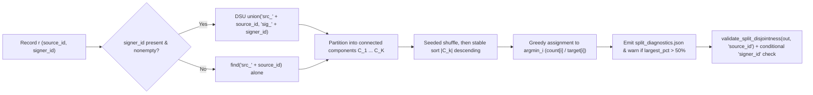
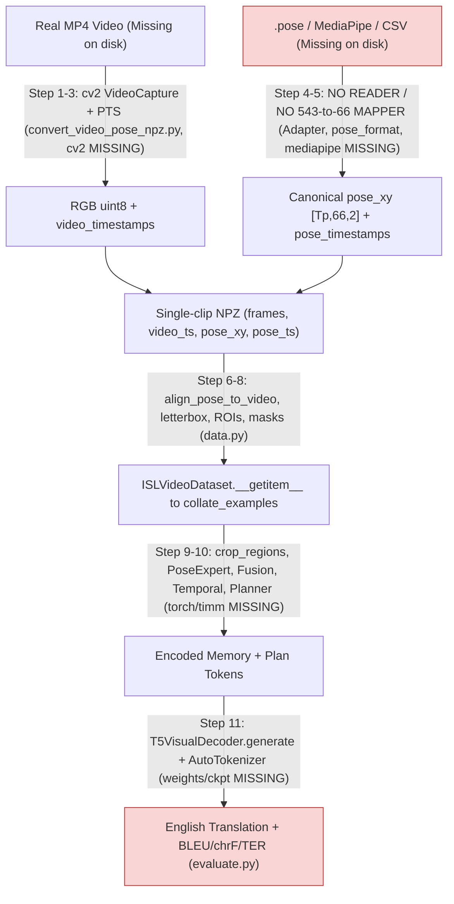

# Dataset Provenance, Integrity Audit & Real-Data Pipeline Readiness

**Target Repository:** `DINOv2-PoseGraph-3DCNN-Conformer` (`isl-mega` v`0.2.0`)  
**Sibling Codebases Audited for Dataset Infrastructure:** `CNN-BiLSTM` (`isl-slt`) and `InceptionCNN-Transformer`  
**Audit Mode:** Read-only code, filesystem, runtime environment, and published literature/repository verification (no source files modified)

---

## Executive Verdict

1. **Zero Real Continuous ISL Data Exists on Disk:** Despite detailed registry files ([`CNN-BiLSTM/configs/datasets.yaml`](file:///Users/likhith/Codes%20-%20Github./ISLTranslate-ideas/CNN-BiLSTM/configs/datasets.yaml)) and README guides, **0 MP4/video files, 0 `.pose` archives, 0 CSV annotation tables, 0 Parquet shards, 0 `.jsonl` manifests, and 0 real `.npz` records** exist anywhere inside `DINOv2-PoseGraph-3DCNN-Conformer/` or `CNN-BiLSTM/`. All `CNN-BiLSTM/data/*` folders contain only `.gitkeep` and `README.md`, and `DINOv2-PoseGraph-3DCNN-Conformer/` has no `data/` directory.
2. **Only Synthetic Fixtures & Unusable ASL Isolated Skeletons Exist in Workspace:**
   - Inside `DINOv2-PoseGraph-3DCNN-Conformer/`, [`scripts/create_synthetic_dataset.py`](file:///Users/likhith/Codes%20-%20Github./ISLTranslate-ideas/DINOv2-PoseGraph-3DCNN-Conformer/scripts/create_synthetic_dataset.py) generates uniform-random RGB noise and keypoints (`syntax/pipeline smoke only`, explicitly **not** valid research data).
   - Inside sibling `InceptionCNN-Transformer/preprocessing/output/`, **3,543** `.npy` arrays (`train: 2,838`, `val: 359`, `test: 346` across 100 gloss directories) exist alongside 3 MediaPipe `.task` bundles. Verified via sample headers (`(60, 85, 3)` `float32`, e.g., `ABOUT1/44951093832888867-seedABOUT.npy`) and [`Milestone_1:Data_Preprocessing.md`](file:///Users/likhith/Codes%20-%20Github./ISLTranslate-ideas/InceptionCNN-Transformer/Milestone_1:Data_Preprocessing.md), these belong to **ASL Citizen** (isolated American Sign Language gloss classification), **not** continuous Indian Sign Language translation—they lack RGB frames, timestamps, English sentences, and the 66-point ISL-MEGA joint topology.
3. **Prior Repository Audit Documents Contain Material Provenance & Licensing Errors:** Direct verification against Hugging Face dataset cards and published ACL/Nature papers uncovered multiple inaccuracies in [`reports/phase_1_verification/03_DATASET_PROVENANCE_AND_LEAKAGE.md`](file:///Users/likhith/Codes%20-%20Github./ISLTranslate-ideas/DINOv2-PoseGraph-3DCNN-Conformer/reports/phase_1_verification/03_DATASET_PROVENANCE_AND_LEAKAGE.md), [`reports/02_DATASET_AND_TRAINING_AUDIT.md`](file:///Users/likhith/Codes%20-%20Github./ISLTranslate-ideas/DINOv2-PoseGraph-3DCNN-Conformer/reports/02_DATASET_AND_TRAINING_AUDIT.md), and [`CNN-BiLSTM/configs/datasets.yaml`](file:///Users/likhith/Codes%20-%20Github./ISLTranslate-ideas/CNN-BiLSTM/configs/datasets.yaml)—most critically mislabeling **`pedroodb/glosl-isl` as `CC-BY-4.0`** (it is actually **`CC-BY-NC-4.0`**) and misstating **`iSign` (`84,204` / `~112.5 hrs` vs actual `118,228` pairs / `~252 hrs`)** and **`ISLTranslate` (`31,107` vs published `31,222` pairs)**.
4. **End-to-End Real-Data Pipeline Is Blocked at Pose Ingestion, Environment, & Weights:** `DINOv2-PoseGraph-3DCNN-Conformer` can ingest pre-clipped `.mp4` videos only if paired with an already-converted `(Tp, 66, 2)` pose NPZ ([`convert_video_pose_npz.py`](file:///Users/likhith/Codes%20-%20Github./ISLTranslate-ideas/DINOv2-PoseGraph-3DCNN-Conformer/scripts/convert_video_pose_npz.py)). It has **no MediaPipe extractor**, **no `pose-format` `.pose` reader**, **no 543-to-66 landmark mapper**, and **no CSV/JSONL dataset adapter** for any of the 5 ISL corpora. On the current macOS host, **zero ML/video packages** (`torch`, `numpy`, `cv2`, `mediapipe`, `pose_format`, `timm`, `transformers`, `sacrebleu`, `ffmpeg`) and **zero cached Hugging Face / PyTorch weights** are installed.

---

## 1. Physical Workspace Inventory vs. Documentation Claims

### 1.1 Physical Files Found on Disk Across `ISLTranslate-ideas/`

| Subproject | Real Continuous ISL Data on Disk | Real Assets / Files Actually Found on Disk | Code Support Level |
| :--- | :--- | :--- | :--- |
| **`DINOv2-PoseGraph-3DCNN-Conformer/`** | **0 files** (no `data/` folder) | Schema example [`examples/manifest_record.json`](file:///Users/likhith/Codes%20-%20Github./ISLTranslate-ideas/DINOv2-PoseGraph-3DCNN-Conformer/examples/manifest_record.json), synthetic generator [`scripts/create_synthetic_dataset.py`](file:///Users/likhith/Codes%20-%20Github./ISLTranslate-ideas/DINOv2-PoseGraph-3DCNN-Conformer/scripts/create_synthetic_dataset.py), [`configs/*.yaml`](file:///Users/likhith/Codes%20-%20Github./ISLTranslate-ideas/DINOv2-PoseGraph-3DCNN-Conformer/configs/research_v3_compact.yaml) pointing to missing `data/manifests/{train,valid,test}.jsonl` | Reads only post-converted `[frames, video_timestamps, pose_xy, pose_timestamps]` `.npz` + `.jsonl` manifests |
| **`CNN-BiLSTM/`** | **0 real files** (`0` `.mp4`, `.pose`, `.csv`, `.parquet`, `.npz`) | Only `.gitkeep` and `README.md` files under [`data/raw/`](file:///Users/likhith/Codes%20-%20Github./ISLTranslate-ideas/CNN-BiLSTM/data/README.md), `data/manifests/`, `data/processed/`, `data/cache/` | Has Hugging Face `iSign` byte-range ZIP acquisition ([`acquisition.py`](file:///Users/likhith/Codes%20-%20Github./ISLTranslate-ideas/CNN-BiLSTM/src/isl_slt/data/acquisition.py)), `pose-format` reader ([`pose.py`](file:///Users/likhith/Codes%20-%20Github./ISLTranslate-ideas/CNN-BiLSTM/src/isl_slt/data/pose.py)), CSV/provenance/DSU builders ([`manifests.py`](file:///Users/likhith/Codes%20-%20Github./ISLTranslate-ideas/CNN-BiLSTM/src/isl_slt/data/manifests.py), [`splits.py`](file:///Users/likhith/Codes%20-%20Github./ISLTranslate-ideas/CNN-BiLSTM/src/isl_slt/data/splits.py)) |
| **`InceptionCNN-Transformer/`** | **0 continuous ISL files** | **3,543** ASL Citizen isolated-word pose `.npy` files (`(60, 85, 3)` `float32`; `train: 2,838`, `val: 359`, `test: 346` across 100 gloss dirs) + 3 MediaPipe Tasks bundles (`face_landmarker.task`, `hand_landmarker.task`, `pose_landmarker_full.task`) + stale WLASL reference in [`preprocessing/count.py`](file:///Users/likhith/Codes%20-%20Github./ISLTranslate-ideas/InceptionCNN-Transformer/preprocessing/count.py) | Isolated 100-class American Sign Language word classifier; unusable for continuous ISL-to-English translation |

### 1.2 Factual Discrepancies Corrected Against Original Papers & Repositories

| Claim in Existing Repository Docs | File & Line Citation | Verified Reality from Official Paper / Repo | Severity |
| :--- | :--- | :--- | :--- |
| **`GloSL-ISL` is `CC-BY-4.0`** ("permits open academic and commercial model training") | [`CNN-BiLSTM/configs/datasets.yaml:125`](file:///Users/likhith/Codes%20-%20Github./ISLTranslate-ideas/CNN-BiLSTM/configs/datasets.yaml#L125); [`03_DATASET_PROVENANCE_AND_LEAKAGE.md:35,48-50`](file:///Users/likhith/Codes%20-%20Github./ISLTranslate-ideas/DINOv2-PoseGraph-3DCNN-Conformer/reports/phase_1_verification/03_DATASET_PROVENANCE_AND_LEAKAGE.md#L35); [`02_DATASET_AND_TRAINING_AUDIT.md:18,24`](file:///Users/likhith/Codes%20-%20Github./ISLTranslate-ideas/DINOv2-PoseGraph-3DCNN-Conformer/reports/02_DATASET_AND_TRAINING_AUDIT.md#L18) | `pedroodb/glosl-isl` on Hugging Face declares **`CC-BY-NC-4.0`** (strictly Non-Commercial), consistent with its source corpora (`ISLTranslate`/`iSign`). No commercial-safe pretraining ISL corpus exists in the registry. | **Critical (Legal/Licensing)** |
| **`GloSL-ISL` stores `.parquet` / `.npz` files & distinct data** | [`03_DATASET_PROVENANCE_AND_LEAKAGE.md:35`](file:///Users/likhith/Codes%20-%20Github./ISLTranslate-ideas/DINOv2-PoseGraph-3DCNN-Conformer/reports/phase_1_verification/03_DATASET_PROVENANCE_AND_LEAKAGE.md#L35) | Actual repository stores **`annotations.csv` + `card.json` + MediaPipe `.pose` (`pose-format`) files** under `poses/`, harmonizing **iSign / ISLTranslate** with **no RGB videos** and an **empty `signer` column**. | **High (Schema & Overlap)** |
| **`iSign v1.1` has `84,204` utterances / `~112.5 hrs`** | [`03_DATASET_PROVENANCE_AND_LEAKAGE.md:34`](file:///Users/likhith/Codes%20-%20Github./ISLTranslate-ideas/DINOv2-PoseGraph-3DCNN-Conformer/reports/phase_1_verification/03_DATASET_PROVENANCE_AND_LEAKAGE.md#L34); [`02_DATASET_AND_TRAINING_AUDIT.md:17`](file:///Users/likhith/Codes%20-%20Github./ISLTranslate-ideas/DINOv2-PoseGraph-3DCNN-Conformer/reports/02_DATASET_AND_TRAINING_AUDIT.md#L17) | ACL Findings 2024 (`arXiv:2407.05404`) and `Exploration-Lab/iSign` officially contain **118,228** pairs spanning **~252 hours** across 5 tasks (merging ~31K ISLTranslate + ~7K CISLR + ~80K newly collected pairs). `84,204` is unsubstantiated by the published paper. | **Medium (Scale Reporting)** |
| **`ISLTranslate` has `31,107` clips / `~35.2 hrs` under Research-Only license** | [`03_DATASET_PROVENANCE_AND_LEAKAGE.md:33`](file:///Users/likhith/Codes%20-%20Github./ISLTranslate-ideas/DINOv2-PoseGraph-3DCNN-Conformer/reports/phase_1_verification/03_DATASET_PROVENANCE_AND_LEAKAGE.md#L33); [`02_DATASET_AND_TRAINING_AUDIT.md:16`](file:///Users/likhith/Codes%20-%20Github./ISLTranslate-ideas/DINOv2-PoseGraph-3DCNN-Conformer/reports/02_DATASET_AND_TRAINING_AUDIT.md#L16) | Official ACL Findings 2023 paper (`2023.findings-acl.665`) reports **31,222** sentence/phrase pairs (`11,655` vocabulary; `24,978` train / `3,122` val / `3,122` test in 80/10/10 split; plus `291` interpreter-validated pairs); data release uses **`CC-BY-NC-4.0`**. | **Medium (Count & License)** |
| **66-landmark face points are `(33, 133, 159, 145, 362, 263, 386, 374, ...)` eyelid/eye/brow/mouth IDs** | [`02_DATASET_AND_TRAINING_AUDIT.md:72-79`](file:///Users/likhith/Codes%20-%20Github./ISLTranslate-ideas/DINOv2-PoseGraph-3DCNN-Conformer/reports/02_DATASET_AND_TRAINING_AUDIT.md#L72-L79); [`04_REAL_DATA_PIPELINE_READINESS.md:63`](file:///Users/likhith/Codes%20-%20Github./ISLTranslate-ideas/DINOv2-PoseGraph-3DCNN-Conformer/reports/phase_1_verification/04_REAL_DATA_PIPELINE_READINESS.md#L63); [`CNN-BiLSTM/.../pose.py:17-18`](file:///Users/likhith/Codes%20-%20Github./ISLTranslate-ideas/CNN-BiLSTM/src/isl_slt/features/pose.py#L17-L18) | [`docs/data_contract.md:63-80`](file:///Users/likhith/Codes%20-%20Github./ISLTranslate-ideas/DINOv2-PoseGraph-3DCNN-Conformer/docs/data_contract.md#L63-L80) specifies **eyebrows (`4`), eyes outer/inner (`4`), nose bridge, nose tip, glabella, left/right cheeks, left/right mouth corners, upper/lower lip center, chin**—replacing the 4 eyelids (`159,145,386,374`) and 2 inner brows used in `CNN-BiLSTM`. Joint block order also differs (`BODY 0:6` first in `CNN-BiLSTM` vs `LEFT 0:21` first in `ISL-MEGA`). | **Critical (Silent Joint Corruption)** |

---

## 2. Dataset-by-Dataset Provenance & Adapter Compatibility Audit

### 2.1 Primary & Referenced Datasets Overview

| Attribute | **ISLTranslate** | **iSign (v1.1)** | **GloSL-ISL** | **ISH-NEWS** | **ISL-FS-Dense / ISL-Fingerspelling** *(extra)* |
| :--- | :--- | :--- | :--- | :--- | :--- |
| **Official Source** | [GitHub `Exploration-Lab/ISLTranslate`](https://github.com/Exploration-Lab/ISLTranslate); [ACL 2023](https://aclanthology.org/2023.findings-acl.665/) | [Hugging Face `Exploration-Lab/iSign`](https://huggingface.co/datasets/Exploration-Lab/iSign); [ACL 2024 `arXiv:2407.05404`](https://arxiv.org/abs/2407.05404) | [HF `pedroodb/glosl-isl`](https://huggingface.co/datasets/pedroodb/glosl-isl); [PyPI `glosl`](https://pypi.org/project/glosl/) | [Nature *Sci. Rep.* `10.1038/s41598-026-60893-0`](https://www.nature.com/articles/s41598-026-60893-0) (July 2026); GDrive folder cited in `datasets.yaml` | [HF `kirandevraj/ISL-Fingerspelling`](https://huggingface.co/datasets/kirandevraj/ISL-Fingerspelling); [GitHub](https://github.com/Kirandevraj/ISL-Fingerspelling-Dense); [WSLP 2025](https://aclanthology.org/2025.wslp-main.6/) |
| **Release / Version** | 2023 (ACL Findings); CSV + GDrive tarballs | **`v1.1`** (gated HF dataset) | `glosl-splits-v1` / `glosl-norm-v1` (2024–2025) | July 2026 publication release | WSLP 2025 release (+ Dense extension) |
| **License** | `CC-BY-NC-4.0` (Non-Commercial) | **`CC-BY-NC-SA-4.0`** (Non-Commercial + ShareAlike, gated) | **`CC-BY-NC-4.0`** (Non-Commercial; **NOT** `CC-BY-4.0`) | Article `CC-BY`; **raw broadcast video copyright-restricted** (not redistributed directly) | `CC-BY-NC-4.0` (Non-Commercial) |
| **Sample Count** | **31,222** sentence/phrase pairs (`11,655` vocab); **291** interpreter-validated | **118,228** pairs (~252 hrs across 5 tasks; subsumes ISLTranslate + CISLR) | **126,846** samples (**269.03 hrs**); subsumes iSign/ISLTranslate | **4,222** sentence videos (>6,500 distinct words) | **1,308** gold manual segments (from 499 YouTube videos, ~70.8 min) + **11,700+** auto segments from iSign |
| **Video Availability** | YouTube-sourced educational videos (`ISLRTC`, `DEF`) distributed via GDrive `ISL-videos.tar.gz` (subject to link/YouTube availability) | Split zip parts `iSign-videos_v1.1_part_{aa,ab}` on gated HF | **None (pose-only)**; `video_file`/`video_ref` metadata pointers only | **Not directly redistributed**; annotations/timestamps/derived files via Drive | Extracted segments / YouTube ISH News refs + iSign video refs |
| **Annotations** | `ISLTranslate.csv` (`uid`, `text`), derived largely from YouTube captions/ASR; `ISL-signer_validation.csv` (291 human refs) | `iSign_v1.1.csv` (`uid`, `text`), `word_presence`, `semantic_descriptions` | `annotations.csv` (`id, split, text, gloss, gloss_type, signer, start, end, fps, n_frames, video_ref, pose_file, video_file`), `card.json` | Sentence transcripts, splits, timestamps | `manual_annotations.csv`, `signer_split.csv`, `automatic_segments.csv` (word + dense character boundaries) |
| **Translations** | Yes (English sentences/phrases) | Yes (English sentences/phrases across `SignVideo2Text`/`SignPose2Text`; word-level for CISLR/semantics subsets) | Yes (English `text`; `gloss` empty when source lacks gloss) | Yes (English news transcripts) | Character/word fingerspelling labels (`a-z`), **not** full sentence translations |
| **Signer Metadata** | **None globally**; `291` validated subset checked by certified ISL signer | **Not uniformly provided** in `iSign_v1.1.csv` (web-scraped multi-channel clips) | `signer` column **present in schema, empty/null in practice** | Multi-signer news anchors (per paper; exact ID coverage unverified without Drive access) | **Yes on manual subset (`signer_00..02`)** via `signer_split.csv` |
| **Source-Video Meta** | Inferable from `uid` patterns (`{source}-{seq}` or 11-char YT ID + DEF tag) if verified | Encoded in `uid` prefix (`{video_id}-{seq}`) | `video_ref` + `start`/`end` columns | Parent news broadcast timestamps (`timestamps.csv` planned in `datasets.yaml`) | Explicit parent YouTube/ISH News video IDs (gold) and iSign parent UIDs (`11,700` auto) |
| **Splits** | Official ~80/10/10 (`24,978 / 3,122 / 3,122`), source-held-out | Author guidance: 80/10/10 grouped strictly by `video_id` (`uid` prefix) | `glosl-splits-v1`: `101,481` train / `12,683` dev / `12,682` test (source-disjoint topic-stratified) | Paper splits over 4,222 videos (exact public `splits.json` uninspected locally) | Official signer-disjoint `signer_split.csv` (`810` train / `498` test cited for base 1,308) |
| **Frame Rate (FPS)** | Mixed source YouTube FPS (typically 25–30 fps) | Variable source FPS (typically 25–30 fps; pose pipelines sometimes resample) | Stored per sample in `fps` column + `.pose` header (native rate) | Broadcast TV/web FPS (exact value unverified locally) | Native YouTube ISH News FPS (varies per clip) |
| **Pose Availability** | MediaPipe Holistic 543-pt `.pose` archives (`13` tarballs on GDrive) | MediaPipe Holistic 543-pt `.pose` parts (`iSign-poses_v1.1_part_{aa..ad}`) | MediaPipe Holistic 543-pt `.pose` files (`poses/<NNNN>/<id>.pose`, raw pixel space) | MediaPipe landmarks (derived features noted; raw video restricted) | Hand crops + 21-pt hand landmarks referenced |
| **ISL-MEGA Adapter** | **NONE** (no `.pose`/CSV/YT adapter in `DINOv2-PoseGraph-3DCNN-Conformer`; sibling `CNN-BiLSTM` joint order/face IDs incompatible) | **NONE** (sibling `CNN-BiLSTM/scripts/fetch_isign.py` downloads HF parts & `.pose`, but outputs incompatible schema) | **NONE** (and **incompatible** with ISL-MEGA's RGB-required `ISLVideoDataset` since GloSL-ISL ships no RGB frames) | **NONE** (missing video access + missing CSV/pose/timestamp adapter) | **NONE** (`data.py` accepts `fingerspelling_text` & `fingerspelling_spans`, but zero CSV/crop importer exists) |

### 2.2 Non-Continuous / Non-Research Datasets Found in Workspace Code

- **ISL-MEGA Synthetic Smoke Fixture ([`scripts/create_synthetic_dataset.py`](file:///Users/likhith/Codes%20-%20Github./ISLTranslate-ideas/DINOv2-PoseGraph-3DCNN-Conformer/scripts/create_synthetic_dataset.py)):** Only dataset runnable directly with ISL-MEGA right now. Writes 8–14 frames of uniform random noise (`frames`: `[T, 96, 96, 3]`, `pose_xy`: uniform `[0.15, 0.85]`, fixed string `"this is a synthetic smoke test sentence"`, synthetic `"abc"` spans on every 3rd sample, singleton `source-{i}`/`signer-{i}`). Explicitly labeled *"for software smoke tests only (not research data)"*.
- **ASL Citizen Top-100 `.npy` Arrays (`InceptionCNN-Transformer/preprocessing/output/`):** Contains **3,543** real skeleton files (`(60, 85, 3)` `float32`), pre-split across 100 isolated English gloss labels (`train: 2,838`, `val: 359`, `test: 346`). **Incompatible on five counts:** (1) American Sign Language (`ASL`), not ISL; (2) isolated single-gloss classification, zero sentence translations; (3) pose-only skeletons, zero RGB frames; (4) cubic-spline resampled to fixed `T=60` with zero real timestamps; (5) 85-point schema omits both **wrist landmarks (`15`, `16`)** and **nose/glabella/cheeks/chin** required by ISL-MEGA's 66-point pose contract.

### 2.3 Structural Adapter Gap Between Sibling `CNN-BiLSTM` and `ISL-MEGA`

Even though sibling `CNN-BiLSTM` already implements HF `iSign` byte-range ZIP streaming ([`acquisition.py:116-239`](file:///Users/likhith/Codes%20-%20Github./ISLTranslate-ideas/CNN-BiLSTM/src/isl_slt/data/acquisition.py#L116-L239)) and header-checked `.pose` decoding ([`isl_slt/data/pose.py:27-110`](file:///Users/likhith/Codes%20-%20Github./ISLTranslate-ideas/CNN-BiLSTM/src/isl_slt/data/pose.py#L27-L110)), it **cannot** act as a drop-in adapter for `DINOv2-PoseGraph-3DCNN-Conformer`:

1. **Incompatible 66-Joint Ordering:** `CNN-BiLSTM` extracts joints in order `[POSE_LANDMARKS(0:6), LEFT_HAND(6:27), RIGHT_HAND(27:48), FACE(48:66)]` ([`CNN-BiLSTM/.../features/pose.py:38-40`](file:///Users/likhith/Codes%20-%20Github./ISLTranslate-ideas/CNN-BiLSTM/src/isl_slt/features/pose.py#L38-L40)), whereas `ISL-MEGA` requires `[LEFT_HAND(0:21), RIGHT_HAND(21:42), BODY(42:48), FACE(48:66)]` ([`isl_mega/pose.py:14-17`](file:///Users/likhith/Codes%20-%20Github./ISLTranslate-ideas/DINOv2-PoseGraph-3DCNN-Conformer/src/isl_mega/pose.py#L14-L17); [`docs/data_contract.md:36-57`](file:///Users/likhith/Codes%20-%20Github./ISLTranslate-ideas/DINOv2-PoseGraph-3DCNN-Conformer/docs/data_contract.md#L36-L57)). Passing `CNN-BiLSTM` joint arrays directly into `ISL-MEGA` silently scrambles shoulders/wrists with left-hand fingers.
2. **Contradictory 18-Point Face Definition:** `CNN-BiLSTM` maps indices `48..65` to MediaPipe Face Mesh IDs `("33","133","159","145","362","263","386","374","70","63","105","336","296","334","61","291","13","14")` (containing 4 upper/lower eyelids and 6 brow points). By contrast, [`ISL-MEGA/docs/data_contract.md:63-80`](file:///Users/likhith/Codes%20-%20Github./ISLTranslate-ideas/DINOv2-PoseGraph-3DCNN-Conformer/docs/data_contract.md#L63-L80) defines indices `48..65` as 4 eyebrows, 4 eye corners, nose bridge, nose tip, glabella, left/right cheeks, left/right mouth corners, upper/lower lip center, and chin—and warns on line 82 to build a verified semantic mapping.
3. **Different Storage/Time Contracts:** `CNN-BiLSTM` caches flattened normalized feature arrays (`artifacts/features/`) and frozen ResNet18 vectors (`artifacts/rgb/`), optionally running without RGB (`rgb.mode: off`). `ISL-MEGA` requires **both** raw RGB `frames` `[Tv, H, W, 3]` and synchronized normalized `[Tp, 66, 2]` coordinates in a single per-clip NPZ ([`isl_mega/data.py:244-279`](file:///Users/likhith/Codes%20-%20Github./ISLTranslate-ideas/DINOv2-PoseGraph-3DCNN-Conformer/src/isl_mega/data.py#L244-L279)).

---

## 3. Ten-Point Leakage, Contamination & Integrity Audit

| # | Risk Vector | Concrete Exposure Across ISL Corpora | Actual Mitigation Status in `ISL-MEGA` (`DINOv2-PoseGraph-3DCNN-Conformer`) | Audit Verdict |
| :-: | :--- | :--- | :--- | :--- |
| **1** | **Duplicate videos** | Re-uploaded or re-encoded ISLRTC / DEF / ISH News clips across YouTube compilations carry identical visual content under distinct `uid`s and filenames. | **None.** `ISL-MEGA` performs zero SHA-256 media hashing and zero perceptual video hashing (pHash/dHash/frame-histogram similarity). Even sibling `CNN-BiLSTM` only hashes exact file bytes (`asset_hashes`) and explicitly warns ([`data_contracts.md:101`](file:///Users/likhith/Codes%20-%20Github./ISLTranslate-ideas/CNN-BiLSTM/docs/data_contracts.md#L101)) that near-duplicates remain untested. | **UNMITIGATED** |
| **2** | **Source-video leakage** | Long continuous educational/news lectures (ISLRTC NCERT lessons, ISH News bulletins) are sliced into dozens of sequential clips (`{video_id}-0`, `{video_id}-1`, ...). Same background, signer, camera, and discourse narrative repeat within a parent video. | **Partial (structural only).** `ISLVideoDataset` requires nonempty `source_id` ([`data.py:185-194`](file:///Users/likhith/Codes%20-%20Github./ISLTranslate-ideas/DINOv2-PoseGraph-3DCNN-Conformer/src/isl_mega/data.py#L185-L194)), and [`train.py:220-221`](file:///Users/likhith/Codes%20-%20Github./ISLTranslate-ideas/DINOv2-PoseGraph-3DCNN-Conformer/scripts/train.py#L220-L221) checks `validate_split_disjointness(..., "source_id")` when `strict_source_disjoint=True`. **Gap:** `ISL-MEGA` has zero `source_verified` provenance audit (`uid`-vs-`source_id` regex/evidence check) and lets `--strict_source_disjoint=false` bypass with a warning ([`train.py:222-224`](file:///Users/likhith/Codes%20-%20Github./ISLTranslate-ideas/DINOv2-PoseGraph-3DCNN-Conformer/scripts/train.py#L222-L224)). | **PARTIAL / WEAK PROVENANCE** |
| **3** | **Signer leakage** | A small pool of certified ISLRTC / DEF / ISH News signers appears across hundreds of separate YouTube videos/playlists. Grouping only by `source_id` leaks signer appearance and idiosyncrasies into test sets. | **High Risk.** Real `ISLTranslate`, `iSign`, and `GloSL-ISL` releases omit global verified `signer_id`. Moreover, every shipped config ([`research.yaml:94`](file:///Users/likhith/Codes%20-%20Github./ISLTranslate-ideas/DINOv2-PoseGraph-3DCNN-Conformer/configs/research.yaml#L94), [`research_v3_compact.yaml:105`](file:///Users/likhith/Codes%20-%20Github./ISLTranslate-ideas/DINOv2-PoseGraph-3DCNN-Conformer/configs/research_v3_compact.yaml#L105), [`smoke*.yaml`](file:///Users/likhith/Codes%20-%20Github./ISLTranslate-ideas/DINOv2-PoseGraph-3DCNN-Conformer/configs/smoke_v2.yaml#L87)) defaults to **`require_signer_disjoint: false`**, and `write_grouped_splits(..., "joint_source_signer")` silently skips `signer_id` checks on rows where `signer_id` is `None` ([`data.py:462-466,530-532`](file:///Users/likhith/Codes%20-%20Github./ISLTranslate-ideas/DINOv2-PoseGraph-3DCNN-Conformer/src/isl_mega/data.py#L462-L466)). | **UNMITIGATED ON REAL DATA** |
| **4** | **Sentence duplication** | Boilerplate intros/outros (*"Welcome to ISH News"*, *"Subscribe to..."*), glossary entries, and NCERT exercises repeat verbatim English translations across distinct videos. | **None.** `ISL-MEGA` never inspects, normalizes, or deduplicates `translation` across splits (`write_grouped_splits` and `validate_split_disjointness` check IDs only). Only sibling `CNN-BiLSTM` ([`splits.py:104-141`](file:///Users/likhith/Codes%20-%20Github./ISLTranslate-ideas/CNN-BiLSTM/src/isl_slt/data/splits.py#L104-L141)) checks NFKC/casefold text duplicates, and only between `pretrain` vs `target` (`target` internal repeats remain). | **UNMITIGATED** |
| **5** | **Dataset-release overlap** | **Severe nested containment:** `iSign` (118,228) includes `ISLTranslate` (~31K) + `CISLR` (~7K); `GloSL-ISL` (126,846) includes `iSign` + `ISLTranslate`; `ISL-FS-Dense` mines 499 `ISH News` YT videos + 11,700 auto clips from `iSign`; `ISH-NEWS` (4,222) also mines `ISH News` broadcasts. | **None.** `ISL-MEGA` has no cross-dataset canonical source-ID normalizer (e.g., canonical 11-char YouTube ID table) to detect that an `iSign` pretraining clip shares the same parent YouTube broadcast as an `ISLTranslate`, `ISH-NEWS`, or `ISL-FS-Dense` test clip. | **CRITICAL EXPOSURE** |
| **6** | **Split contamination** | (a) Overlapping sliding/utterance windows (`start_sec`, `end_sec`) from the same parent video; (b) Running SSL visual pretraining on held-out validation/test videos. | (a) `ISL-MEGA` has no timestamp-interval overlap check within `source_id` (`CNN-BiLSTM` tracks intervals in `context.py`, `ISL-MEGA` does not). (b) **`scripts/pretrain_visual.py:29-30` loads an arbitrary `--manifest` and does NOT run `validate_split_disjointness` against `valid_manifest` or `test_manifest`!** | **HIGH EXPOSURE (`pretrain_visual.py` HOLE)** |
| **7** | **Incompatible annotations** | Mixed domains & label granularity: ASR-aligned YT transcripts (`ISLTranslate` bulk) vs human interpreter translations (`291` gold subset); isolated single words (`CISLR`) vs continuous sentences; character-only strings (`ISL-FS`); weak mined spans (`11,700` auto). | Partially guarded only at low-level schema (`ManifestRecord` rejects empty `translation` unless `require_translation=False`; `fingerspelling.py:11-21` throws `ValueError` on punctuation outside `[a-z0-9-' ]`). No separation of `gold` interpreter refs vs ASR noisy refs inside `ISLVideoDataset` or `make_splits.py` (unlike `CNN-BiLSTM/src/isl_slt/data/splits.py:61-76`). | **PARTIAL / MISSING SEMANTIC FILTER** |
| **8** | **Missing labels** | Fingerspelling text & frame intervals absent across all 4 SLT datasets; per-landmark confidence missing in `GloSL-ISL` hands/face (binary `1/0`); no human frame rationale annotations exist for planner grounding. | **Well-handled architecturally** via `fingerspelling_label_known`, `fingerspelling_span_known`, `confidence_known`, and `pose_valid` masks (`data.py:253-265,341-377`), preventing missing labels from acting as false negatives (`losses.py`). Does **not** cure absence of real supervised signal for FS/rationale modules. | **CODE SAFE / DATA ABSENT** |
| **9** | **Preprocessing leakage** | Dataset-wide normalization stats, BPE/lexicon vocabularies, or cross-clip temporal smoothing computed over `valid`+`test`. | **Low structural risk in `ISL-MEGA`:** spatial letterboxing ([`data.py:31-56`](file:///Users/likhith/Codes%20-%20Github./ISLTranslate-ideas/DINOv2-PoseGraph-3DCNN-Conformer/src/isl_mega/data.py#L31-L56)) and torso scaling ([`pose.py:61-86`](file:///Users/likhith/Codes%20-%20Github./ISLTranslate-ideas/DINOv2-PoseGraph-3DCNN-Conformer/src/isl_mega/pose.py#L61-L86)) are strictly **per-frame/per-clip**; T5/DINOv2 use external pretrained normalization; `align_pose_to_video` interpolates strictly within one clip (`<= max_gap_seconds`). Remaining vector: running `pretrain_visual.py` on unsplit manifests, or FLAN-T5 pretraining web exposure. | **MOSTLY CLEAN (`pretrain_visual.py` EXCEPTION)** |
| **10** | **Licensing restrictions** | Combined legal constraints across data + pretrained backbones. | **Restrictive (`NC` / `SA` contamination):** `ISLTranslate` (`CC-BY-NC-4.0`), `iSign` (`CC-BY-NC-SA-4.0`), `GloSL-ISL` (**`CC-BY-NC-4.0`**), `ISL-FS` (`CC-BY-NC-4.0`), `ISH-NEWS` (broadcast copyright restricts raw video redistribution), and `timm` DINOv2 (`vit_base/large_patch14_dinov2.lvd142m`: `CC-BY-NC-4.0`). Using `iSign` additionally triggers **`ShareAlike` (`SA`)** on derivative weights. | **NON-COMMERCIAL ONLY** |

---

## 4. Connected-Component (DSU) Splitting Implementation & Percolation Analysis

### 4.1 Code Inspection (`data.py` & `make_splits.py` vs. `CNN-BiLSTM/splits.py`)

[`scripts/make_splits.py`](file:///Users/likhith/Codes%20-%20Github./ISLTranslate-ideas/DINOv2-PoseGraph-3DCNN-Conformer/scripts/make_splits.py#L1-L34) delegates directly to [`write_grouped_splits`](file:///Users/likhith/Codes%20-%20Github./ISLTranslate-ideas/DINOv2-PoseGraph-3DCNN-Conformer/src/isl_mega/data.py#L432-L535) (`src/isl_mega/data.py:432-535`). When `--group-key joint_source_signer` is selected:

**Verified Implementation Findings (`src/isl_mega/data.py:443-575`):**

1. **Union-Find Structure (`L444-469`):** Iterative path-compressed `find(u)` (`L445-452`) + naive `parent[root_u] = root_v` (`L453-456`, no union-by-rank/size; safe because depth stays tiny under path compression). Prefixes `"src_"` and `"sig_"` (`L461-464`) correctly prevent string collisions when a signer ID matches a video ID.
2. **Silent Fallback on Missing `signer_id` (`L462-466, L530-532`):** If `signer_id` is `None` or missing on some/all records, `write_grouped_splits` does **not** raise an error. Each signerless record stays anchored only to `"src_<source_id>"`. Worse, on line 530–532, post-split validation checks `validate_split_disjointness(out, "signer_id")` with **`require_signer_disjoint=False` (default)**—meaning unlabeled clips with the same real signer can still split across `train`/`valid`/`test` whenever metadata is incomplete! (Explicit signer enforcement requires calling `validate_split_disjointness(..., require_signer_disjoint=True)`, as done only if `data.require_signer_disjoint: true` in config, which is `false` in all shipped YAMLs.)
3. **Greedy Partition Assignment (`L478-489`):** Shuffles cluster keys via `np.random.default_rng(seed)`, sorts descending by component size (`L486`), and assigns each component `k` to split `idx = argmin_i (counts[i] / totals[i])` (`L487`). Because empty splits have `counts[i] == 0`, as long as `len(groups) >= 3`, all 3 splits are guaranteed to receive at least 1 component (`L476-477`). **However**, if component #1 holds >80% of total examples, `counts[0] / totals[0]` jumps above `1.0` on step 1 and `valid`/`test` receive only residual small components.
4. **Diagnostics & Percolation Guard (`L495-527`):** Computes `total_components`, `largest_component_size`, `largest_component_pct`, `median_component_size`, and `p90_component_size` into `split_diagnostics.json`, issuing a `RuntimeWarning` when `largest_pct > 50.0`.
5. **Missing Features vs. Sibling `CNN-BiLSTM` ([`isl_slt/data/splits.py:50-194`](file:///Users/likhith/Codes%20-%20Github./ISLTranslate-ideas/CNN-BiLSTM/src/isl_slt/data/splits.py#L50-L194)):** `ISL-MEGA`'s `write_grouped_splits`:
   - Bakes machine-local **absolute paths** (`make_splits.py:24`) into `train.jsonl`/`valid.jsonl`/`test.jsonl`.
   - Does **not** carve out parent sources of the **291 human-validated gold clips** into a dedicated `gold` partition (unlike `CNN-BiLSTM/splits.py:61-76`), risking leaking source videos of gold test clips into `train`.
   - Does **not** emit immutable membership hashes (`splits.json`, `leakage.json`, `pretraining-filter.json`) or filter pretraining pools.

### 4.2 Component-Size Statistics

- **Real-Data Component Statistics: UNAVAILABLE (`0` real records on disk).** No ISLTranslate, iSign, GloSL-ISL, ISH-NEWS, or ISL-FS manifests exist in the workspace, so empirical connected-component distributions (`|C_k|`, `largest_component_pct`, median, p90) **cannot be measured** and are **not** fabricated or substituted from synthetic scripts.
- *(Note on synthetic test fixtures only: [`tests/test_novel_v2.py:488-513`](file:///Users/likhith/Codes%20-%20Github./ISLTranslate-ideas/DINOv2-PoseGraph-3DCNN-Conformer/tests/test_novel_v2.py#L488-L513) exercises DSU bridging on 5 mock dicts `{c1..c5}` across `{v1,v2,v3}` and `{s1,s2}` forming 2 components `{v1+v2/s1}` and `{v3/s2}`; [`create_synthetic_dataset.py`](file:///Users/likhith/Codes%20-%20Github./ISLTranslate-ideas/DINOv2-PoseGraph-3DCNN-Conformer/scripts/create_synthetic_dataset.py) assigns bijective `source-{i}`/`signer-{i}` IDs creating trivial size-1 components.)*
- **Expected Bipartite Percolation Risk Once Signer Labels Are Populated:** Because broadcast channels (ISH News) and educational series (ISLRTC/DEF) rotate recurring interpreters across playlists/topics, connecting `source_id` and `signer_id` creates a bipartite graph whose giant connected component frequently exceeds the 50% threshold warned at `data.py:521`. Dual reporting—**Protocol 1 (Source-Disjoint)** on full benchmarks and **Protocol 2 (Strict Signer-Disjoint)** on curated multi-signer subsets (e.g., `ISL-FS-Dense` `signer_00..02` or face-clustered verified subsets)—should be locked once component statistics are computed on downloaded manifests.

---

## 5. End-to-End 11-Step Video-to-Model Pipeline Readiness Trace

Runtime environment check executed on the workspace host verified: **all Python binaries** (`/opt/homebrew/opt/python@3.14/bin/python3.14`, `/Library/Frameworks/Python.framework/Versions/3.14/bin/python3`, `/Library/Developer/CommandLineTools/usr/bin/python3`, `/opt/homebrew/opt/python@3.12/bin/python3.12`) lack `torch`, `numpy`, `cv2`, `mediapipe`, `pose_format`, `timm`, `transformers`, `sacrebleu`, `rouge_score`, and `pytest`; **`ffmpeg`, `ffprobe`, `yt-dlp`, `uv`** are missing from `PATH`; and `~/.cache/huggingface/hub` / `~/.cache/torch/hub` are absent.

| Step | Stage | ISL-MEGA Implementation | Synthetic Code Path Status | Real-Data & Host Readiness Verdict |
| :-: | :--- | :--- | :--- | :--- |
| **1** | **Read an MP4** | [`scripts/convert_video_pose_npz.py:46-48`](file:///Users/likhith/Codes%20-%20Github./ISLTranslate-ideas/DINOv2-PoseGraph-3DCNN-Conformer/scripts/convert_video_pose_npz.py#L46-L48) (`cv2.VideoCapture`) | Code present (pre-clipped videos only; **no continuous clip slicer** using start/end timestamps) | **BLOCKED:** `0` `.mp4` files on disk + `opencv-python-headless` (`cv2`) not installed. |
| **2** | **Decode frames** | [`convert_video_pose_npz.py:54-67`](file:///Users/likhith/Codes%20-%20Github./ISLTranslate-ideas/DINOv2-PoseGraph-3DCNN-Conformer/scripts/convert_video_pose_npz.py#L54-L67) (`BGR2RGB` -> `[Tv,H,W,3]` `uint8`); [`data.py:249-309`](file:///Users/likhith/Codes%20-%20Github./ISLTranslate-ideas/DINOv2-PoseGraph-3DCNN-Conformer/src/isl_mega/data.py#L249-L309) | Code ready; accepts `uint8` `[0,255]` or float `[0,1]` (strictly rejects `uint16`, NaN/Inf) | **BLOCKED:** `cv2` missing on host + storage risk (saving full uncompressed/compressed RGB frames in per-clip `.npz` files across 31K–118K clips requires multi-TB disk). |
| **3** | **Sample frames** | [`convert_video_pose_npz.py:58-75`](file:///Users/likhith/Codes%20-%20Github./ISLTranslate-ideas/DINOv2-PoseGraph-3DCNN-Conformer/scripts/convert_video_pose_npz.py#L58-L75) (`CAP_PROP_POS_MSEC / 1000.0`, nominal FPS fallback on non-monotonic PTS); [`docs/data_contract.md:96`](file:///Users/likhith/Codes%20-%20Github./ISLTranslate-ideas/DINOv2-PoseGraph-3DCNN-Conformer/docs/data_contract.md#L96) | Code ready: deliberately retains **100% of frames** without temporal downsampling or truncation | **OPERATIONAL HAZARD:** Retaining every frame with zero sequence-length cap or frame-budget sampler risks OOM on long (>20s) continuous ISL clips, especially in `research.yaml` (`518px`). |
| **4** | **Load or extract pose** | **None in `DINOv2-PoseGraph-3DCNN-Conformer`** (`convert_video_pose_npz.py:26-45` assumes an already-exported `.pose.npz`) | **MISSING** (no MediaPipe Holistic/Tasks runner, no `pose-format` `.pose` binary reader) | **HARD BLOCKER:** Cannot read `.pose` files shipped by ISLTranslate / iSign / GloSL-ISL or extract poses from ISH-NEWS MP4s. `mediapipe` & `pose_format` missing on host. |
| **5** | **Map pose landmarks** | **None in `DINOv2-PoseGraph-3DCNN-Conformer`** ([`data.py:278-289`](file:///Users/likhith/Codes%20-%20Github./ISLTranslate-ideas/DINOv2-PoseGraph-3DCNN-Conformer/src/isl_mega/data.py#L278-L289) expects `[Tp,66,2]` matching [`docs/data_contract.md:36-80`](file:///Users/likhith/Codes%20-%20Github./ISLTranslate-ideas/DINOv2-PoseGraph-3DCNN-Conformer/docs/data_contract.md#L36-L80)) | **MISSING** (sibling `CNN-BiLSTM` uses incompatible order & different 18 face points) | **HARD BLOCKER:** No 543 -> 66 semantic mapper (`LEFT 0:21, RIGHT 21:42, BODY 42:48, FACE 48:66`) or detector confidence exporter exists. |
| **6** | **Normalise coordinates** | [`data.py:31-75,310-313`](file:///Users/likhith/Codes%20-%20Github./ISLTranslate-ideas/DINOv2-PoseGraph-3DCNN-Conformer/src/isl_mega/data.py#L31-L75) (`letterbox_frames` + affine `transform_points_to_letterbox`); [`pose.py:61-86,349-405`](file:///Users/likhith/Codes%20-%20Github./ISLTranslate-ideas/DINOv2-PoseGraph-3DCNN-Conformer/src/isl_mega/pose.py#L61-L86) (shoulder midpoint anchor, torso span scaling, bilateral right-hand x-mirroring) | Code ready & tested synthetically; **requires normalized `[0,1]` image coordinates** matching original video width/height (`GloSL-ISL` stores raw pixels, so pre-normalization is mandatory) | **CODE READY (blocked upstream by Steps 4–5 & `torch`/`numpy` missing on host).** |
| **7** | **Generate visual crops** | [`data.py:124-154,315-338`](file:///Users/likhith/Codes%20-%20Github./ISLTranslate-ideas/DINOv2-PoseGraph-3DCNN-Conformer/src/isl_mega/data.py#L124-L154) (`derive_rois` + full-frame fallback box `0.25` score); [`vision.py:20-59`](file:///Users/likhith/Codes%20-%20Github./ISLTranslate-ideas/DINOv2-PoseGraph-3DCNN-Conformer/src/isl_mega/vision.py#L20-L59) (`crop_regions` via `F.grid_sample`) | Code ready & tested synthetically; generates `[B,T,4,3,crop_size,crop_size]` in `face/left/right/body` order | **CODE READY (blocked upstream by missing real RGB+pose tensors & `torch` missing on host).** |
| **8** | **Construct masks** | [`data.py:103-121,253-265,312-377,414-428`](file:///Users/likhith/Codes%20-%20Github./ISLTranslate-ideas/DINOv2-PoseGraph-3DCNN-Conformer/src/isl_mega/data.py#L103-L121); [`model.py:137-147`](file:///Users/likhith/Codes%20-%20Github./ISLTranslate-ideas/DINOv2-PoseGraph-3DCNN-Conformer/src/isl_mega/model.py#L137-L147) | Code ready & tested synthetically (`pose_valid`, `confidence_known`, `box_valid`, `frame_mask`, `stream_available`, `memory_mask`, `plan_mask`, `fingerspelling_*_known`) | **CODE READY (depends on upstream adapters accurately setting `confidence_known=False` when confidence is binary/synthetic).** |
| **9** | **Produce model inputs** | [`data.py:380-429`](file:///Users/likhith/Codes%20-%20Github./ISLTranslate-ideas/DINOv2-PoseGraph-3DCNN-Conformer/src/isl_mega/data.py#L380-L429) (`collate_examples`); [`scripts/train.py:37-51`](file:///Users/likhith/Codes%20-%20Github./ISLTranslate-ideas/DINOv2-PoseGraph-3DCNN-Conformer/scripts/train.py#L37-L51) (`model_inputs`, `tokenize_targets` via `AutoTokenizer`) | Tensor collation ready; target tokenization relies on HF `AutoTokenizer` (untested offline) | **BLOCKED:** Zero real manifest `.jsonl`, `transformers` missing on host, zero cached FLAN-T5 tokenizer files, and `AutoTokenizer` fails if `max_target_tokens` exceeded. |
| **10** | **Run inference** | [`model.py:42-227`](file:///Users/likhith/Codes%20-%20Github./ISLTranslate-ideas/DINOv2-PoseGraph-3DCNN-Conformer/src/isl_mega/model.py#L42-L227) (`ISLMEGA.encode` / `forward` / `build_model`) | Synthetic native ViT forward tested (`smoke*.yaml`), **except** `test_compact_v3_config_and_motion_disabled_forward_backward` fails due to unconditional unused `self.detail` in `temporal.py:218` (PROMPT 2) | **BLOCKED:** `torch` & `timm` missing; `vit_{base,large}_patch14_dinov2.lvd142m` weights uncached; zero trained model checkpoints; `research.yaml` (`>38 GB` activations/sample) cannot run on 8 GB local M2 MacBook Air. |
| **11** | **Generate text** | [`model.py:200-212`](file:///Users/likhith/Codes%20-%20Github./ISLTranslate-ideas/DINOv2-PoseGraph-3DCNN-Conformer/src/isl_mega/model.py#L200-L212); [`decoder.py:177-197`](file:///Users/likhith/Codes%20-%20Github./ISLTranslate-ideas/DINOv2-PoseGraph-3DCNN-Conformer/src/isl_mega/decoder.py#L177-L197); [`scripts/evaluate.py:50-109`](file:///Users/likhith/Codes%20-%20Github./ISLTranslate-ideas/DINOv2-PoseGraph-3DCNN-Conformer/scripts/evaluate.py#L50-L109); [`metrics.py:8-40`](file:///Users/likhith/Codes%20-%20Github./ISLTranslate-ideas/DINOv2-PoseGraph-3DCNN-Conformer/src/isl_mega/metrics.py#L8-L40) | Synthetic `MockT5` decode + mocked `sacrebleu` tested; real HF FLAN-T5 weights never executed | **BLOCKED:** `transformers`, `sentencepiece`, `safetensors`, `sacrebleu`, `rouge-score` missing on host; zero cached FLAN-T5 weights; no trained ISL-MEGA visual-language checkpoint. |

---

## 6. Exact Prerequisite List Before the First Genuine Training Experiment

Do **not** launch real training on `configs/research_v3_compact.yaml` or `configs/research.yaml` (nor claim empirical validity from `create_synthetic_dataset.py` or ASL Citizen arrays) until **every** item below is provisioned and verified:

### 6.1 Required External Datasets & Cached Pretrained Weights

1. **Primary Benchmark Corpus — `ISLTranslate` (`Exploration-Lab/ISLTranslate`, `CC-BY-NC-4.0`):**
   - `ISLTranslate.csv` (`uid`, `text`), `ISL-signer_validation.csv` (291 human-verified evaluation pairs).
   - Pre-clipped/source `.mp4` videos (`ISL-videos.tar.gz`) **or** lawful source broadcasts, plus original MediaPipe 543-pt `.pose` archives (`mediapipe_holistic_poses*.tar.gz`).
2. **Optional Scale Pretraining Corpus — `iSign v1.1` (`Exploration-Lab/iSign`, gated `CC-BY-NC-SA-4.0`):**
   - `iSign_v1.1.csv`, `iSign-poses_v1.1_part_{aa..ad}`, and `iSign-videos_v1.1_part_{aa..ab}` (if training RGB streams end-to-end).
   - *(Note: Exclude **`GloSL-ISL`** as an "additional" dataset unless strictly treating it as a pose-only pretraining repackaging of `iSign`/`ISLTranslate`, and treat its license accurately as **`CC-BY-NC-4.0`**, never `CC-BY-4.0`. Do **not** train on `iSign` if non-`ShareAlike` licensing is required.)*
3. **Optional Fingerspelling Supervision Corpus — `ISL-Fingerspelling` (`kirandevraj/ISL-Fingerspelling`, `CC-BY-NC-4.0`):**
   - `manual_annotations.csv`, `signer_split.csv`, and extracted segment clips (1,308 gold character segments across 499 ISH News videos) if validating the `fingerspelling` BiGRU-CTC + span spotter on genuine annotations.
4. **Pretrained Backbone & Decoder Weights (Explicitly Downloaded & Verified Cached):**
   - For the tractable baseline [`configs/research_v3_compact.yaml`](file:///Users/likhith/Codes%20-%20Github./ISLTranslate-ideas/DINOv2-PoseGraph-3DCNN-Conformer/configs/research_v3_compact.yaml): `timm` `vit_base_patch14_dinov2.lvd142m` (`CC-BY-NC-4.0`) + Hugging Face `google/flan-t5-base` (`Apache-2.0`, model + tokenizer).

### 6.2 Required Local Workspace Files & Target Compute Environment

1. **Compute Environment (Cannot Run Training on Current 8 GB Host):**
   - Linux GPU machine with CUDA (`>= 24 GB` VRAM such as RTX 4090 / A100 for `research_v3_compact.yaml`; `>= 80 GB` multi-GPU required for `research.yaml`) + `>= 500 GB–1 TB` fast NVMe storage if caching frame-level RGB tensors.
   - Python `>= 3.10` virtualenv with `pip install -e ".[all]"` **plus** `mediapipe`, `pose-format`, `ffmpeg`/`ffprobe`, `pandas`, `pyarrow`, and `huggingface_hub`.
2. **Mandatory Pre-Training Code Fix Identified in PROMPT 2:**
   - Guard unused `self.detail` instantiation in [`HierarchicalTemporalEncoder.__init__`](file:///Users/likhith/Codes%20-%20Github./ISLTranslate-ideas/DINOv2-PoseGraph-3DCNN-Conformer/src/isl_mega/temporal.py#L218) so `adaptive_consolidation: true` produces `0` dead parameters with `p.grad is None`, ensuring `pytest -q` reaches `58 passed, 0 failed`.
3. **Required Prepared Data Files Under `DINOv2-PoseGraph-3DCNN-Conformer/`:**
   - `data/npz/<uid>.npz` containing `[frames, video_timestamps, pose_xy, pose_timestamps, pose_valid, pose_confidence]` conforming strictly to [`docs/data_contract.md`](file:///Users/likhith/Codes%20-%20Github./ISLTranslate-ideas/DINOv2-PoseGraph-3DCNN-Conformer/docs/data_contract.md) (or a streaming MP4+pose dataset refactor—see adapter #4 below).
   - `data/manifests/{train,valid,test}.jsonl` + `data/manifests/gold_interpreter.jsonl` (separate 291-pair human-validated benchmark, parent-disjoint from `train` and `valid`).
   - `data/manifests/provenance_audit.json` & `data/manifests/split_diagnostics.json` recording source/UID hashes, duplicate/near-duplicate removals, and real DSU component-size statistics.

### 6.3 Exact Missing Software Adapters & Safeguards to Build

1. **Adapter 1 — Authoritative `.pose` & Holistic 543-to-66 Exporter (`scripts/extract_66_landmarks.py`):**
   - Port/write a `pose-format` `.pose` binary reader (adaptable from [`CNN-BiLSTM/src/isl_slt/data/pose.py`](file:///Users/likhith/Codes%20-%20Github./ISLTranslate-ideas/CNN-BiLSTM/src/isl_slt/data/pose.py)) plus a MediaPipe Holistic/Tasks fallback extractor for raw MP4s (e.g., ISH-NEWS or missing `.pose` clips).
   - Implement the **exact** 66-point mapping `[LEFT 0:21, RIGHT 21:42, BODY 42:48, FACE 48:66]` resolving the [`docs/data_contract.md:63-80`](file:///Users/likhith/Codes%20-%20Github./ISLTranslate-ideas/DINOv2-PoseGraph-3DCNN-Conformer/docs/data_contract.md#L63-L80) face points (eyebrows, eyes, nose bridge/tip, glabella, cheeks, lips, chin) vs `CNN-BiLSTM`'s eyelid set, divide raw pixels by header width/height into `[0, 1]`, extract true frame PTS/FPS timestamps, and overlay-render sample frames to visually confirm left/right hand chirality and face alignment before training.
2. **Adapter 2 — Dataset-Specific CSV & Clip-Segment Importer (`scripts/prepare_corpus.py`):**
   - Parse `ISLTranslate.csv`, `ISL-signer_validation.csv`, `iSign_v1.1.csv`, and optionally `ISL-FS` `manual_annotations.csv`.
   - Slice continuous broadcast videos by `[start_sec, end_sec]` when source datasets provide whole YouTube videos rather than pre-cut clips, populate canonical `source_id`, `signer_id` (where verified), `fingerspelling_text`, and `fingerspelling_spans`, and enforce explicit character sanitization or logging before hitting `fingerspelling.py:18`.
3. **Adapter 3 — Cross-Corpus Provenance, Near-Duplicate & Pretraining Leakage Gate (`scripts/audit_and_split.py`):**
   - Canonicalize parent `source_id` across `ISLTranslate`, `iSign`, `GloSL-ISL`, `ISH-NEWS`, and `ISL-FS` using normalized video/YouTube IDs.
   - Add perceptual frame hashing (pHash/dHash) + NFKC normalized English sentence deduplication checks across `train`/`valid`/`test`/pretrain splits.
   - Quarantine parent sources of the 291 `ISL-signer_validation` clips into a dedicated `gold` holdout.
   - Enforce `validate_split_disjointness` against `valid_manifest` and `test_manifest` directly inside [`scripts/pretrain_visual.py`](file:///Users/likhith/Codes%20-%20Github./ISLTranslate-ideas/DINOv2-PoseGraph-3DCNN-Conformer/scripts/pretrain_visual.py) so unlabeled SSL pretraining cannot contaminate held-out test sources.
   - Measure actual DSU `joint_source_signer` component-size distributions on the real corpus before deciding `source_id` vs `joint_source_signer` splitting.
4. **Engineering Prerequisite — Storage-Feasible Video Loading / Chunked NPZ Option:**
   - [`ISLVideoDataset`](file:///Users/likhith/Codes%20-%20Github./ISLTranslate-ideas/DINOv2-PoseGraph-3DCNN-Conformer/src/isl_mega/data.py#L169-L310) currently loads full uncompressed/NPZ-compressed RGB video arrays (`[Tv, H, W, 3]`) from standalone `.npz` files. Across ~31K–118K continuous clips (~35–252 hrs at 25–30 fps), unpacking raw RGB tensors into individual `.npz` files will consume several terabytes of disk and cause severe I/O bottlenecks. Before scaling past small subsets, either (a) pre-resize decoded MP4 clips to `224×224` when exporting NPZs or (b) add an indexed MP4 frame-decoder path inside `ISLVideoDataset.__getitem__` paired with cached `(Tp, 66, 2)` pose NPZs.
