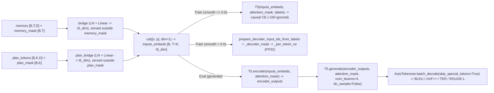

# Training, Optimisation, Loss Functions & Decoder Correctness Audit

**Target Repository:** `DINOv2-PoseGraph-3DCNN-Conformer` (`isl-mega` v`0.2.0`)  
**Audit Scope:** Complete inspection of batching, dataset indexing, optimisation, scheduling, mixed precision, checkpointing, all 10 loss objectives, decoder shifting/generation, evaluation, and runtime testability (`src/isl_mega/*`, `scripts/*`, `configs/*`, `tests/*`).  
**Audit Mode:** Read-only code, AST, bytecode, and environment verification (no source files modified; full training not launched).

---

## Executive Verdict & Local Execution Boundary

1. **Runtime Environment Verification Executed on Host:**
   - Bytecode compilation (`python3 -m compileall -q src scripts tests`) and Python `ast.parse` across all **26** Python files succeeded with **exit code 0**.
   - Probing all host Python interpreters (`/opt/homebrew/bin/python3`, `/Library/Frameworks/Python.framework/Versions/3.14/bin/python3`, `/usr/local/bin/python3`, `/usr/bin/python3`, `/opt/homebrew/opt/python@3.12/bin/python3.12`) confirmed `torch`, `numpy`, `pytest`, `PyYAML`, `transformers`, `timm`, and `sacrebleu` are **not installed** locally. Consequently, runtime `pytest` (`57` discovered `test_*` functions expanding via parametrize to `58` items) and live HF FLAN-T5 / CUDA execution cannot run on this machine. All findings below are proven directly from source semantics, PyTorch/Transformers API contracts, and deterministic simulation of the scheduler code.
2. **Critical Training-Pipeline Bugs Identified (Verified in Source):**
   - **P0 — `amp_dtype: fp16` Immediate Crash ([`scripts/train.py:144-149`](file:///Users/likhith/Codes%20-%20Github./ISLTranslate-ideas/DINOv2-PoseGraph-3DCNN-Conformer/scripts/train.py#L144-L149)):** Calling `torch.nn.utils.clip_grad_norm_(..., error_if_nonfinite=True)` after `scaler.unscale_(optimizer)` throws `RuntimeError` and aborts training on the very first normal FP16 dynamic loss-scale overflow, before `scaler.step()` can skip the step and halve the scale.
   - **P0 — `float16` Subnormal Underflow in `sqrt(... + 1e-8)` ([`src/isl_mega/temporal.py:257`](file:///Users/likhith/Codes%20-%20Github./ISLTranslate-ideas/DINOv2-PoseGraph-3DCNN-Conformer/src/isl_mega/temporal.py#L257)):** IEEE-754 `float16` minimum positive subnormal is ~`5.96e-8` (`1e-8` rounds to exact `0.0`). On static frames or single-frame inputs (`T == 1`), `delta == 0` under `amp_dtype: fp16` evaluates `sqrt(0.0)`, creating `Inf`/`NaN` backward gradients in `salience_net`.
   - **P0 — CUDA Resume Crash on `cuda_rng` ([`src/isl_mega/checkpoint.py:39,53-55`](file:///Users/likhith/Codes%20-%20Github./ISLTranslate-ideas/DINOv2-PoseGraph-3DCNN-Conformer/src/isl_mega/checkpoint.py#L39-L55)):** [`train.py:273`](file:///Users/likhith/Codes%20-%20Github./ISLTranslate-ideas/DINOv2-PoseGraph-3DCNN-Conformer/scripts/train.py#L273) calls `load_checkpoint(..., map_location=device)`. On CUDA, `torch.load` moves `state["cuda_rng"]` tensors onto GPU; while line 53 converts `torch_rng.cpu()`, line 55 omits `.cpu()` before calling `torch.cuda.set_rng_state_all(...)`, which crashes when resuming on GPU or across differing GPU counts. Moreover, `GradScaler` state is never saved/restored and `state["config"]` is never validated on resume.
   - **P0 — Dead Parameters Breaking `test_compact_v3_config_and_motion_disabled_forward_backward` & DDP ([`src/isl_mega/temporal.py:218`](file:///Users/likhith/Codes%20-%20Github./ISLTranslate-ideas/DINOv2-PoseGraph-3DCNN-Conformer/src/isl_mega/temporal.py#L218)):** `self.detail` is unconditionally instantiated when `adaptive_consolidation: true` (`2.36M–4.20M` dead trainable params with `p.grad is None`). Additionally, [`fusion.py:69-70`](file:///Users/likhith/Codes%20-%20Github./ISLTranslate-ideas/DINOv2-PoseGraph-3DCNN-Conformer/src/isl_mega/fusion.py#L69-L70) keeps `projections["motion"]` (`grad == 0.0`) shrinking under AdamW `weight_decay` when `motion.enabled: false`.
   - **P0 — Real FLAN-T5 `generate()` & Tokenisation Never Executed:** Both decoder tests use `DummyT5` / `MockT5` stubs returning fixed tensors (`torch.ones`). Real Hugging Face `T5ForConditionalGeneration` + `AutoTokenizer` has **zero** runtime verification with `ISL-MEGA`.
   - **P1 — Multiple Loss, Scheduler, Selection & SSL Flaws:** Unweighted `pretrain_visual.py` batch loss averaging and global-crop leakage into `"local"` student views; `train.py:250` placing newly initialized `decoder.bridge`/`plan_bridge` at tiny `decoder_lr`; epoch-stepped LR scheduler holding constant `0.5x` LR for an entire first epoch (or skipping warmup when `warmup_epochs == 1` and repeating peak LR at Epochs 2–3); missing `GradAccum`; weak MIL target unit bug (`chars / frames` in [`losses.py:97`](file:///Users/likhith/Codes%20-%20Github./ISLTranslate-ideas/DINOv2-PoseGraph-3DCNN-Conformer/src/isl_mega/losses.py#L97)); silent span-drop fallback in [`compute_ctc_batch`](file:///Users/likhith/Codes%20-%20Github./ISLTranslate-ideas/DINOv2-PoseGraph-3DCNN-Conformer/src/isl_mega/losses.py#L40-L43); checkpoint selection by composite 9-term training loss (`valid_metrics["loss"]`) instead of validation translation NLL/BLEU/chrF++.

---

## A. Dataset, Batching & Collation Audit

| Pipeline Stage | Source & Lines | Implemented Behaviour | Verified Gaps / Risks |
|---|---|---|---|
| **Manifest Indexing** | [`data.py:169-236`](file:///Users/likhith/Codes%20-%20Github./ISLTranslate-ideas/DINOv2-PoseGraph-3DCNN-Conformer/src/isl_mega/data.py#L169-L236) | Eagerly loads JSONL into `list[ManifestRecord]`, enforcing unique non-empty `uid`, `npz`, `source_id`, `translation` (when supervised), valid finite `[start, end]` intervals for `fingerspelling_spans`, and explicit/inferred `fingerspelling_label_known`. | Resolves relative `.npz` relative to `manifest.parent`, whereas [`make_splits.py:24`](file:///Users/likhith/Codes%20-%20Github./ISLTranslate-ideas/DINOv2-PoseGraph-3DCNN-Conformer/scripts/make_splits.py#L24) bakes machine-local absolute paths. No streaming index for very large corpora (>100K clips metadata stays small, though `np.load` reads full RGB per `__getitem__`). |
| **Frame Sampling & Alignment** | [`convert_video_pose_npz.py:46-79`](file:///Users/likhith/Codes%20-%20Github./ISLTranslate-ideas/DINOv2-PoseGraph-3DCNN-Conformer/scripts/convert_video_pose_npz.py#L46-L79), [`data.py:77-121,287-342`](file:///Users/likhith/Codes%20-%20Github./ISLTranslate-ideas/DINOv2-PoseGraph-3DCNN-Conformer/src/isl_mega/data.py#L77-L121) | Retains **100% of decoded video frames** (`BGR->RGB`) with `float64` presentation timestamps (nominal FPS fallback on non-monotonic PTS). `align_pose_to_video` linearly interpolates each landmark only when bracketing gap `<= max_pose_gap` (`0.20s`), invalidating long gaps, then rebases `rel_times = (video_times - video_times[0]).astype(float32)`. | **OOM / batch-padding hazard:** Zero maximum frame cap, chunking, or length-bucketed batch sampler. A single 30 s clip (`T=900`) forces the entire batch to pad to `900` across ViT (`[B,T,4,3,H,W]`) and Conformer (`O(T^2)`). Upstream storage of `video_timestamps` as `float32` at high epoch offsets would silently fail `diff <= 0` in `validate_times`. |
| **Spatial Transforms & ROIs** | [`data.py:31-75,124-154,310-339`](file:///Users/likhith/Codes%20-%20Github./ISLTranslate-ideas/DINOv2-PoseGraph-3DCNN-Conformer/src/isl_mega/data.py#L31-L75) | Enforces `uint8` (`/ 255.0` by dtype) or float `[0, 1]` (rejects `uint16`/NaN/Inf). Applies identical aspect-preserving `letterbox_frames` affine mapping to frames, `pose_xy`, and optional `boxes`, invalidating out-of-bounds pose points and marking full-frame `[0,0,1,1]` body fallback with low quality proxy `box_scores[:, 3] = 0.25`. | Clean coordinate synchronization; relies on upstream extractor never exporting raw un-normalized pixel coordinates (`(0..W, 0..H)`). |
| **Collation & Padding** | [`data.py:380-429`](file:///Users/likhith/Codes%20-%20Github./ISLTranslate-ideas/DINOv2-PoseGraph-3DCNN-Conformer/src/isl_mega/data.py#L380-L429) | Pads `frames`, `timestamps`, `pose_xy`, `pose_confidence`, `boxes`, `box_scores` with `0.0` (`T_max = max(lengths)`) and boolean masks (`pose_valid`, `confidence_known`, `box_valid`, `fingerspelling_spans`) with `False`. Constructs `frame_mask = arange(max_t) < lengths[:, None]`. | Padded `timestamps` = `0.0` makes `dt = 0.0 - t_i` negative for valid neighbor lookups in [`fusion.py:167`](file:///Users/likhith/Codes%20-%20Github./ISLTranslate-ideas/DINOv2-PoseGraph-3DCNN-Conformer/src/isl_mega/fusion.py#L167), safely clamped in `ContinuousTimeLagBias` and excluded by `neighbour_mask`. **Minor leak before stem:** `ReliabilityAwareFusion` emits **nonzero** `fused` vectors on padded positions `t >= L_i` (`self.null` + biases in `output`), which are only zeroed immediately upon entering `MultiScaleTemporalStem` ([`temporal.py:38`](file:///Users/likhith/Codes%20-%20Github./ISLTranslate-ideas/DINOv2-PoseGraph-3DCNN-Conformer/src/isl_mega/temporal.py#L38)). |
| **Label Encoding** | [`train.py:43-51`](file:///Users/likhith/Codes%20-%20Github./ISLTranslate-ideas/DINOv2-PoseGraph-3DCNN-Conformer/scripts/train.py#L43-L51), [`fingerspelling.py:11-26`](file:///Users/likhith/Codes%20-%20Github./ISLTranslate-ideas/DINOv2-PoseGraph-3DCNN-Conformer/src/isl_mega/fingerspelling.py#L11-L26) | `tokenize_targets` uses HF `AutoTokenizer(..., padding=True, truncation=False)` and raises `ValueError` if `seq_len > max_target_tokens`, masking `attention_mask == 0` -> `-100`. Fingerspelling maps lowercased `"a-z0-9-' "` -> `1..39` (`BLANK_ID = 0`). | `encode_characters` raises `ValueError` on any punctuation/symbol (`.`, `,`, `/`, brackets, non-ASCII) **mid-training** in `compute_ctc_batch` unless validated or sanitized upfront. Target length > `max_target_tokens` (`128` in `research_v3_compact.yaml`) aborts epoch rather than filtering at dataset init. |

---

## B. Optimisation, Scheduling, Mixed Precision & Checkpointing Audit

### B.1 Parameter Groups, Weight Decay & Dead Parameters

In [`scripts/train.py:250-261`](file:///Users/likhith/Codes%20-%20Github./ISLTranslate-ideas/DINOv2-PoseGraph-3DCNN-Conformer/scripts/train.py#L250-L261):
```python
decoder_params = [p for n, p in model.named_parameters() if n.startswith("decoder.") and p.requires_grad]
visual_params = [p for n, p in model.named_parameters() if not n.startswith("decoder.") and p.requires_grad]
optimizer = torch.optim.AdamW(param_groups, weight_decay=cfg.train.weight_decay)
```

1. **Randomly Initialized Bridges Assigned Tiny Pretrained-LM LR (`train.py:250`):** `model.decoder` is [`T5VisualDecoder`](file:///Users/likhith/Codes%20-%20Github./ISLTranslate-ideas/DINOv2-PoseGraph-3DCNN-Conformer/src/isl_mega/decoder.py#L18-L26), which contains **freshly initialized** `decoder.bridge` (`LayerNorm + Linear`) and `decoder.plan_bridge` (`LayerNorm + Linear`) alongside pretrained `decoder.model` (FLAN-T5). Matching `"decoder."` puts both untrained visual-language adapters at `decoder_lr` (`1e-5` in `research.yaml`, `5e-5` in `research_v3_compact.yaml`, `2e-5` in `smoke*.yaml`)—10x smaller than `visual_lr`. Only `decoder.model.` parameters should receive `decoder_lr`.
2. **Uniform Weight Decay on Normalization, Biases & Scalar Gates:** Passing raw parameter lists to `AdamW(weight_decay=0.01)` decays all `1-D` normalization weights (`LayerNorm`, T5 `RMSNorm`), linear biases, embeddings (`cls`, `pos`, `type_embedding`, `null`, `queries`, `slot_pos`, `RelativeTimeBias.table`), and learned scalar gates (`CrossArticulatorGraph.gate`, `log_slot_sigma`, `log_prior_scale`). Decaying `cross_graph.gate` (`init=0.1`) toward `0` shrinks cross-articulator interaction on low-gradient steps.
3. **Unreachable & Zero-Grad Parameters in Optimizer State:**
   - `HierarchicalTemporalEncoder.detail` ([`temporal.py:218`](file:///Users/likhith/Codes%20-%20Github./ISLTranslate-ideas/DINOv2-PoseGraph-3DCNN-Conformer/src/isl_mega/temporal.py#L218)) is always allocated even when `adaptive_consolidation: true`, producing `10` parameter tensors (`2.36M` params in compact v3, `4.20M` in v2 research) with `p.grad is None` -> breaks `test_compact_v3_config_and_motion_disabled_forward_backward` (`tests/test_novel_v2.py:485`) and would fail PyTorch `DDP` unused-parameter checks. Note that AdamW skips `p.grad is None` weights cleanly in single-GPU updates, leaving them frozen at random init while holding state memory.
   - When `motion.enabled: false` (`research_v3_compact.yaml:43`), `model.fusion.projections["motion"]` (`fusion.py:69-70`, ~`396K` params in v3 compact) and `stream_slope[:, 8]` / `stream_bias[:, 8]` / `type_embedding[:, :, 8, :]` still execute inside `forward_with_aux` on zeroed stream 8 before being zero-masked (`weights[:, :, 8] == 0`), giving `p.grad == 0.0` (not `None`). In decoupled `AdamW`, **`weight_decay` continuously shrinks zero-gradient parameters every step** needlessly.

### B.2 Learning-Rate Scheduler Anomalies

Simulated directly from [`build_epoch_scheduler`](file:///Users/likhith/Codes%20-%20Github./ISLTranslate-ideas/DINOv2-PoseGraph-3DCNN-Conformer/scripts/train.py#L172-L186):

| Config / Regime | `epochs` | `warmup_ratio` | `warmup_epochs` (`round`) | Simulated LR Multiplier Sequence (`epoch 1 .. N`, then post-final `step()`) | Diagnosis |
|---|---:|---:|---:|---|---|
| `research.yaml` | 40 | 0.05 | `round(2.0) = 2` | `[0.5, 1.0, 1.0, 0.9737, ..., 0.0263, 0.0]` | **Flat 0.5x for all of Epoch 1** (10k–59k steps on ISLTranslate/iSign!); **repeats peak `1.0` at Epochs 2 & 3.** |
| `research_v3_compact.yaml` | 30 | 0.05 | `round(1.5) = 2` | `[0.5, 1.0, 1.0, 0.9643, ..., 0.0357, 0.0]` | Same: full first epoch at constant `0.5 * lr`, plateau `1.0` at Epochs 2 & 3. |
| Example `epochs=10, wr=0.10` (or test `4, 0.25`) | 4 / 10 | 0.25 / 0.10 | `1` | `4 ep: [1.0, 1.0, 0.6667, 0.3333, 0.0]` | **Completely skips warmup** whenever `warmup_epochs == 1` (`factor(0) = 1 / 1 = 1.0`) and repeats peak `1.0` at Epoch 2! |
| `smoke.yaml` / `smoke_v2.yaml` | 1 | 0.05 | `round(0.05) = 0` | `[1.0, 0.0]` | OK for 1-epoch smoke. |
| [`pretrain_visual.py:34`](file:///Users/likhith/Codes%20-%20Github./ISLTranslate-ideas/DINOv2-PoseGraph-3DCNN-Conformer/scripts/pretrain_visual.py#L34) | CLI | N/A | **None** | Constant `lr=2e-4`, `wd=0.04` forever | **No scheduler at all** (DINOv2/SSL recipes normally require cosine LR + warmup + WD schedule to prevent prototype collapse). |

### B.3 Gradient Accumulation, Clipping & Mixed Precision (`bf16` / `fp16`)

1. **No Gradient Accumulation:** `TrainConfig` (`config.py:241-264`) lacks `grad_accum_steps`. With `batch_size: 2` (`research.yaml:97`) or `4` (`research_v3_compact.yaml:108`), micro-batches simultaneously act as the full optimizer step and as the batch contrast pool for source-aware InfoNCE (`losses.py:128`) and `batch_swap_or_zero` counterfactuals (`decoder.py:140`).
2. **CRITICAL `fp16` `GradScaler` + `error_if_nonfinite=True` Crash (`train.py:144-149`):**
   ```python
   scaler.scale(loss).backward()
   scaler.unscale_(optimizer)
   torch.nn.utils.clip_grad_norm_(model.parameters(), cfg.train.grad_clip_norm,
                                  error_if_nonfinite=True)
   scaler.step(optimizer)
   scaler.update()
   ```
   Under `amp_dtype: fp16`, dynamic loss scaling intentionally expects occasional `inf`/`nan` overflow gradients on early iterations; `scaler.step(optimizer)` inspects unscaled gradients, skips the optimizer update if non-finite, and halves the loss scale via `scaler.update()`. Passing `error_if_nonfinite=True` **throws `RuntimeError` inside `clip_grad_norm_` before `scaler.step()` executes**, killing training on the first overflow.
3. **CRITICAL `float16` Subnormal Underflow in `torch.sqrt(... + 1e-8)` (`temporal.py:257`, `pose.py:69,77,124,255`):**
   In IEEE-754 `float16`, numbers below `2^-25` (approx `2.98e-8`) round to **`0.0`**. In [`temporal.py:257`](file:///Users/likhith/Codes%20-%20Github./ISLTranslate-ideas/DINOv2-PoseGraph-3DCNN-Conformer/src/isl_mega/temporal.py#L257):
   `delta_norm = torch.sqrt(delta.square().sum(dim=-1, keepdim=True) + 1e-8) / math.sqrt(d)`
   Because `fine` (hence `delta`) exits `MultiScaleTemporalStem` in `float16` inside `torch.autocast(..., dtype=float16)` (`train.py:84`), `+ 1e-8` vanishes to `+ 0.0`! On frame `t=0` (where `delta[:, 0] == 0`), padded positions, or static consecutive frames, **`sqrt(0.0)` produces `0.5 / 0.0 = Inf` (`0 * Inf = NaN`) in backward**. Notice line 284 of the same file explicitly used `.float()` + `1e-6` for `slot_std` (`+ 1e-6`), leaving line 257 unprotected. (In `pose.py`, `xy` arrives in `float32`, protecting coordinate diffs unless upstream casts `pose_xy` to fp16, though explicit `.float()` is still safer.)
4. **Autocast Wrapping Losses & Inference Precision Mismatch:** `train.py:84-141` wraps all loss sums inside `torch.autocast`; while `decoder._per_token_ce`, `entropic_semantic_ot`, `compute_ctc_batch`, `compute_fingerspelling_spotting_loss`, `compute_fusion_entropy_loss`, and `compute_cross_modal_alignment_loss` cast key reductions to `.float()`, `planning._grounding_losses` casts output back `.to(plan.dtype)` (`planning.py:149`), and `evaluate.py` runs inference strictly in `float32` without `autocast`. Meanwhile `pretrain_visual.py` omits `autocast` completely.

### B.4 Checkpointing, Resume, Early Stopping & Seeding

1. **CRITICAL CUDA Resume Bug ([`checkpoint.py:39,53-55`](file:///Users/likhith/Codes%20-%20Github./ISLTranslate-ideas/DINOv2-PoseGraph-3DCNN-Conformer/src/isl_mega/checkpoint.py#L39-L55) & [`train.py:273`](file:///Users/likhith/Codes%20-%20Github./ISLTranslate-ideas/DINOv2-PoseGraph-3DCNN-Conformer/scripts/train.py#L273)):**
   - `train.py:273` passes `map_location=device`. When `device` is CUDA, `torch.load` moves **every saved tensor**—including `state["torch_rng"]` and each element of `state["cuda_rng"]`—onto CUDA memory.
   - Line 53 explicitly fixes CPU RNG via `state["torch_rng"].cpu()`.
   - Line 55 calls `torch.cuda.set_rng_state_all(state["cuda_rng"])` **without `.cpu()`** (and without checking `len(state["cuda_rng"]) == torch.cuda.device_count()`). In PyTorch, `torch.cuda.set_rng_state` expects **CPU `torch.ByteTensor`** objects and raises an error on CUDA tensors or mismatched GPU counts.
2. **Missing `GradScaler` State & Unvalidated Config on Resume:** `save_checkpoint` / `load_checkpoint` never saves/restores `scaler.state_dict()`. `train.py:272-279` ignores `state["config"]` completely—resuming with modified `amp_dtype`, loss weights, `freeze_decoder`, or `epochs` runs silently (or fails on `optimizer.load_state_dict` if trainable parameter groups changed, or breaks LR continuity if `epochs` increased because `LambdaLR` recomputes `factor` with the new `epochs`).
3. **Partial Debug Checkpoints & Wrong `best_valid.pt` Criterion (`train.py:330-345`):**
   - If `--max-steps` is supplied, `train.py` still overwrites `last.pt` and `best_valid.pt` after a truncated debug epoch before `break`.
   - `is_best = valid_metrics["loss"] < best_valid` selects `best_valid.pt` using the **sum of all 9 training objectives** rather than `valid_metrics["translation"]` or corpus BLEU/chrF++. Auxiliary objectives (`ot`, `plan_div`, `cf_loss`, batch-sparse `ctc`/`fs_spot`) can lower composite validation loss even when translation quality worsens.
4. **No Early Stopping & Incomplete Determinism:** No patience/early-stopping mechanism exists. `seed_everything` (`train.py:29-34`) omits `DataLoader(..., worker_init_fn=..., generator=...)` and `cudnn` determinism flags; `pretrain_visual.py` has no seeding at all. `train.py:301` logs only `visual_lr` (not `decoder_lr`) in `metrics.csv`, and appends if header matches (`L290-294`) without truncating uncommitted rows if crash occurred mid-epoch cleanly (actually CSV is written once per epoch at `L327-328`, safe against mid-epoch duplicates).

---

## C. Mathematical & Code Audit of All 10 Loss Objectives

No **uncertainty calibration / Dirichlet / evidential loss** (the gating MLP `reliability_net` receives only implicit translation/fusion gradients) and no **masked reconstruction / MAE objective** exist in `ISL-MEGA`. Below are all **10 implemented objectives** (9 supervised/regularization terms combined in `train.py:131-141`, plus 1 SSL term in `pretrain_visual.py`).

### C.1 Complete Objective Summary Matrix

| # | Objective & Source | Config Weight (`research` / `v3_compact`) | Masking & Missing-Label Policy | Normalization Scope | Critical Bugs / Scientific Issues |
|---|---|---|---|---|---|
| **1** | Translation Cross-Entropy [`decoder.py:51-63,92-108`](file:///Users/likhith/Codes%20-%20Github./ISLTranslate-ideas/DINOv2-PoseGraph-3DCNN-Conformer/src/isl_mega/decoder.py#L51-L108) | `1.0` / `1.0` (`label_smoothing: 0.0`) | Ignores `labels == -100` (`attention_mask == 0`). `_decoder_mask` keeps index `0` (`START==PAD=0`) visible. | Per-valid-token batch mean (`L62`); **epoch log** averages batch means by `batch_examples` (`train.py:163`). | No real HF FLAN-T5 execution tested. Epoch CSV log weights short-target batches equally per clip rather than per token. |
| **2** | Fingerspelling Character CTC [`losses.py:22-60`](file:///Users/likhith/Codes%20-%20Github./ISLTranslate-ideas/DINOv2-PoseGraph-3DCNN-Conformer/src/isl_mega/losses.py#L22-L60), [`fingerspelling.py:127-140`](file:///Users/likhith/Codes%20-%20Github./ISLTranslate-ideas/DINOv2-PoseGraph-3DCNN-Conformer/src/isl_mega/fingerspelling.py#L127-L140) | `0.10` / `0.10` | Filters empty text & keeps frames with `ctc_available` (`(left or right) & frame_mask`), optionally intersected with `span_targets`. Rejects `T_eff < len(seq) + repeated`. Returns `logits.sum()*0` if batch has no valid clip. | PyTorch `F.ctc_loss(..., reduction="mean")`: normalizes each sequence by `target_length`, then averages over valid clips in batch. | **(a) Does NOT inspect `label_known`** (crashes if unannotated row has placeholder text); **(b) Silent fallback on `L42-43`:** when `span_known=True` and `spanned.sum() < min_steps`, falls back to the **entire clip** instead of skipping!; **(c)** Punctuation/non-ASCII crashes mid-epoch in `encode_characters`. |
| **3** | Fingerspelling Spotting / MIL [`losses.py:63-103`](file:///Users/likhith/Codes%20-%20Github./ISLTranslate-ideas/DINOv2-PoseGraph-3DCNN-Conformer/src/isl_mega/losses.py#L63-L103) | `0.05` / `0.05` | Respects `fingerspelling_label_known` (skips unknown). Exact frame BCE if `span_known=True`; weak MIL + sparsity if `text` nonempty; `0.25*BCE(..., 0)` if `text == ""`. | Macro-average over eligible clips in batch (`stack(losses).mean()`). | **(a) Unit mismatch on `L97`:** `len(text.strip()) / len(logits_i)` divides **characters** by **video frames** with a `0.10` floor (forcing >=10% active frames on long clips); **(b)** Unweighted BCE (`1:1`) on sparse FS frames; **(c)** `amax()` puts all positive MIL gradient on a single peak frame. |
| **4** | Entropic Semantic OT (Visual + Plan) [`decoder.py:111-134,200-238`](file:///Users/likhith/Codes%20-%20Github./ISLTranslate-ideas/DINOv2-PoseGraph-3DCNN-Conformer/src/isl_mega/decoder.py#L111-L134) | `0.05` (`plan_alpha=0.5`) / `0.0` | Masks visual slots by `memory_mask`, active plans by `plan_mask`, and text tokens by `text_ids != pad_id`. Target text encoder embeds are detached (`no_grad`). | Averages KL-regularized Sinkhorn cost over valid clips (`L238`), FP32 unrolled (`iterations=30`, `eps=0.08`). | Aligns monotonic/non-monotonic ISL frames uniformly onto English subwords **including `EOS`** (`mu=1/T, nu=1/L`), assuming all function words have frame mass. |
| **5** | Source-Aware RGB↔Pose InfoNCE [`losses.py:128-188`](file:///Users/likhith/Codes%20-%20Github./ISLTranslate-ideas/DINOv2-PoseGraph-3DCNN-Conformer/src/isl_mega/losses.py#L128-L188) | `0.05` / `0.05` (`temp=0.07`) | Pairs `(left, right, face, body)` RGB vs pose only where both `stream_available` (`& frame_mask`) are True. Masks out same-`source_id` negatives. Returns `0` if `<2` unique `source_id`s. | Symmetric row/col CrossEntropy over all valid `(b, t, region)` pairs in batch (quadratic memory in `B*T`). | **(a)** `batch_size=2` gives 0 loss on same-source batches and only 1 negative video otherwise; **(b) Temporal shortcutting:** masking all same-source frames removes **intra-clip temporal negatives**, letting static signer/background identity solve InfoNCE; **(c)** Docstring says `interactions` while `train.py:116` passes pre-interaction `modality_embeddings` (`model.py:160`). |
| **6** | Plan Diversity [`planning.py:115-126`](file:///Users/likhith/Codes%20-%20Github./ISLTranslate-ideas/DINOv2-PoseGraph-3DCNN-Conformer/src/isl_mega/planning.py#L115-L126) | `0.05` / `0.0` | Evaluated strictly over active query pairs `plan_mask_i & plan_mask_j & (i != j)` on layer-averaged attention + final plan embeddings. | Pairwise mean over valid query pairs across batch. | Computed even when `plan_diversity_weight == 0` (negligible). When `dynamic_routing=False`, short clips (`T < K`) hit an inescapable orthogonality rank floor. |
| **7** | Plan Temporal Ordering [`planning.py:128-149`](file:///Users/likhith/Codes%20-%20Github./ISLTranslate-ideas/DINOv2-PoseGraph-3DCNN-Conformer/src/isl_mega/planning.py#L128-L149) | `0.02` / `0.0` (`margin=0.0`) | Restricted to `valid_len >= 2` and consecutive active slots `plan_mask[:, :-1] & plan_mask[:, 1:]`. Uses normalized elapsed timestamps. | Pairwise mean over active adjacent pairs across batch. | Soft assumption of monotonic frame coverage across latent queries (acceptable as queries are reordered via T5 cross-attention). |
| **8** | Fusion Stream Entropy [`losses.py:105-125`](file:///Users/likhith/Codes%20-%20Github./ISLTranslate-ideas/DINOv2-PoseGraph-3DCNN-Conformer/src/isl_mega/losses.py#L105-L125) | `0.02` / `0.0` | Restricted to valid frames (`memory_mask`) having `>= 2` available streams (`stream_available`). | Mean over active `(b, t)` frames (`count >= 2`). | **Design tension:** Minimizing `(1 - H / log(num_avail))` pulls softmax weights toward uniform `1 / num_avail`, directly fighting reliability gating on corrupted/fallback streams (intentionally disabled in `v3_compact`). |
| **9** | Counterfactual Grounding [`decoder.py:135-173`](file:///Users/likhith/Codes%20-%20Github./ISLTranslate-ideas/DINOv2-PoseGraph-3DCNN-Conformer/src/isl_mega/decoder.py#L135-L173) | `0.05` / `0.0` (`margin=0.5, kl=0.2`) | Detached `roll(1)` donor embeddings when targets differ, falling back per sample to 1 zero token (`zero_mask[:, 0]=1`) when `same_target` or `B==1`. Masked by `valid_tok`. | Valid-token mean across batch (`denom = valid_tok.sum().clamp_min(1)`). | **(a) Runs during validation** in `train.py:88-90` (doubling validation T5 compute + polluting checkpoint selection); **(b)** `-KL(p_real, p_cf)` pushes `p_real` away from `p_cf` even on function words/`EOS` where visual & blank language priors rightfully agree! |
| **10** | Sign-Aware Global↔Local SSL [`pretraining.py:58-81`](file:///Users/likhith/Codes%20-%20Github./ISLTranslate-ideas/DINOv2-PoseGraph-3DCNN-Conformer/src/isl_mega/pretraining.py#L58-L81), [`pretrain_visual.py`](file:///Users/likhith/Codes%20-%20Github./ISLTranslate-ideas/DINOv2-PoseGraph-3DCNN-Conformer/scripts/pretrain_visual.py) | Standalone SSL stage | Global frame teacher (detached, centered, `τ_t = 0.04`) -> valid local crop students (`τ_s = 0.10`). Skips batches with no valid crops. | Mean over kept crops `local[keep]`; **epoch script averages per batch (`running/count`), not per crop/clip!** | **(a)** `local` (`4` ROIs) includes ROI 3 **`body`**, which is full-frame fallback `[0,0,1,1]` whenever pose is absent—distilling global frame into itself!; **(b)** Runs all `B * T` frames + `4*B*T` crops in one step (OOM at `518px`); **(c)** Missing split-disjointness gate against `valid`/`test`. |

### C.2 Exact Mathematical Definitions

1. **Translation Cross-Entropy (`decoder.py:51-63`):** For valid mask `m_{b,l} = 1[y_{b,l} != -100]` and log-probabilities `l_{b,l} = log softmax(z_{b,l})`:
$$\mathcal{L}_{\text{trans}} = \frac{1}{\max\left(\sum_{b,l} m_{b,l},\, 1\right)} \sum_{b,l} m_{b,l} \left[ (1 - \varepsilon)\left(-\ell_{b,l,y_{b,l}}\right) + \varepsilon \left(-\frac{1}{|V|} \sum_{v=1}^{|V|} \ell_{b,l,v}\right) \right]$$

2. **Fingerspelling Spotting (`losses.py:88-102`):** On valid frame set `V_i = {t < L_i : avail_{i,t}}` (when `label_known_i = True`):
$$\mathcal{L}_{\text{spot}, i} = \begin{cases} \frac{1}{|\mathcal{V}_i|} \sum_{t \in \mathcal{V}_i} \text{BCE}(s_{i,t}, \text{span}_{i,t}), & \text{span\_known}_i = \text{True} \\ \text{BCE}\!\left(\max_{t \in \mathcal{V}_i} s_{i,t},\, 1\right) + \frac{1}{2}\left(\frac{1}{|\mathcal{V}_i|}\sum_{t \in \mathcal{V}_i} \sigma(s_{i,t}) - \min\!\left(0.65, \max\!\left(0.10, \frac{|\text{text}_i|}{|\mathcal{V}_i|}\right)\right)\right)^2, & \text{text}_i \neq \text{""} \\ \frac{1}{4|\mathcal{V}_i|} \sum_{t \in \mathcal{V}_i} \text{BCE}(s_{i,t}, 0), & \text{text}_i = \text{""} \end{cases}$$

3. **Unconstrained Entropic Semantic OT (`decoder.py:219-237`):** For normalized visual/plan embeddings `a_hat` (`[N, d]`) and detached T5 target text embeddings `b_hat` (`[M, d]`), cosine cost `C_{uv} = max(0, 1 - <a_hat_u, b_hat_v>)`, uniform marginals `mu_u = 1/N`, `nu_v = 1/M`, and 30 Sinkhorn log-updates giving coupling `P*`:
$$\mathcal{L}_{\text{OT}} = \sum_{u=1}^{N}\sum_{v=1}^{M} P^\star_{uv} C_{uv} + \varepsilon \sum_{u,v} P^\star_{uv} \log \frac{P^\star_{uv}}{\mu_u \nu_v}, \qquad \mathcal{L}_{\text{OT,total}} = (1-\alpha)\mathcal{L}_{\text{OT,vis}} + \alpha\mathcal{L}_{\text{OT,plan}}$$

4. **Source-Aware Cross-Modal InfoNCE (`losses.py:172-188`):** Collecting valid RGB/pose pairs `k in {1..P}` across streams `((0,4),(1,5),(2,7),(3,6))` with L2-normalized `(a_k, p_k)` and negative-eligibility mask `M_{kl} = 1[k = l or src(k) != src(l)]`:
$$\tilde{S}_{kl} = \begin{cases} \langle \hat{a}_k, \hat{p}_l \rangle / \tau, & M_{kl} = 1 \\ \text{min\_f32}, & M_{kl} = 0 \end{cases}, \qquad \mathcal{L}_{\text{InfoNCE}} = \frac{1}{2}\left(\text{CE}(\tilde{S}, I) + \text{CE}(\tilde{S}^\top, I)\right)$$

5. **Plan Diversity & Temporal Ordering (`planning.py:116-148`):** With active query mask `m_plan[b,k]`, unit-normalized layer-mean attention rows `g_hat[b,k]`, normalized plan vectors `p_hat[b,k]`, normalized timestamps `tau[b,t]` in `[0, 1]`, and temporal centers `mu[b,k] = sum_t(g_{b,k,t} * tau_{b,t}) / max(sum_t(g_{b,k,t}), 1e-6)`:
$$\mathcal{L}_{\text{div}} = \frac{1}{|P|}\sum_{(b,i \neq j) \in P} \left( \langle \hat{g}_{b,i}, \hat{g}_{b,j} \rangle^2 + 0.25 \langle \hat{p}_{b,i}, \hat{p}_{b,j} \rangle^2 \right), \qquad \mathcal{L}_{\text{ord}} = \frac{1}{|S|}\sum_{(b,k) \in S} \max\!\left(0,\, \mu_{b,k} - \mu_{b,k+1} + m_{\text{ord}}\right)$$

6. **Fusion Normalized Entropy & Counterfactual Grounding (`losses.py:120-125`, `decoder.py:162-172`):**
$$\mathcal{L}_{\text{ent}} = \frac{1}{|M|}\sum_{(b,t) \in M} \left(1 - \frac{-\sum_{s \in \mathcal{A}_{b,t}} \tilde{w}_{b,t,s} \log \tilde{w}_{b,t,s}}{\log |\mathcal{A}_{b,t}|}\right)$$
$$\mathcal{L}_{\text{CF}} = \frac{1}{2\,\sum m_{b,l}} \sum_{b,l} m_{b,l} \Big[ \max\!\big(0,\; m_{\text{NLL}} - \text{clip}(\text{NLL}^{\text{cf}}_{b,l} - \text{NLL}^{\text{real}}_{b,l}, -5, 5)\big) + \max\!\big(0,\; m_{\text{KL}} - \text{KL}(p^{\text{real}}_{b,l} \parallel p^{\text{cf}}_{b,l})\big) \Big]$$

---

## D. Decoder & Inference Correctness Trace



### Detailed Decoder Verification

1. **Tokenisation & Special Tokens ([`train.py:43-51`](file:///Users/likhith/Codes%20-%20Github./ISLTranslate-ideas/DINOv2-PoseGraph-3DCNN-Conformer/scripts/train.py#L43-L51), [`evaluate.py:54-55`](file:///Users/likhith/Codes%20-%20Github./ISLTranslate-ideas/DINOv2-PoseGraph-3DCNN-Conformer/scripts/evaluate.py#L54-L55)):**
   - FLAN-T5 uses `pad_token_id = 0`, `decoder_start_token_id = 0`, `eos_token_id = 1`, `unk_token_id = 2`.
   - `tokenize_targets` sets `truncation=False` and checks `input_ids.shape[1] > max_tokens`, preventing silent truncation of long reference translations, then fills `attention_mask == 0` with `-100` while retaining `eos_token_id = 1` as a supervised target.
   - **Gap:** No FLAN-T5 instruction prompt (e.g., `"Translate Indian Sign Language to English: "`) is prepended or embedded, which relies on fine-tuning (`freeze_decoder: false`) and reduces zero/low-shot alignment when `freeze_decoder: true`.
2. **Target Shifting & `_decoder_mask` ([`decoder.py:45-49,92-107`](file:///Users/likhith/Codes%20-%20Github./ISLTranslate-ideas/DINOv2-PoseGraph-3DCNN-Conformer/src/isl_mega/decoder.py#L45-L49)):**
   - Verified token-by-token on `labels = [t_0, t_1, EOS, -100, -100]`: `prepare_decoder_input_ids_from_labels` yields `[0, t_0, t_1, EOS, 0]`, and `_decoder_mask` yields `[1, 1, 1, 1, 0]`—correctly keeping position `0` (`START == PAD == 0`) unmasked while masking padded decoder inputs (`j = 4`, where `labels[3] == -100`). Note that position `3` (`EOS` input -> target `-100`) remains visible in `decoder_mask` (matching Hugging Face's attention pattern when only `labels` is supplied, without affecting earlier causal positions `0..2`).
   - **Critical Verification Gap:** Real `transformers.T5ForConditionalGeneration` has **never** been executed against `T5VisualDecoder`; [`test_architecture.py:489-520`](file:///Users/likhith/Codes%20-%20Github./ISLTranslate-ideas/DINOv2-PoseGraph-3DCNN-Conformer/tests/test_architecture.py#L489-L520) and [`test_novel_v2.py:66-105`](file:///Users/likhith/Codes%20-%20Github./ISLTranslate-ideas/DINOv2-PoseGraph-3DCNN-Conformer/tests/test_novel_v2.py#L66-L105) substitute `DummyT5`/`MockT5`.
3. **Autoregressive Beam Search & Evaluation Mismatches ([`decoder.py:176-197`](file:///Users/likhith/Codes%20-%20Github./ISLTranslate-ideas/DINOv2-PoseGraph-3DCNN-Conformer/src/isl_mega/decoder.py#L176-L197), [`evaluate.py:65-94`](file:///Users/likhith/Codes%20-%20Github./ISLTranslate-ideas/DINOv2-PoseGraph-3DCNN-Conformer/scripts/evaluate.py#L65-L94), [`metrics.py:8-40`](file:///Users/likhith/Codes%20-%20Github./ISLTranslate-ideas/DINOv2-PoseGraph-3DCNN-Conformer/src/isl_mega/metrics.py#L8-L40)):**
   - `T5VisualDecoder.generate` explicitly runs `self.model.encoder(inputs_embeds=embeddings, attention_mask=mask.long())` and passes `encoder_outputs` + `attention_mask` into `self.model.generate(num_beams=4, max_new_tokens=..., length_penalty=1.0, do_sample=False)`.
   - **Train/Eval Precision Mismatch:** `train.py` uses `bf16` autocast (`research*.yaml`), whereas `evaluate.py` never enables `torch.autocast`, running full `float32` inference (doubling activation memory vs `bf16`).
   - **Unvalidated String Comparison:** `evaluate.py:86` compares `tokenizer.batch_decode(generated, skip_special_tokens=True)` directly against un-normalized `batch["translations"]`, so any `<unk>`-mapped symbols in raw captions or SentencePiece whitespace/Unicode differences show up as uncalibrated metric drops.
   - **No Repetition / Min-Length Guards & Warning-Prone Generation Config:** Missing `no_repeat_ngram_size` / repetition control options, and `scripts/evaluate.py` omits seed/amp/checkpoint-epoch logging in `diagnostics.json`.

---

## E. Audit of the 10 Common Silent Failures

1. **Incorrect label shifting:** **Clean in logic, untested against HF T5.** `_decoder_mask` + `prepare_decoder_input_ids_from_labels` preserves `START == PAD == 0` visibility (`decoder.py:45-49`), verified only against `MockT5`/`DummyT5`.
2. **Unknown labels treated as negatives:** **Fixed in FS spotting (`label_known`, `losses.py:82`), residual gap in CTC (`losses.py:22`).** `compute_ctc_batch` does not check `label_known`, relying on `fingerspelling_text` being `""`; unexpected placeholders or punctuation crash `encode_characters` mid-epoch.
3. **Incorrect loss normalisation:** **Present in 3 places.** (i) MIL `target_frac = len(text_chars) / len(frames)` mixes characters and frames with an artificial `0.10` floor (`losses.py:97`); (ii) `train.py:163` aggregates per-token translation CE across batches using clip count (`batch_examples`) rather than valid token count; (iii) spotting BCE is macro-averaged equally per clip (`losses.py:102`) while entropy (`losses.py:125`) and InfoNCE (`losses.py:187`) average equally per valid frame/pair.
4. **Batch-averaged rather than example-weighted loss:** **Fixed in `train.py:155-169`, STILL BROKEN in `pretrain_visual.py:57-58`** (`running / count` averages batch means unconditionally). Note also that PyTorch optimizer steps in `train.py` weight final partial batches identically to full batches.
5. **Padding included in losses:** **Protected downstream (`temporal.stem` masks at `L38`, losses slice `[:length][valid]` or mask via `memory_mask`/`plan_mask`/`-100`).** Subtle non-zero `fused` embeddings on padded slots `t >= L_i` exist temporarily at the exit of `ReliabilityAwareFusion` (`fusion.py:196`) before `temporal.stem`.
6. **Detached gradients / dead params:** **Active bug on `temporal.detail` (`temporal.py:218`)** (`grad is None` whenever `adaptive_consolidation=True`, causing `test_compact_v3_config_and_motion_disabled_forward_backward` to fail); **`fusion.projections["motion"]`** (`grad == 0.0`) still suffers AdamW `weight_decay` when `motion.enabled=False`. Also `decoder.bridge`/`plan_bridge` get decayed/under-stepped at `decoder_lr`.
7. **Invalid CTC lengths:** **Silent span-fallback bug at `losses.py:40-46`.** When `span_known[i]` is True and `spanned.sum() < len(seq) + repeated`, `compute_ctc_batch` silently discards `span_targets` and supervises the entire clip with that fingerspelling word.
8. **NaNs and infinities:** **Two critical `fp16` bugs:** (i) `clip_grad_norm_(..., error_if_nonfinite=True)` (`train.py:147`) aborts `fp16` training on the first `GradScaler` overflow; (ii) `sqrt(... + 1e-8)` (`temporal.py:257`) underflows `1e-8 -> 0.0` in `fp16`, giving `NaN` backward gradients on `T==1` or static frames. Attention all-masked guards (`any_valid`) in `pose.py`, `fusion.py`, `temporal.py`, and `planning.py` are otherwise sound.
9. **Train/evaluation mismatch:** **Present.** `best_valid.pt` minimizes 9-loss sum (`valid_metrics["loss"]`) instead of translation NLL or BLEU; `train.py` runs `bf16` while `evaluate.py` runs `float32`; counterfactual doubles validation forward cost; `evaluate.py` skips raw reference text normalization/charset check; real HF FLAN-T5 `generate()` never executed.
10. **Incorrect checkpoint restoration:** **Broken on CUDA.** `map_location=device` + `torch.cuda.set_rng_state_all(state["cuda_rng"])` without `.cpu()` ([`checkpoint.py:55`](file:///Users/likhith/Codes%20-%20Github./ISLTranslate-ideas/DINOv2-PoseGraph-3DCNN-Conformer/src/isl_mega/checkpoint.py#L55)) crashes GPU resume; `GradScaler` state is lost; `state["config"]` is unvalidated on resume; `--max-steps` overwrites checkpoints.

---

## F. Minimum Corrections Needed to Make the Training Pipeline Scientifically Reliable

Apply the following **minimal, targeted fixes** (listed in strict priority order) before launching any real GPU training experiment:

1. **Guard Unused `self.detail` & Unused Motion Projection (`P0`):**
   - In [`HierarchicalTemporalEncoder.__init__`](file:///Users/likhith/Codes%20-%20Github./ISLTranslate-ideas/DINOv2-PoseGraph-3DCNN-Conformer/src/isl_mega/temporal.py#L218), instantiate `self.detail` only when `not config.adaptive_consolidation` (else `None`).
   - In [`ReliabilityAwareFusion`](file:///Users/likhith/Codes%20-%20Github./ISLTranslate-ideas/DINOv2-PoseGraph-3DCNN-Conformer/src/isl_mega/fusion.py#L64-L70) / [`train.py`](file:///Users/likhith/Codes%20-%20Github./ISLTranslate-ideas/DINOv2-PoseGraph-3DCNN-Conformer/scripts/train.py#L250-L261), either omit disabled `motion` projection params or exclude zero-grad / disabled modules from AdamW `weight_decay`.
2. **Fix Mixed-Precision Crash & `fp16` Underflow (`P0`):**
   - In [`scripts/train.py:146-147`](file:///Users/likhith/Codes%20-%20Github./ISLTranslate-ideas/DINOv2-PoseGraph-3DCNN-Conformer/scripts/train.py#L146-L147), remove `error_if_nonfinite=True` when `scaler.is_enabled()` (or pass `error_if_nonfinite=False`) so `scaler.step()` and `scaler.update()` handle normal `fp16` overflows cleanly; run `run_epoch` losses outside `autocast` in FP32.
   - In [`src/isl_mega/temporal.py:257`](file:///Users/likhith/Codes%20-%20Github./ISLTranslate-ideas/DINOv2-PoseGraph-3DCNN-Conformer/src/isl_mega/temporal.py#L257) and [`src/isl_mega/pose.py`](file:///Users/likhith/Codes%20-%20Github./ISLTranslate-ideas/DINOv2-PoseGraph-3DCNN-Conformer/src/isl_mega/pose.py#L69), compute `sqrt(sum + 1e-6)` in `.float()` (FP32) before downcasting.
3. **Fix CUDA Checkpoint Restoration & Validation Model Selection (`P0`):**
   - In [`src/isl_mega/checkpoint.py:54-55`](file:///Users/likhith/Codes%20-%20Github./ISLTranslate-ideas/DINOv2-PoseGraph-3DCNN-Conformer/src/isl_mega/checkpoint.py#L54-L55), move each tensor in `state["cuda_rng"]` to `.cpu()` and verify `len == torch.cuda.device_count()`; save/restore optional `scaler` `state_dict()`, verify `state["config"]` compatibility on `--resume`, and avoid saving `last.pt`/`best_valid.pt` when `--max-steps` is set.
   - In [`scripts/train.py:330`](file:///Users/likhith/Codes%20-%20Github./ISLTranslate-ideas/DINOv2-PoseGraph-3DCNN-Conformer/scripts/train.py#L330), select `best_valid.pt` strictly by **`valid_metrics["translation"]`** (or validation corpus chrF++/BLEU) rather than composite 9-term loss, disable `counterfactual_grounding` during validation, and weight logged translation CE by valid token count.
4. **Fix Optimizer Parameter Grouping & Per-Step Scheduler (`P1`):**
   - Route `decoder.bridge.*` and `decoder.plan_bridge.*` to `visual_lr` (leaving only `decoder.model.*` on `decoder_lr`), separate bias / LayerNorm / RMSNorm / embeddings / scalar gates into a `weight_decay = 0.0` parameter group, add `grad_accum_steps`, and replace the epoch-level LR scheduler with a **per-optimizer-step** warmup + cosine/linear decay scheduler.
5. **Harden CTC Span Masking, Weak MIL, & Sign-SSL Pretraining (`P1`):**
   - In [`compute_ctc_batch`](file:///Users/likhith/Codes%20-%20Github./ISLTranslate-ideas/DINOv2-PoseGraph-3DCNN-Conformer/src/isl_mega/losses.py#L40-L46), pass `label_known` (skip if `False`) and **skip** (`continue`) rather than dropping `span_targets` when `span_known=True` and `spanned.sum() < minimum_steps`; sanitize/validate characters in `ISLVideoDataset.__init__`.
   - Disable `fs_spot_weight` / fix the `len(text) / len(frames)` MIL target heuristic before claiming fingerspelling spotting improvements on weak labels.
   - In [`scripts/pretrain_visual.py`](file:///Users/likhith/Codes%20-%20Github./ISLTranslate-ideas/DINOv2-PoseGraph-3DCNN-Conformer/scripts/pretrain_visual.py#L44-L58), enforce split disjointness against `valid`/`test`, seed RNGs, exclude full-frame `body` from `local_crops` (or keep strictly hand/face crops), subsample frames per clip to prevent OOM, and aggregate epoch SSL loss by example/crop count instead of batch count.
6. **Add Real FLAN-T5 Integration Smoke Test (`P0` Before Training):**
   - Add an automated test (executed in the target CUDA/Transformers environment) loading a real small HF T5 checkpoint (`google/flan-t5-small` cached locally) to verify `T5VisualDecoder.forward` (with and without `label_smoothing > 0`), `encode_inputs`, `generate()`, and `tokenize_targets` <-> `evaluate.py` decode alignment without relying on `MockT5`.
