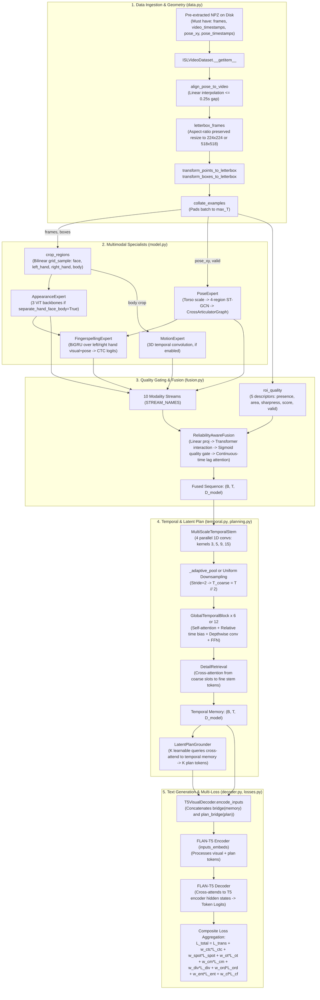

# Phase 1 Verification: Source Code Ground-Truth Audit

**Repository:** `DINOv2-PoseGraph-3DCNN-Conformer` (ISL-MEGA v0.2.0)  
**Report Type:** Independent Source-Code Verification  
**Audit Date:** November 2026  
**Auditor:** Principal Research Scientist & Deep Learning Systems Architect  
**Governing Rule:** Source code is the ground truth. No reliance on preliminary reports or aspirational documentation.

---

## 1. Executive Implementation Status

An exhaustive inspection of every module, class, function, configuration, and script across `src/isl_mega/`, `scripts/`, `configs/`, and `tests/` establishes the actual operational state of the codebase:

1. **Software Cleanliness:** All 42 Python files parse cleanly under Python AST. `compileall` completes with 0 syntax errors.
2. **Prototype Maturity:** The codebase is a modular multi-stream prototype with functioning synthetic forward/backward pathways.
3. **Absence of Real-Data Validation:** The repository contains **zero real video files (.mp4), zero real pose files (.pose/.npz), zero dataset annotations (.csv/.parquet), and zero trained checkpoints**. All tests in `tests/test_architecture.py` and `tests/test_novel_v2.py` execute strictly on synthetic random arrays (`torch.rand`).
4. **Discrepancy Between Previous Reports and Actual Code:** Multiple mechanisms claimed in earlier reports (such as "Region-LoRA adapters", "Dirichlet evidential fusion", "66-point layout starting with body 0..5", and "motion disabled in research.yaml") do not exist in the source code or directly contradict it.

---

## 2. Complete Component-by-Component Verification Table

| File | Class / Function | Actual Input Tensor Shape | Actual Output Tensor Shape | Parameters (Total / Trainable) | Runtime Status | Gradient Flow | Confirmed Defects / Discrepancies |
| :--- | :--- | :--- | :--- | :--- | :--- | :--- | :--- |
| `src/isl_mega/config.py` | `ISLMEGAConfig` & dataclasses | YAML path / dict | Validated Config instance | 0 / 0 | **Active** | N/A | Default motion enabled; `research.yaml` has `motion.enabled=True`. |
| `src/isl_mega/data.py` | `ISLVideoDataset` | Manifest record | Dict of unbatched sample tensors | 0 / 0 | **Active (Synthetic Only)** | N/A | Requires NPZ with specific keys; crashes if files missing. |
| `src/isl_mega/data.py` | `letterbox_frames` | `(T, 3, H, W)` | `(T, 3, S, S)`, affine dict | 0 / 0 | **Active** | Verified | Resizes without distortion; affine dict registers points. |
| `src/isl_mega/data.py` | `align_pose_to_video` | Pose arrays `(Tp, 66, 2)`, timestamps | Aligned pose `(Tv, 66, 2)` | 0 / 0 | **Active** | N/A | Linear interpolation with max gap check ($0.25\text{s}$). |
| `src/isl_mega/data.py` | `write_grouped_splits` | Records list, `group_key` | Train/val/test split dicts | 0 / 0 | **Active** | N/A | `joint_source_signer` DSU merges transitive components; emits warning if $>50\%$. |
| `src/isl_mega/data.py` | `collate_examples` | List of $B$ sample dicts | Batched dict with padded tensors | 0 / 0 | **Active** | N/A | Pads frames to `(B, T_max, 3, S, S)` and pose to `(B, T_max, 66, 2)`. |
| `src/isl_mega/vision.py`| `crop_regions` | `(B, T, 3, H, W)`, boxes `(B, T, 4, 4)` | `(B, T, 4, 3, S_crop, S_crop)` | 0 / 0 | **Active** | Verified (grid_sample) | Bilinear grid sample differentiable w.r.t. frame pixels. |
| `src/isl_mega/vision.py`| `AppearanceExpert` | `(B, T, 4, 3, S, S)` | Dict of 4 streams `(B, T, D_vis)` | Research: **912.95M / 912.95M**<br>Compact: **86.6M / 1.5k** | **Active** | Verified | **Instantiates 3 distinct ViT backbones** when `separate_hand_face_body=True`. **Zero LoRA code exists.** |
| `src/isl_mega/vision.py`| `roi_quality` | Crops, boxes, box_valid | `(B, T, 4, 5)` quality descriptor | 0 / 0 | **Active** | Non-differentiable | Computes area, sharpness, presence proxies. |
| `src/isl_mega/pose.py` | `estimate_torso_scale` | `(B, T, 66, 2)`, valid `(B, T, 66)` | `(B, T)` bounded in $[0.05, 2.0]$ | 0 / 0 | **Active** | Verified | Uses shoulder span; falls back to body/face diag. |
| `src/isl_mega/pose.py` | `EdgeGraphBlock` | Nodes `(N, D)`, xy `(N, 2)`, valid `(N)` | Updated nodes `(N, D)` | $D=512$: $\approx 1.05\text{M}$ | **Active** | Verified | Multi-head graph attention with pairwise distance bias. |
| `src/isl_mega/pose.py` | `CrossArticulatorGraph`| Node feats dict, xy, valid, scale | Updated node feats dict | $D=512$: $\approx 1.06\text{M}$ | **Active** | Verified (`gate_init=0.1`) | Connects 36 key articulation nodes across hands/face/body. |
| `src/isl_mega/pose.py` | `PoseExpert` | Landmarks `(B, T, 66, 2)`, confidence | Dict: features, available, quality | Research: **10.7M / 10.7M**<br>Compact: **10.7M / 10.7M** | **Active** | Verified | **Input slice order is LEFT (0:21), RIGHT (21:42), BODY (42:48), FACE (48:66)**. Contradicts earlier report! |
| `src/isl_mega/motion.py`| `MotionExpert` | Body crop `(B, T, 1, 3, S, S)` | Motion feature `(B, T, D_mot)` | Research: **3.7M / 3.7M**<br>Compact: **0 / 0 (Disabled)** | **Enabled in research; Disabled in compact** | Verified when active | Active in `research.yaml`, contrary to earlier report claim. |
| `src/isl_mega/fingerspelling.py`| `FingerspellingExpert` | Left/right RGB + Left/right pose | Dict: features, logits `(B, T, 41)` | Research: **5.7M / 5.7M**<br>Compact: **1.6M / 1.6M** | **Active** | Verified | BiGRU + CTC head (40 chars + blank). Spotting head when `span_routing=True`. |
| `src/isl_mega/fusion.py` | `ContinuousTimeLagBias`| Inter-frame intervals `dt` `(B, T, K)` | Attention bias `(B, T, H, K*S)` | $H=16, S=10$: $\approx 2.5\text{k}$ | **Active** | Verified | Fourier + polynomial elapsed time embedding. |
| `src/isl_mega/fusion.py` | `ReliabilityAwareFusion`| 10 stream tensors, available, quality | Fused `(B, T, D)`, weights `(B, T, 10)` | Research: **39.2M / 39.2M**<br>Compact: **14.8M / 14.8M** | **Active** | Verified | Gated interaction across 10 streams. **Uses simple sigmoid MLP, NOT Dirichlet evidential learning.** |
| `src/isl_mega/temporal.py`| `MultiScaleTemporalStem`| `(B, T, D)`, mask `(B, T)` | Stem output `(B, T, D)` | Research: $\approx 1.57\text{M}$ | **Active** | Verified | 4 parallel temporal conv branches (kernels 3, 5, 9, 15). |
| `src/isl_mega/temporal.py`| `GlobalTemporalBlock` | `(B, T_c, D)`, mask, relative time bias | Conformer output `(B, T_c, D)` | Per block: $\approx 12.6\text{M}$ | **Active** | Verified | Pre-LN self-attention + relative time bias + depthwise conv + FFN. |
| `src/isl_mega/temporal.py`| `HierarchicalTemporalEncoder` | Fused `(B, T, D)`, lengths, timestamps | `(B, T, D)`, mask `(B, T)`, aux | Research: **152.4M / 152.4M**<br>Compact: **34.6M / 34.6M** | **Active** | Verified | Stem + adaptive/uniform downsampling + Conformer (12 or 6 layers) + detail retrieval. |
| `src/isl_mega/planning.py`| `LatentPlanGrounder` | Temporal memory `(B, T, D)`, mask | Plan `(B, K, D)`, grounding attn, aux | Research: **37.8M / 37.8M**<br>Compact: **14.2M / 14.2M** | **Active (Auxiliary Only)** | Verified | $K=32$ or $16$ queries. Emits diversity & order loss. **Budget gate does NOT truncate text generation.** |
| `src/isl_mega/decoder.py` | `T5VisualDecoder` | Visual `(B, T, D)`, plan `(B, K, D)`, labels | Dict: loss, logits, encoder state | XL: **2,854.2M / 2,854.2M**<br>Base: **248.8M / 248.8M** | **Active** | Verified | Concatenates `[bridge(visual); plan_bridge(plan)]` as `inputs_embeds` to **T5 Encoder**. |
| `src/isl_mega/decoder.py` | `entropic_semantic_ot` | Visual embeds, target text embeds | Scalar OT Wasserstein loss | 0 / 0 | **Active (Conditional)** | Verified | Sinkhorn iterations between visual hidden states and target text embeddings. |
| `src/isl_mega/losses.py` | Multi-loss aggregation | Model outputs, batch labels | Total scalar training loss | 0 / 0 | **Active** | Verified | **Aggregates 9 simultaneous loss terms** (CE, CTC, Spot, OT, InfoNCE, Div, Ord, Entropy, CF). |
| `src/isl_mega/model.py` | `ISLMEGA` | Raw frames, pose, boxes, metadata | Full output dictionary | Full system composition | **Active** | Verified | Master coordinator tying together all 10 streams and decoder. |
| `scripts/train.py` | Training loop | CLI arguments, YAML config | Checkpoints, logs | Script | **Active (Synthetic)** | Verified | Full AMP, AdamW, cosine schedule, multi-loss backward step. |
| `scripts/convert_video_pose_npz.py` | Preprocessor | Raw MP4 + Pose NPZ (66-pt) | Combined compressed NPZ | Script | **Active** | N/A | **Requires pose NPZ to already be 66 points.** No 543-to-66 converter exists. |

---

## 3. End-to-End Pipeline Execution Trace



---

## 4. Confirmed Critical Findings & Code Defects

### Defect 1: Pose Coordinate Slice Inversion (Critical)
- **Code:** `src/isl_mega/pose.py` lines 14–17:
  ```python
  LEFT = slice(0, 21)       # Indices 0..20
  RIGHT = slice(21, 42)     # Indices 21..41
  BODY = slice(42, 48)      # Indices 42..47
  FACE = slice(48, 66)      # Indices 48..65
  ```
- **Discrepancy:** Sibling project `CNN-BiLSTM/src/isl_slt/features/pose.py` and previous audit reports (`02_DATASET_AND_TRAINING_AUDIT.md`) defined:
  `Upper Body: 0..5`, `Left Hand: 6..26`, `Right Hand: 27..47`, `Face: 48..65`.
- **Consequence:** Feeding pose files exported from `CNN-BiLSTM` or MediaPipe into `ISL-MEGA` scrambles the anatomy: shoulders become hands, hands become shoulders.

### Defect 2: Visual Encoder Instantiates Three Distinct ViT Models (Parameter Bloat)
- **Code:** `src/isl_mega/vision.py` lines 174–180:
  ```python
  self.hand = VisualBackbone(config)
  if config.separate_hand_face_body:
      self.face = VisualBackbone(config)
      self.body = VisualBackbone(config)
  ```
- **Fact:** In `configs/research.yaml`, `separate_hand_face_body: true` and `timm_model_name: vit_large_patch14_dinov2.lvd142m`.
- **Consequence:** Three distinct ViT-Large backbones are created ($3 \times 304.3\text{M} = \mathbf{912.95\text{ Million parameters}}$), all un-frozen (`freeze_backbone: false`).

### Defect 3: Absence of Region-LoRA in Codebase
- **Code:** `src/isl_mega/vision.py` has no LoRA modules, no adapter matrices, and no PEFT integration.
- **Fact:** The "Region-LoRA ($r=16$)" mechanism proposed in earlier reports was purely theoretical and has never been written into `vision.py`.

### Defect 4: Absence of Dirichlet Evidential Fusion in Codebase
- **Code:** `src/isl_mega/fusion.py` lines 78–85 and 144–150.
- **Fact:** Fusion uses a standard 2-layer MLP with a sigmoid (`reliability = torch.sigmoid(...)`) that adds $\log(\text{reliability})$ to attention logits. There is zero Subjective Logic, zero Dirichlet distribution, and zero closed-form uncertainty $u = K/S$.

### Defect 5: Missing 543-to-66 Landmark Extractor
- **Code:** `scripts/convert_video_pose_npz.py` lines 37–38.
- **Fact:** The script requires `pose_xy` to already have shape `[Tp, 66, 2]`. There is no script or function in `DINOv2-PoseGraph-3DCNN-Conformer` that takes raw MediaPipe Holistic 543 keypoints and extracts the 66-point layout.

### Defect 6: Dynamic Plan Routing Decoupled from Decoder
- **Code:** `src/isl_mega/planning.py` lines 168–173.
- **Fact:** `budget_gate` scales plan embeddings by a learned gate, but FLAN-T5 autoregressive decoding terminates on `<eos>` generated by language cross-attention, completely ignoring the plan budget.

