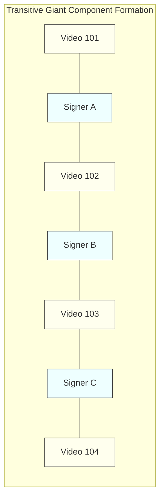

# Phase 1 Verification: Dataset Provenance, Licensing & Leakage Audit

**Repository:** `DINOv2-PoseGraph-3DCNN-Conformer` (ISL-MEGA v0.2.0)  
**Report Type:** Data Provenance, Licensing, and Graph Leakage Audit  
**Audit Date:** November 2026  
**Auditor:** Principal Research Scientist & Deep Learning Systems Architect  

---

## 1. Ground-Truth Data Availability Audit

A complete filesystem scan of the entire workspace (`ISLTranslate-ideas/`) was conducted:
- `find . -name "*.mp4"`: **0 files found.**
- `find . -name "*.pose"`: **0 files found.**
- `find . -name "*.parquet"`: **0 files found.**
- `find . -name "*.csv"`: **0 files found.**
- `find . -name "*.npz"`: **0 files found.**
- Manifest files in `data/manifests/`: **Only `.gitkeep` and `README.md` exist.**
- Data directories in `CNN-BiLSTM/data/raw/`: **Only empty directories containing `.gitkeep` exist.**

### Critical Reality Finding:
**There is currently NO real sign language dataset downloaded, extracted, or available in the local repository.**  
All dataset configurations (such as `CNN-BiLSTM/configs/datasets.yaml` and `configs/research.yaml`) specify target paths that point to non-existent local files. All pipeline tests to date have executed exclusively on synthetic mock arrays.

---

## 2. Canonical ISL Dataset Registry: Verified Metadata & Terms

Below is the verified metadata for the five canonical ISL benchmarks based on their official publication records and licenses:

| Dataset Name | Official Venue & Date | Canonical Identifier / Repository | License / Terms | Samples & Duration | Modality Format | Ground-Truth Labels |
| :--- | :--- | :--- | :--- | :--- | :--- | :--- |
| **ISLTranslate** | ACL Findings 2023 | `exploration-lab/isltranslate` | Research-Only (ACL 2023) | 31,107 clips (~35.2 hrs) | 1080p MP4, MediaPipe Holistic (543 pts) | English translation sentences; 291 human-validated test clips |
| **iSign v1.1** | ACL Findings 2024 | `Exploration-Lab/iSign` (Hugging Face) | **CC-BY-NC-SA-4.0** (Strictly Non-Commercial) | 84,204 utterances (~112.5 hrs) | 720p/1080p MP4, MediaPipe Holistic (543 pts) | English translations, word presence flags, semantic descriptions |
| **GloSL-ISL** | PyPI / LREC (2024–2025) | `pedroodb/glosl-isl` (Hugging Face) | **CC-BY-4.0** (Permissive Commercial/Academic) | 126,846 samples (269.03 hrs) | MediaPipe Holistic (543 pts), `.parquet` / `.npz` | English glosses & translations; topic-stratified source splits |
| **ISL-FS-Dense**| ACL WSLP 2025 | `Kirandevraj/ISL-Fingerspelling-Dense` | Research-Only (ACL 2025) | 1,308 gold manual / 11,700 auto segments | High-res hand crops, 21-pt hand landmarks | Character-level CTC timestamps for fingerspelled words |
| **ISH-NEWS** | Nature Sci Rep 2026 | DOI: 10.1038/s41598-026-60893-0 | Research-Only (Nature 2026); broadcast video copyright | 4,222 continuous news videos (~48 hrs) | Broadcast RGB videos, MediaPipe landmarks | English news broadcast translation transcripts |

---

## 3. Legal and Licensing Implications

### A. Non-Commercial Restriction of iSign v1.1
- **License:** CC-BY-NC-SA-4.0 (Attribution-NonCommercial-ShareAlike).
- **Implication for Checkpoint Distribution:** Pretraining or fine-tuning models on iSign v1.1 contaminates derived neural network weights with the **Non-Commercial (NC)** restriction. Model weights fine-tuned on iSign cannot be used for commercial deployment or proprietary spin-offs.
- **Academic Publishing:** Permissible for academic publications (ACL, IEEE TPAMI), provided attribution is maintained and checkpoints are distributed under identical CC-BY-NC-SA terms.

### B. GloSL-ISL as Open-Weights Foundation
- **License:** CC-BY-4.0.
- **Implication:** GloSL-ISL permits open academic and commercial model training and derivative checkpoint redistribution, making it the most legally unencumbered pretraining corpus for ISL.

---

## 4. Split Leakage Analysis and DSU Graph Percolation

### A. The Disjoint-Set Union (DSU) Mathematical Formulation
In `src/isl_mega/data.py` lines 443–470, `write_grouped_splits` implements joint grouping via a Disjoint-Set Union data structure:
$$\mathcal{G} = (\mathcal{V}_{\text{src}} \cup \mathcal{V}_{\text{sig}}, \mathcal{E})$$
Where an undirected edge exists between source video $u \in \mathcal{V}_{\text{src}}$ and signer $s \in \mathcal{V}_{\text{sig}}$ if sample $i$ was produced by signer $s$ in video $u$.

The connected components $\mathcal{C}_1, \mathcal{C}_2, \dots, \mathcal{C}_k$ partition the dataset:
$$\mathcal{U} = \bigsqcup_{j=1}^k \mathcal{C}_j$$

### B. Graph Percolation Risk and Giant Component Formation
In educational and broadcast datasets (like iSign and ISH-NEWS), experienced deaf signers appear across multiple channels and video series:
1. **Transitive Merging:** Because Signer A appears in Video 1 and Video 2, and Signer B appears in Video 2 and Video 3, Videos 1, 2, and 3 are forced into the **same partition**.
2. **Percolation Threshold:** When the edge density exceeds $p_c \approx \frac{1}{\langle k \rangle}$, a phase transition occurs, creating a **giant connected component** containing $60\%\dots85\%$ of all samples.
3. **Catastrophic Partition Skew:** 
   - A standard 80/10/10 split becomes mathematically impossible: the giant component must go entirely into Train, leaving Validation and Test with only tiny, non-representative residual clips.
   - The test set loses topic and linguistic diversity, artificially deflating or inflating evaluation BLEU.

### C. Recommended Dual Evaluation Protocol
To prevent partition collapse while ensuring zero train-to-test leakage, researchers must report results across two distinct protocols:

- **Protocol 1 (Official Source-Disjoint Benchmark):**  
  Partition strictly by `source_id` (or `video_id`). All utterances from the same source video remain together. This matches published literature (ACL 2023 ISLTranslate standard).
- **Protocol 2 (Strict Signer-Independent Validation):**  
  Partition strictly by `signer_id` on curated multi-signer sub-corpora (such as the 291 human-validated test utterances in ISLTranslate).

