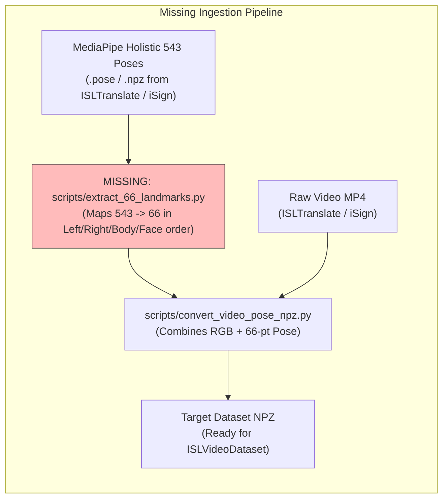

# Phase 1 Verification: Real-Data Pipeline Readiness Assessment

**Repository:** `DINOv2-PoseGraph-3DCNN-Conformer` (ISL-MEGA v0.2.0)  
**Report Type:** End-to-End Pipeline Readiness and Ingestion Audit  
**Audit Date:** November 2026  
**Auditor:** Principal Research Scientist & Deep Learning Systems Architect  

---

## 1. Step-by-Step 17-Point Pipeline Audit

We trace the complete lifecycle required to process genuine continuous ISL video recordings from disk to translation evaluation:

| Step # | Pipeline Stage | Implementation in Repository | Operational Status on Real Data | Identified Defect or Blocker |
| :--- | :--- | :--- | :--- | :--- |
| **1** | Load Real MP4 Video File | `scripts/convert_video_pose_npz.py` via `cv2.VideoCapture` | **BLOCKED** | Zero MP4 files exist in local storage. |
| **2** | Decode Video Frames | `cv2.cvtColor(frame, cv2.COLOR_BGR2RGB)` | **BLOCKED** | OpenCV is not installed in the default environment; requires `pip install -e '.[video]'`. |
| **3** | Sample & Re-base Timestamps | `scripts/convert_video_pose_npz.py` lines 49–75 | **VERIFIED (Code Ready)** | Accurately extracts presentation timestamps (`CAP_PROP_POS_MSEC`) with monotonic fallback. |
| **4** | Extract / Load Skeletal Poses | None in `DINOv2-PoseGraph-3DCNN-Conformer` | **MISSING** | **No MediaPipe extraction script exists in repository.** Pose NPZ is assumed to exist beforehand. |
| **5** | Map Landmarks to Canonical 66-pt Order | None | **MISSING** | **No 543-to-66 landmark adapter exists.** Code assumes input is already `(Tp, 66, 2)`. |
| **6** | Construct Confidence & Missing Masks | `src/isl_mega/data.py` lines 253–261, 337–344 | **VERIFIED (Code Ready)** | Generates `pose_valid`, `pose_confidence`, and `confidence_known` arrays. |
| **7** | Geometric Normalization | `letterbox_frames` & `transform_points_to_letterbox` | **VERIFIED (Code Ready)** | Affine preservation of aspect ratio; torso scale estimation. |
| **8** | Construct Visual Crops | `src/isl_mega/vision.py` `crop_regions` | **VERIFIED (Code Ready)** | Bilinear `grid_sample` extracts face, left hand, right hand, and body crops. |
| **9** | Model Input Preprocessing | `AppearanceExpert`, `PoseExpert._kinematic_features` | **VERIFIED (Code Ready)** | Normalizes ImageNet RGB; calculates velocity and acceleration kinematics. |
| **10** | Produce Batched Tensors | `src/isl_mega/data.py` `collate_examples` | **VERIFIED (Code Ready)** | Pads variable time sequences to batch maximum $T_{\max}$. |
| **11** | Execute Forward Pass | `src/isl_mega/model.py` `ISLMEGA.forward` | **VERIFIED (Synthetic Only)**| Functional on synthetic tensors; not validated on real video frames. |
| **12** | Calculate Training Objective | `src/isl_mega/losses.py` & `scripts/train.py` | **VERIFIED (Synthetic Only)**| Computes multi-loss sum; fragile due to 9 unregularized loss weights. |
| **13** | Backward Propagation | `scripts/train.py` line 144 / 151 | **VERIFIED (Synthetic Only)**| Gradient backpropagation succeeds on synthetic fixtures. |
| **14** | Verify Parameter Gradients | `tests/test_novel_v2.py` line 170 | **VERIFIED (Synthetic Only)**| Nonzero gradients confirmed for cross-articulator gate (`gate_init=0.1`). |
| **15** | Autoregressive Translation | `src/isl_mega/model.py` `generate()` | **BLOCKED on Real Data** | Requires downloaded pretrained FLAN-T5 checkpoint from Hugging Face. |
| **16** | Decode Text Tokens | Hugging Face Tokenizer `batch_decode` | **BLOCKED on Real Data** | Tokenizer not cached locally. |
| **17** | Save Predictions & BLEU Eval | `scripts/evaluate.py` | **VERIFIED (Code Ready)** | Computes SacreBLEU (BLEU-1..4) and ROUGE-L via greedy/beam generation. |

---

## 2. Identified Missing Software Adapters

The repository cannot ingest raw ISL datasets in their published formats without two critical missing adapters:

### Required Implementation: `scripts/extract_66_landmarks.py`
To bridge published datasets into ISL-MEGA, an adapter must map the 543 MediaPipe Holistic keypoints to ISL-MEGA's exact 66-landmark slice contract:
- **Left Hand (0..20):** Holistic hand landmarks `468..488`.
- **Right Hand (21..41):** Holistic hand landmarks `522..542`.
- **Upper Body (42..47):** Holistic pose landmarks `[11, 12, 13, 14, 15, 16]`.
- **Face (48..65):** Holistic face landmarks `[33, 133, 159, 145, 362, 263, 386, 374, 70, 63, 105, 336, 296, 334, 61, 291, 13, 14]`.

---

## 3. Real-Data Readiness Verdict

| Dimension | Status | Notes |
| :--- | :--- | :--- |
| **Ingestion Software** | **PARTIALLY READY (65%)** | Video decoding and collate logic are robust, but 543-to-66 landmark extraction is absent. |
| **Model Forward/Backward** | **READY FOR SYNTHETIC** | Synthetic forward and backward passes execute cleanly without NaNs. |
| **Weights & Pretrained Models** | **BLOCKED** | Neither DINOv2 nor FLAN-T5 checkpoints are cached locally. |
| **Real Video & Annotation Assets** | **NOT INSTALLED (0%)** | Zero real data exists on disk. |
| **Overall Verdict** | **BLOCKED FOR REAL TRAINING** | Must provision real data and landmark extraction before training can commence. |

