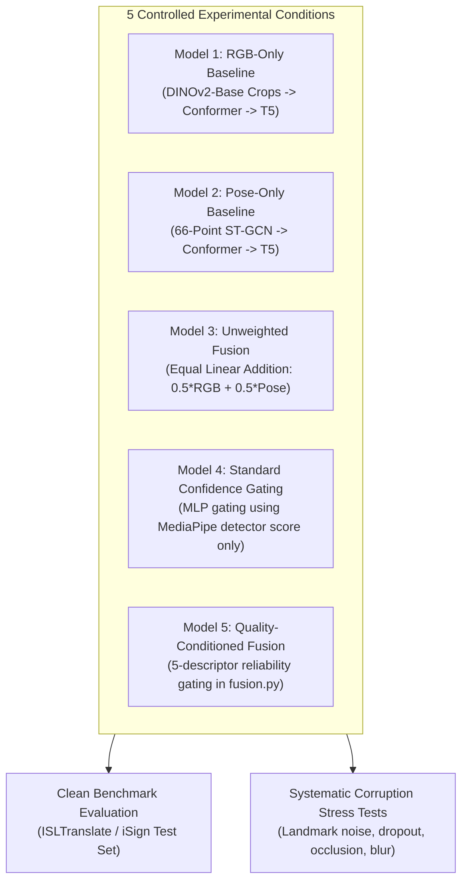

# Phase 1 Verification: First Scientific Research Experiment Specification

**Repository:** `DINOv2-PoseGraph-3DCNN-Conformer` (ISL-MEGA v0.2.0)  
**Report Type:** Experimental Protocol and Falsification Criteria  
**Audit Date:** November 2026  
**Auditor:** Principal Research Scientist & Deep Learning Systems Architect  

---

## 1. The Core Scientific Hypothesis

Before introducing architectural novelty or switching sequence backbones, the project must test one falsifiable research hypothesis using the existing repository infrastructure:

> **CORE RESEARCH HYPOTHESIS:**  
> *"Conditioning multimodal RGB-pose fusion on observable sensor quality descriptors (presence, crop area, sharpness, tracking velocity, and frame validity) preserves translation fidelity (BLEU-4 and chrF) under severe landmark loss and visual degradation significantly better than unweighted feature fusion or standard scalar confidence gating, without requiring gloss annotations or multi-billion parameter foundation models."*

---

## 2. Experimental Design: 5 Controlled Experimental Conditions

To scientifically isolate the contribution of quality-conditioned multimodal fusion, we construct five strictly controlled model variants. All variants share identical frozen visual backbones (DINOv2-Base), identical 6-layer Conformer temporal backbones ($d=768$), identical FLAN-T5-small decoders ($d=512$, $60\text{M params}$), and identical training configurations:

### Detailed Specification of the 5 Variants:
1. **Model 1 (RGB-Only Baseline):** Operates exclusively on the 4 visual crops (`AppearanceExpert`). All pose and fingerspelling streams are disabled. Measures the visual appearance ceiling.
2. **Model 2 (Pose-Only Baseline):** Operates exclusively on the 66-point anatomical skeleton (`PoseExpert`). All visual RGB crops are zeroed out. Measures the keypoint-only translation capability (similar to ISLiM).
3. **Model 3 (Unweighted Additive Fusion):** Both visual and pose features are extracted and projected to $D=768$, then simply added:
   $$F_{\text{fused}} = \frac{1}{2} F_{\text{vis}} + \frac{1}{2} F_{\text{pose}}$$
   No dynamic gating or reliability estimation is applied.
4. **Model 4 (Scalar Confidence Gating):** Dynamic gating conditioned strictly on MediaPipe's raw scalar detector confidence score $c \in [0, 1]$.
5. **Model 5 (Proposed Quality-Conditioned Fusion):** The full reliability-aware fusion block from `src/isl_mega/fusion.py`, incorporating all 5 descriptors: presence, area, sharpness, detector score, and frame validity.

---

## 3. Systematic Corruption Stress-Testing Protocol

To prevent test-set leakage, **models are trained exclusively on clean training data**. During inference on the test partition, inputs are subjected to four independent and combined synthetic corruptions:

| Corruption Type | Injected Perturbation Procedure | Target Modality Affected | Real-World Failure Mode Simulated |
| :--- | :--- | :--- | :--- |
| **C1: Landmark Jitter** | Add zero-mean Gaussian noise $\epsilon \sim \mathcal{N}(0, \sigma^2)$ to pose coordinates, $\sigma \in \{0.02, 0.05, 0.10\}$. | Pose only | Poor lighting, detector noise, off-axis angles. |
| **C2: Limb Frame Dropout** | Randomly drop consecutive chunks of 5, 10, or 20 frames (zero out coordinates and set `valid=False`). | Pose only | High-speed motion blur causing tracker loss. |
| **C3: Unilateral Hand Occlusion** | Set all dominant hand landmarks to zero (`valid=False`) for the entire video clip. | Pose only | Hand passing behind torso, crossing limbs, self-occlusion. |
| **C4: Visual Motion Blur** | Convolve video frames with Gaussian blur kernel ($k=15, \sigma=3.0$). | RGB only | Low-cost camera optics, rapid signer articulation. |
| **C5: Combined Corruption** | Apply C1 ($\sigma=0.05$) + C4 (Motion Blur) simultaneously. | Multimodal | Realistic unconstrained mobile video recording. |

---

## 4. Quantitative Evaluation Metrics

1. **Translation Accuracy:**
   - **SacreBLEU:** BLEU-1, BLEU-2, BLEU-3, BLEU-4 (`sacrebleu -m bleu -w 2`).
   - **ROUGE-L:** Longest common subsequence F1 score.
   - **chrF / chrF++:** Character n-gram F-score, critical for capturing morphologically rich Indian English translations and fingerspelled entities.
2. **Robustness & Retention Ratio:**
   $$\text{Retention Ratio } \mathcal{R} = \frac{\text{BLEU-4}_{\text{corrupted}}}{\text{BLEU-4}_{\text{clean}}} \times 100\%$$
3. **Inference Latency & Efficiency:**
   - Wall-clock latency per sentence video (milliseconds).
   - Peak VRAM allocated during beam search ($B=1, \text{num\_beams}=4$).

---

## 5. Explicit Falsification Criteria

The primary scientific hypothesis will be formally **FALSIFIED** if any of the following empirical outcomes occur:

1. **Lack of Corruption Advantage:** Under 20-frame landmark dropout (C2) or unilateral hand occlusion (C3), Model 5 does not achieve a statistically significant improvement ($p \ge 0.05$, paired bootstrap resampling) of at least $+1.5\text{ BLEU-4}$ over unweighted fusion (Model 3).
2. **Confidence Equivalence:** Model 5 exhibits no statistically significant difference compared to simple scalar confidence gating (Model 4), indicating that multi-descriptor quality modeling provides no empirical value over raw detector confidence.
3. **Dominance of Single Modality:** Model 1 (RGB-only) outperforms all multimodal fusion variants on clean data, indicating that the pose stream introduces noise rather than complementary kinematic structure.

