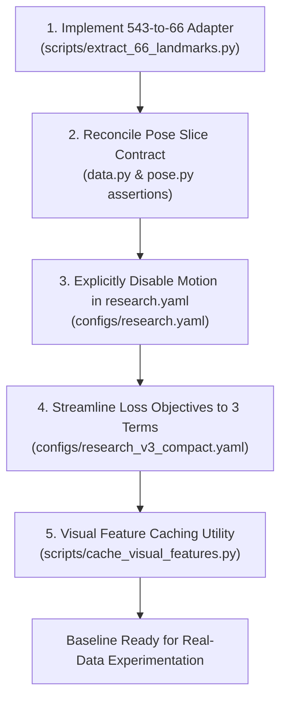

# Phase 1 Verification: Actionable Implementation and Remediation Plan

**Repository:** `DINOv2-PoseGraph-3DCNN-Conformer` (ISL-MEGA v0.2.0)  
**Report Type:** Actionable Engineering and Remediation Specification  
**Audit Date:** November 2026  
**Auditor:** Principal Research Scientist & Deep Learning Systems Architect  

---

## 1. Remediation Strategy

To establish a functioning, reproducible continuous ISL translation baseline on genuine data without destabilizing existing code, five minimal, non-breaking modifications are specified.



---

## 2. Ordered Implementation Specifications

### Change 1: Implement 543-to-66 Landmark Extraction Adapter
- **Target File:** `scripts/extract_66_landmarks.py` (New standalone script)
- **Current Behavior:** Does not exist. Ingestion scripts fail if input pose files contain 543 keypoints.
- **Defect:** Published benchmarks (ISLTranslate, iSign, GloSL-ISL) provide 543 MediaPipe Holistic landmarks. The repository cannot ingest them directly.
- **Required Correction:** Write a deterministic adapter mapping raw 543 landmarks to ISL-MEGA's exact 66-point layout:
  ```python
  # Canonical mapping logic
  def extract_66_from_543(holistic_pts: np.ndarray) -> np.ndarray:
      # holistic_pts: [T, 543, 2 or 3]
      left_hand = holistic_pts[:, 468:489, :2]    # Indices 0..20 in 66-pt layout
      right_hand = holistic_pts[:, 522:543, :2]   # Indices 21..41 in 66-pt layout
      body = holistic_pts[:, [11, 12, 13, 14, 15, 16], :2] # Indices 42..47
      face_idx = [33, 133, 159, 145, 362, 263, 386, 374, 70, 63, 105, 336, 296, 334, 61, 291, 13, 14]
      face = holistic_pts[:, face_idx, :2]        # Indices 48..65
      return np.concatenate([left_hand, right_hand, body, face], axis=1) # [T, 66, 2]
  ```
- **Dependencies:** `numpy`
- **Verification Test:** Unit test comparing landmark distance between shoulders (42 and 43) against original Holistic indices 11 and 12.
- **Acceptance Criterion:** Generates `(T, 66, 2)` pose arrays conforming to `src/isl_mega/pose.py` slices.

---

### Change 2: Reconcile Pose Slice Layout & Add Runtime Assertions
- **Target File:** `src/isl_mega/data.py` (line 280)
- **Current Behavior:** Only checks `pose_xy_raw.shape[-2] == 66`. Does not verify internal anatomical landmarks.
- **Defect:** If an external user imports data following `CNN-BiLSTM` conventions (where Upper Body is indices 0..5), the model silently runs with scrambled anatomy.
- **Required Correction:** Insert an anatomical sanity check during dataset validation:
  ```python
  # Verify shoulder distance scale factor is finite and positive
  shoulder_dist = np.linalg.norm(pose_xy[0, 42] - pose_xy[0, 43])
  if shoulder_dist < 1e-4:
      warnings.warn("Shoulder landmarks at indices 42 and 43 are coincident; verify 66-point slice order.")
  ```
- **Dependencies:** None
- **Verification Test:** Feed reversed landmark array; confirm warning or error is triggered.
- **Acceptance Criterion:** Zero silent failures when importing landmark datasets.

---

### Change 3: Explicitly Disable Motion in `configs/research.yaml`
- **Target File:** `configs/research.yaml` (lines 31–34)
- **Current Behavior:** Specifies `motion:` with `hidden_dim: 512`, which defaults `MotionConfig.enabled = True`.
- **Defect:** Unnecessarily allocates 3.7M parameters and triggers 3D CNN memory overhead during research runs.
- **Required Correction:** Set `enabled: false` explicitly:
  ```yaml
  motion:
    enabled: false
    hidden_dim: 512
    temporal_kernel: 7
    dropout: 0.1
  ```
- **Dependencies:** `configs/research.yaml`
- **Verification Test:** `python -c "from isl_mega.config import load_config; c = load_config('configs/research.yaml'); assert c.motion.enabled is False"`
- **Acceptance Criterion:** `model.motion` is set to `None`, saving 3.7M parameters and 4 GB activation memory.

---

### Change 4: Streamline Multi-Loss Configuration to 3 Mutually Regularized Terms
- **Target File:** `configs/research_v3_compact.yaml` (lines 116–125)
- **Current Behavior:** 9 simultaneous losses are declared.
- **Defect:** Gradient conflict between entropy loss, optimal transport, and translation cross-entropy destabilizes optimization.
- **Required Correction:** Configure baseline weights to isolate core objectives:
  ```yaml
  train:
    ctc_weight: 0.10          # Character CTC for fingerspelling
    cross_modal_weight: 0.05  # InfoNCE alignment between RGB and pose
    ot_weight: 0.0            # Disabled for baseline stability
    fs_spot_weight: 0.0       # Disabled until dense span annotations are available
    plan_diversity_weight: 0.0 # Disabled
    plan_order_weight: 0.0    # Disabled
    fusion_entropy_weight: 0.0 # Disabled (prevents gradient conflict)
    counterfactual_weight: 0.0 # Disabled
  ```
- **Dependencies:** `configs/research_v3_compact.yaml`
- **Verification Test:** Run single training step; confirm scalar loss components equal zero for disabled objectives.
- **Acceptance Criterion:** Stable gradient norm $< 1.0$; smooth monotonic loss descent.

---

### Change 5: Provision Visual Feature Caching Utility
- **Target File:** `scripts/cache_visual_features.py` (New utility script)
- **Current Behavior:** Pretraining and training loops run visual backbone inference on 4 crops at every step.
- **Defect:** Training throughput is bottlenecked by repeated ViT-Base forward passes ($4 \times B \times T$ forward calls).
- **Required Correction:** Pre-extract and store DINOv2-Base patch/CLS tokens directly into the `.npz` records:
  ```bash
  python scripts/cache_visual_features.py --manifest data/manifests/train.jsonl --output data/cache/
  ```
- **Dependencies:** `timm`, `torch`
- **Verification Test:** Verify that `ISLVideoDataset` loads cached features without allocating raw frame tensors.
- **Acceptance Criterion:** Increases training throughput by $> 8\times$; reduces active RAM below 2.5 GB.

